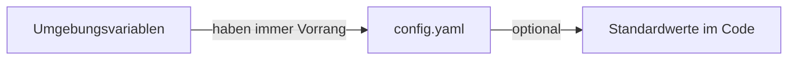

## Gute Standardwerte

GoModel folgt dem Prinzip guter Standardwerte. Die Standardeinstellungen sollen also ausreichen, um GoModel zu nutzen.

## Wie überschreibe ich die Standardeinstellungen?

Wir verwenden eine dreistufige Konfigurations-Pipeline. Jede Einstellung hat einen sinnvollen Standardwert, sodass Sie den Server ganz ohne Konfiguration starten können.

{/* Umgebungsvariablen (haben immer Vorrang) → config.yaml (optional) → Standardwerte im Code */}



<Tip>
  Da GoModel ohne Konfigurationsdateien sofort einsatzbereit ist, können Sie es
  in einer Minute ausprobieren.

Starten Sie hier: [Schnellstart](/de/getting-started/quickstart)

</Tip>

GoModel erkennt Provider automatisch anhand bekannter Umgebungsvariablen.

## Konfigurationsmethoden

### 1. Umgebungsvariablen

Der gängigste Weg, GoModel zu konfigurieren. Setzen Sie eine der folgenden Variablen, um Standardwerte zu überschreiben.

#### Server

| Variable             | Beschreibung                                           | Standardwert                |
| -------------------- | ----------------------------------------------------- | ---------------------- |
| `PORT`               | Port des HTTP-Servers                                      | `8080`                 |
| `BASE_PATH`          | Präfix des Mount-Pfads, zum Beispiel `/g`                   | `/`                    |
| `GOMODEL_MASTER_KEY` | Authentifizierungsschlüssel zur Absicherung des Gateways           | _(leer, unsicherer Modus)_ |
| `MASTER_KEY_DISABLED` | Schaltet die Authentifizierung per Master-Key ab, sodass nur noch [verwaltete Keys](/de/features/users) und Authentifizierungserweiterungen als Zugangsdaten gelten | `false`                |
| `GOMODEL_DEMO_MODE`  | Aktiviert Warnungen für öffentliche Demos in den Logs und im Dashboard  | `false`                |
| `BODY_SIZE_LIMIT`    | Maximale Größe des Request-Bodys (z. B. `10M`, `1024K`, `500KB`), komprimiert und dekomprimiert | `10M`                  |
| `STREAM_STALL_TIMEOUT` | Sekunden, die ein einzelner Response-Schreibvorgang auf einer Modellroute darauf warten darf, dass der Client ihn liest; `0` deaktiviert | `60`                   |
| `USER_PATH_HEADER`   | Header, über den `user_path`-Werte von Requests gelesen und geschrieben werden  | `X-GoModel-User-Path`  |
| `SERVER_TRUSTED_PROXIES` | Netzwerke, in denen Ihre eigenen Proxys stehen; aktiviert Client-Adressen aus Headern | _(leer)_ |
| `SERVER_CLIENT_IP_HEADER` | Header, in dem ein vertrauenswürdiger Proxy die Client-Adresse übergibt | `X-Forwarded-For` |
| `SERVER_TRUSTED_HOPS` | Anzahl der Proxys zwischen Client und Gateway; `0` durchsucht stattdessen die Kette | `0` |
| `SWAGGER_ENABLED`    | Stellt die [Swagger UI](/de/advanced/swagger-ui) bereit; erfordert einen Build mit `-tags=swagger` | `false`                |
| `AUTH_VERIFY_ENABLED` | Stellt [`GET /v1/auth/verify`](/de/advanced/api-endpoints#key-verifizierung) bereit, das meldet, ob der API-Key eines Requests gültig ist | `false`                |
| `PID_FILE`           | Ort, an dem das laufende Gateway seine Prozess-ID für `gomodel --reload` ablegt. Eine Änderung erfordert einen Neustart | `data/gomodel.pid` neben einem `./data`-Verzeichnis, andernfalls das benutzerspezifische Datenverzeichnis |

Request-Bodys dürfen mit `Content-Encoding: gzip` (oder `x-gzip`) oder `zstd`
komprimiert sein; die TypeSafe-SDKs komprimieren Bodys ab 1 KiB standardmäßig
mit zstd. Das Gateway dekodiert sie vor dem Routing, sodass Guardrails, Audit
und Provider den unkomprimierten Body sehen, und `BODY_SIZE_LIMIT` gilt sowohl
für die komprimierte als auch für die dekodierte Größe (`413`, wenn eine davon
überschritten wird). Andere Kodierungen liefern `415`.

`STREAM_STALL_TIMEOUT` (`server.stream_stall_timeout` in YAML) schützt das
Gateway vor Clients, die eine Streaming-Response öffnen und dann aufhören, sie
zu lesen. Jeder Schreibvorgang zum Client erhält eine neue Frist. Der Timeout
greift daher nur, wenn der Socket des Clients so lange voll bleibt, niemals
während ein langsames Modell nichts zu senden hat. Greift er, wird die
Verbindung geschlossen, der Upstream-Request an den Provider abgebrochen und
der Audit-Eintrag vermerkt `client_stalled`, auch wenn der Stream aus dem
Response-Cache bedient wurde. Erhöhen Sie den Wert für Clients, die das Lesen
eines Streams berechtigterweise länger als eine Minute pausieren; setzen Sie
`0`, um ihn zu deaktivieren.

#### Client-Adressen hinter einem Proxy

Jede Client-Adresse, die GoModel meldet – in Audit-Einträgen, Rate-Limit-Keys,
Logs –, ist die Adresse der Verbindung, die das Gateway erreicht hat. Hinter
einem Reverse Proxy zeigen daher alle den Proxy. Setzen Sie
`SERVER_TRUSTED_PROXIES` auf die Netzwerke, in denen Ihre eigenen Proxys
stehen, dann liest GoModel stattdessen den weitergeleiteten Client. Nichts gilt
als vertrauenswürdig, bevor Sie es auflisten, nicht einmal Loopback, und
Änderungen an diesen Einstellungen erfordern einen Neustart.

```bash
SERVER_TRUSTED_PROXIES=10.42.0.0/16,loopback
```

Einträge sind CIDR-Netzwerke, einzelne Adressen (ein einzelner Host) oder ein Preset:

| Preset     | Wird erweitert zu                                           |
| ---------- | ---------------------------------------------------- |
| `loopback` | `127.0.0.0/8`, `::1/128`                             |
| `private`  | `10.0.0.0/8`, `172.16.0.0/12`, `192.168.0.0/16`, `fc00::/7` |

Verwenden Sie bevorzugt genau das Subnetz, in dem Ihr Proxy steht. `private`
erlaubt jedem privaten Client, seine eigene weitergeleitete Adresse zu setzen.
Das ist die falsche Wahl, wenn auch Ihre Clients private Adressen haben – ein
Homelab, dessen Clients in `192.168.1.0/24` liegen und dessen Cluster in
`10.42.0.0/16` läuft, sollte nur `10.42.0.0/16` auflisten.

Standardmäßig liest GoModel `X-Forwarded-For`, an das jeder Hop die von ihm
gesehene Adresse anhängt, und erfasst den nächstgelegenen Hop, der nicht zu
Ihren vertrauenswürdigen Netzwerken gehört: die letzte Adresse, die Ihre eigene
Infrastruktur geschrieben hat, und zugleich die am weitesten entfernte, die ein
Client nicht überschreiben kann. Ein Request von außerhalb der aufgelisteten
Netzwerke, eine nicht parsebare Kette und eine Kette, die ausschließlich aus
vertrauenswürdigen Netzwerken besteht, behalten jeweils die
Verbindungsadresse – im letzten Fall ist jeder Eintrag eine Angabe, die ein
interner Client erfunden haben könnte.

Zwei Einstellungen ändern, wie der Header gelesen wird:

- `SERVER_CLIENT_IP_HEADER` benennt einen anderen Header. Alles außer
  `X-Forwarded-For` enthält eine einzelne Adresse und wird unverändert
  übernommen. Das ist die korrekte Lesart hinter einem Edge, der den Client
  selbst ermittelt: `SERVER_CLIENT_IP_HEADER=CF-Connecting-IP` hinter
  Cloudflare oder `X-Real-IP` hinter einem nginx, der ihn setzt. Der
  `Forwarded`-Header nach RFC 7239 wird nicht unterstützt.
- `SERVER_TRUSTED_HOPS` nimmt den `X-Forwarded-For`-Eintrag in einer festen
  Tiefe, statt die Kette zu durchsuchen – `1` ist der Eintrag ganz rechts, `2`
  der davor. Verwenden Sie diese Einstellung, wenn Ihr Edge in einer bekannten
  Tiefe sitzt, aber wechselnde Adressen nutzt, die Sie nicht aufzählen können.
  Die Verbindung muss weiterhin aus einem vertrauenswürdigen Netzwerk kommen,
  und eine Kette, die kürzer als die konfigurierte Tiefe ist, fällt auf die
  Verbindungsadresse zurück.

Beide setzen `SERVER_TRUSTED_PROXIES` voraus; allein gesetzt führen sie zu
einem Fehler beim Start, statt stillschweigend wirkungslos zu bleiben.

Setzen Sie `GOMODEL_DEMO_MODE=true` für eine öffentliche oder gemeinsam
genutzte Demo-Instanz. GoModel protokolliert dann beim Start und alle fünf
Minuten eine Warnung, zeigt oben im Dashboard eine dauerhafte Warnung an und
gibt `DEMO_MODE=on` über die freigegebene `/admin/runtime/config`-Response aus.
Der Demo-Modus setzt den Speicher nicht zurück; planen Sie das separat im
Deployment ein.

Der Demo-Modus umgeht auch nicht die Authentifizierung. Ein Log-Modus
`managed_keys` beim Start bedeutet, dass der konfigurierte Speicher noch
mindestens einen verwalteten Gateway-API-Key enthält, sodass Requests ein
Bearer-Token erfordern, selbst wenn `GOMODEL_MASTER_KEY` leer ist. Deaktivierte
oder abgelaufene verwaltete Keys lassen die Authentifizierung als
Fail-Closed-Sicherheitsmaßnahme aktiv. Löschen Sie alle verwalteten Keys, um in
den nicht authentifizierten Modus zurückzukehren, oder konfigurieren Sie einen
Master-Key für die Wiederherstellung.

#### Master-Key deaktivieren

Der Master-Key ist eine einzige globale Berechtigung: Wer ihn besitzt, ist
gleichzeitig jeder Benutzer des Gateways. Sobald verwaltete Gateway-API-Keys
ausgegeben sind, setzen Sie `MASTER_KEY_DISABLED=true`
(`server.master_key_disabled` in YAML), um ihn stillzulegen. Dann bleiben diese
Keys – zusammen mit einer eventuell betriebenen Authentifizierungserweiterung
wie SSO – der einzige Zugang. User Paths, Budgets, Rate-Limits und
Audit-Trails pro Key gelten dann für jeden Request, einschließlich der Admin
API.

```bash
MASTER_KEY_DISABLED=true
```

GoModel verwirft einen konfigurierten Master-Key beim Start, sodass nichts ihn
akzeptiert oder daraus ableitet: Er schlägt am Gateway fehl, an
[`GET /v1/auth/verify`](/de/advanced/api-endpoints#key-verifizierung) und an
`/admin`. Ein in der Umgebung oder in `config.yaml` verbliebener Key ist
wirkungslos statt ein Fehler. Deshalb können Sie den Schalter gefahrlos
umlegen, bevor Sie den Key entfernen.

Deaktivieren ist nicht dasselbe, wie `GOMODEL_MASTER_KEY` leer zu lassen. Ein
leerer Wert betreibt das Gateway ohne Authentifizierung und öffnet `/admin/*`,
damit das Dashboard seinen ersten verwalteten Key anlegen kann. Sofern keine
Authentifizierungserweiterung konfiguriert ist, bleibt `/admin/*` auch dann
offen, wenn bereits verwaltete Keys existieren, und GoModel protokolliert
währenddessen beim Start eine Sicherheitswarnung. Setzen Sie daher einen
Master-Key oder deaktivieren Sie ihn, sobald der erste Key mit
Dashboard-Zugriff ausgegeben ist. Ein deaktivierter Master-Key schlägt
dagegen geschlossen fehl (Fail-Closed): Jeder Request benötigt Zugangsdaten,
und die Admin API bleibt hinter Zugangsdaten mit Dashboard-Zugriff. Geben Sie
diese Zugangsdaten aus, bevor Sie den Schalter umlegen – ohne Master-Key, ohne
verwalteten Key und ohne Authentifizierungserweiterung lehnt das Gateway jeden
Request ab und protokolliert beim Start eine entsprechende Warnung.

#### MCP Gateway

Den vollständigen Leitfaden finden Sie unter [MCP Gateway](/de/features/mcp-gateway).

| Variable      | Beschreibung                                                                                                                      | Standardwert            |
| ------------- | -------------------------------------------------------------------------------------------------------------------------------- | ------------------ |
| `MCP_ENABLED` | Stellt die MCP-Endpunkte `/mcp` und `/mcp/{server}` bereit                                                                              | `true`             |
| `MCP_SERVERS` | JSON-Objekt mit Upstream-MCP-Servern, das pro Name über die YAML-Map `mcp.servers` gelegt wird (die Einträge sind im Dashboard schreibgeschützt)     | _(keine)_           |
| `MCP_ALLOWED_ORIGINS` | Kommagetrennte Browser-Origins (`scheme://host[:port]`), die `/mcp` aufrufen dürfen; standardmäßig wird keinem vertraut, was DNS-Rebinding verhindert. `*` deaktiviert die Prüfung | _(keine)_           |
| `MCP_TOOL_DISCOVERY` | `off` listet jedes Tool auf; `search` stellt stattdessen `search_tools` und `call_tool` bereit, damit große Kataloge nicht mehr den Modellkontext füllen. Clients überschreiben dies pro Session mit `X-MCP-Tool-Discovery` | `off` |
| `MCP_VIRTUAL_SERVERS` | JSON-Objekt mit virtuellen Servern, das pro Name über die YAML-Map `mcp.virtual_servers` gelegt wird. Jeder stellt eine Teilmenge der MCP-Server unter `/mcp/{name}` bereit | _(keine)_ |

#### Logging

Ausgabe des Laufzeit-Loggers. Für den persistierten API-Audit-Trail
(Request-/Response-Bodys, Header) siehe [Audit-Logging](/de/advanced/configuration#audit-logging) weiter
unten.

| Variable     | Beschreibung                                                                                                                                                                       | Standardwert              |
| ------------ | --------------------------------------------------------------------------------------------------------------------------------------------------------------------------------- | -------------------- |
| `LOG_FORMAT` | `text` für farbige, menschenlesbare Ausgabe, `json` für strukturierte Logs. Ohne Wert wird automatisch erkannt: Text auf einem TTY, sonst JSON. Erzwingen Sie `json` in Produktiv-, CloudWatch-, Datadog- und GCP-Umgebungen. | _(automatische Erkennung)_      |
| `LOG_LEVEL`  | Minimales Log-Level: `debug`, `info`, `warn`, `error`. Die Aliasse `dbg`, `inf`, `warning`, `err` werden ebenfalls akzeptiert.                                                                    | `info`               |

#### Cache

| Variable            | Beschreibung                       | Standardwert          |
| ------------------- | --------------------------------- | ---------------- |
| `GOMODEL_CACHE_DIR` | Verzeichnis für lokale Cache-Dateien   | `.cache`         |
| `CACHE_REFRESH_INTERVAL` | Sekunden zwischen zwei Durchläufen der Modellerkennung bei den Providern | `3600` (1h) |
| `PROVIDER_RECHECK_INTERVAL` | Sekunden zwischen erneuten Prüfungen von Providern, deren letzte Aktualisierung fehlgeschlagen ist (`0` deaktiviert) | `60` |
| `MODEL_LIST_URL`    | Katalog mit Modell-Metadaten: eine HTTP-URL, ein lokaler Dateipfad (`/etc/gomodel/models.json` oder `file://...`) oder `off` | öffentlicher Katalog auf GitHub |
| `GOMODEL_OFFLINE`   | Schalter für Air-Gap-Umgebungen: deaktiviert die Update-Prüfung und verwirft HTTP-Katalog-URLs. Lokale Katalogdateien und konfigurierte Provider sind nicht betroffen | `false` |
| `REDIS_URL`         | Redis-Verbindungs-URL              | _(leer)_        |
| `REDIS_KEY_MODELS`     | Redis-Key für den Modell-Cache           | `gomodel:models`    |
| `REDIS_KEY_RESPONSES`  | Redis-Key für den Response-Cache        | `gomodel:response:` |
| `REDIS_TTL_MODELS`     | TTL in Sekunden für den Modell-Cache      | `86400` (24h)    |
| `REDIS_TTL_RESPONSES`  | TTL in Sekunden für den Response-Cache   | `3600` (1h)      |

<Tip>
  Unter [Cache](/de/features/cache) finden Sie das Verhalten des exakten Caches,
  Response-Header, Analytics-Endpunkte und den Hinweis, dass `user_path` allein
  den exakten Cache nicht partitioniert.
</Tip>

<Note>
  `CACHE_REFRESH_INTERVAL` legt außerdem fest, wie oft das Dashboard den
  Zustand der Provider erneut prüft („Last checked“), und
  `PROVIDER_RECHECK_INTERVAL`, wie schnell ein ausgefallener Provider erneut
  auf Wiederherstellung geprüft wird. Siehe
  [Ausfallsicherheit](/de/advanced/resilience#circuit-breaker-und-provider-status-im-dashboard).
</Note>

#### Speicher

Der Speicher wird gemeinsam von Audit-Logging, Nutzungserfassung und künftigen Features wie IAM verwendet.

| Variable             | Beschreibung                                   | Standardwert           |
| -------------------- | --------------------------------------------- | ----------------- |
| `STORAGE_TYPE`       | Backend: `sqlite`, `postgresql` oder `mongodb` | `sqlite`          |
| `SQLITE_PATH`        | Pfad zur SQLite-Datenbankdatei                     | `data/gomodel.db` |
| `POSTGRES_URL`       | PostgreSQL-Verbindungsstring                  | _(leer)_         |
| `POSTGRES_MAX_CONNS` | Größe des PostgreSQL-Verbindungspools               | `10`              |
| `MONGODB_URL`        | MongoDB-Verbindungsstring; eine im Pfad angegebene Datenbank wird verwendet | _(leer)_ |
| `MONGODB_DATABASE`   | Name der MongoDB-Datenbank; überschreibt den Pfad in der URL | `gomodel`         |
| `GOMODEL_ENCRYPTION_KEY` | Verschlüsselt im Dashboard verwaltete Secrets im Ruhezustand; siehe [Verschlüsselung ruhender Daten](/de/advanced/encryption-at-rest) | _(leer)_ |
| `GOMODEL_ENCRYPTION_KEY_PREVIOUS` | Vorheriger Schlüssel während einer Key Rotation | _(leer)_ |

<Warning>
  **Upgrade eines PostgreSQL-Deployments über v0.1.59 hinaus.** Die Tabelle
  `workflow_versions` speicherte `created_at` unter PostgreSQL als
  `TIMESTAMPTZ` und unter SQLite als Unix-Sekunden. Beide verwenden jetzt
  einheitlich Unix-Sekunden, und der erste Start konvertiert die Spalte direkt
  in der Datenbank. Eine manuelle Migration ist nicht nötig, aber die Änderung
  ist nicht umkehrbar: Ein älteres Binary, das gegen eine konvertierte
  Datenbank gestartet wird, startet nicht. Erstellen Sie vor dem Upgrade ein
  Backup, falls Sie eventuell zurückrollen müssen, und rollen Sie zurück, indem
  Sie dieses Backup wiederherstellen, nicht indem Sie das Binary austauschen.
  Workflow-Werte für `created_at` werden auf ganze Sekunden abgerundet und in
  UTC dargestellt. SQLite- und MongoDB-Deployments sind nicht betroffen.
</Warning>

#### Medienspeicher

Mediendateien – die Audio- und Bilddaten, die für das Audit-Log erfasst werden,
wenn `LOGGING_LOG_AUDIO_BODIES` oder `LOGGING_LOG_IMAGE_BODIES` aktiv ist –
werden außerhalb der Datenbank abgelegt. Ihre Metadaten liegen im oben
beschriebenen Speicher-Backend; nur die Bytes landen hier. So sind sie in der
Größe nie begrenzt, und die Datenbank bleibt klein. Siehe
[ADR-0013](https://github.com/ENTERPILOT/GoModel/blob/main/docs/adr/0013-media-storage.md).

| Variable             | Beschreibung                                                  | Standardwert      |
| -------------------- | ------------------------------------------------------------ | ------------ |
| `MEDIA_STORAGE_TYPE` | Blob-Backend: `filesystem` oder `memory` (geht beim Neustart verloren)     | `filesystem` |
| `MEDIA_STORAGE_PATH` | Verzeichnis für das Dateisystem-Backend                         | `data/media` |

Der Standardpfad folgt der SQLite-Regel: `./data/media`, wenn neben dem Prozess
ein `./data`-Verzeichnis existiert, andernfalls das benutzerspezifische
Datenverzeichnis des Betriebssystems. Binden Sie in Containern dort ein Volume
ein; bei mehreren Replikas verwenden Sie einen gemeinsamen Mount (EFS, einen
S3-FUSE-Mount), damit jede Instanz jede Datei ausliefern kann. Dateien werden so
lange aufbewahrt wie die Audit-Einträge, die auf sie verweisen
(`LOGGING_RETENTION_DAYS`), und durch einen stündlichen Bereinigungslauf
entfernt.

#### Audit-Logging

| Variable                          | Beschreibung                                | Standardwert |
| --------------------------------- | ------------------------------------------ | ------- |
| `LOGGING_ENABLED`                 | Aktiviert das Audit-Logging                       | `true`  |
| `LOGGING_LOG_BODIES`              | Protokolliert Request-/Response-Bodys                | `true`  |
| `LOGGING_LOG_REVISION_BODIES`     | Protokolliert umgeschriebene Bodys von Request-Rewritern und Prompt-Guardrails | `true`  |
| `LOGGING_LOG_GUARDRAIL_STEPS`     | Eine Audit-Revision pro bearbeitender Prompt-Guardrail (aus: eine pro Kette) | `true`  |
| `LOGGING_LOG_AUDIO_BODIES`        | Protokolliert Ein- und Ausgaben der Audio-Endpunkte          | `false` |
| `LOGGING_LOG_IMAGE_BODIES`        | Protokolliert Ein- und Ausgaben der Bild-Endpunkte          | `false` |
| `LOGGING_LOG_IMAGE_BODIES_SCOPE`  | Welche Bild-Bytes gespeichert werden: `all`, `input`, `output` | `all` |
| `LOGGING_LOG_HEADERS`             | Protokolliert Header (sensible werden automatisch geschwärzt) | `true`  |
| `LOGGING_ONLY_MODEL_INTERACTIONS` | Protokolliert nur Endpunkte von KI-Modellen                | `true`  |
| `LOGGING_BUFFER_SIZE`             | Puffer im Arbeitsspeicher vor dem Schreiben              | `1000`  |
| `LOGGING_FLUSH_INTERVAL`          | Schreibintervall in Sekunden                  | `5`     |
| `LOGGING_RETENTION_DAYS`          | Automatisches Löschen nach N Tagen (0 = nie)     | `30`    |

Audit-Einträge enthalten die Client-Adresse, die das Gateway ermittelt hat.
Hinter einem Reverse Proxy ist das der Proxy, bis Sie dessen Netzwerk in
`SERVER_TRUSTED_PROXIES` eintragen – siehe [Client-Adressen hinter einem
Proxy](/de/advanced/configuration#client-adressen-hinter-einem-proxy).

Echtzeit-Vorschauen im Dashboard und persistierte Audit-Logs sind getrennte
Features. Mit `DASHBOARD_LIVE_LOGS_ENABLED=true` und `LOGGING_ENABLED=false`
können Requests live erscheinen, werden aber nicht gespeichert und
verschwinden nach dem Neuladen der Seite. Ist das Audit-Logging aktiviert,
erfolgen die Schreibvorgänge asynchron, und es kann bis zu
`LOGGING_FLUSH_INTERVAL` Sekunden dauern, bis Einträge über die API für
gespeicherte Logs sichtbar sind.

<Note>
  Unter PostgreSQL nutzt die Volltextsuche des Audit-Logs einen Trigramm-Index
  aus der mitgelieferten Erweiterung `pg_trgm`. GoModel installiert die
  Erweiterung und baut den Index beim Start auf, sofern seine Datenbankrolle das
  darf. Andernfalls funktioniert die Suche weiterhin, durchsucht aber jeden
  Eintrag im gewählten Datumsbereich. Um sie für eine eingeschränkte Rolle zu
  aktivieren, führen Sie einmalig `CREATE EXTENSION pg_trgm;` als Superuser aus
  und starten Sie GoModel neu.
</Note>

<Warning>
  Wenn `LOGGING_LOG_BODIES` aktiviert ist, werden Request- und Response-Bodys
  vollständig gespeichert. Diese können sensible Daten enthalten, etwa
  personenbezogene Daten (PII) oder in Prompts eingebettete API-Keys.
</Warning>

<Note>
  `LOGGING_LOG_REVISION_BODIES` verfeinert `LOGGING_LOG_BODIES` für die
  Rewrite-Kette eingehender Requests – ohne aktiviertes Body-Logging hat es
  keine Wirkung. Sind beide aktiv, speichern jeder Rewriter, der einen Request
  geändert hat (zum Beispiel die Token-Komprimierung von GoModel Pro), und jede
  Prompt-Guardrail, die den Prompt bearbeitet hat, den Request in dem Zustand,
  in dem sie ihn weitergegeben haben, zusammen mit dem ursprünglichen
  Client-Body im Audit-Eintrag. So lässt sich eine Kette von Änderungen Schritt
  für Schritt nachvollziehen. `LOGGING_LOG_GUARDRAIL_STEPS` steuert diese
  Erfassung pro Schritt (die Request-Bodys werden außerhalb des Request-Pfads
  kodiert): Schalten Sie es ab, um die Änderungen einer Kette als eine einzige
  Revision mit dem weitergeleiteten Request zu erfassen, ohne Snapshots pro
  Schritt. Wenn Sie `LOGGING_LOG_REVISION_BODIES` deaktivieren, bleiben die
  Revisions-Metadaten (Name des Rewriters, Bytegrößen, eingesparte Tokens,
  Details der Änderung) erhalten, die zusätzlichen Body-Kopien entfallen aber.
  Das halbiert den Audit-Speicher pro umgeschriebenem Request ungefähr.
</Note>

<Note>
  `LOGGING_LOG_AUDIO_BODIES` verfeinert `LOGGING_LOG_BODIES` für
  Audio-Endpunkte – ohne aktiviertes Body-Logging hat es keine Wirkung. Sind
  beide aktiv, speichert `/v1/audio/speech` seine Texteingabe und das erzeugte
  Audio (Base64, begrenzt auf 8 MB), damit das Dashboard es abspielen kann, und
  `/v1/audio/transcriptions` speichert das hochgeladene Audio (Base64, begrenzt
  auf 8 MB, ebenfalls abspielbar) samt Upload-Metadaten. Der Standardwert ist
  `false`, weil Audio-Payloads groß sind und den Audit-Speicher schnell
  wachsen lassen. Ist Body-Logging aktiv, diese Option aber nicht, werden
  Audio-Bodys (die Speech-Response und der Transkriptions-Upload, der seine
  Metadaten behält) als schlanker Platzhalter
  `{__audio__, content_type, bytes, stored: false}` erfasst; ist Body-Logging
  deaktiviert, wird überhaupt kein Audio-Body gespeichert.
</Note>

<Note>
  `LOGGING_LOG_IMAGE_BODIES` verfeinert `LOGGING_LOG_BODIES` für die
  [Images API](/de/advanced/images-api) – ohne aktiviertes Body-Logging hat es
  keine Wirkung. Sind beide aktiv, werden generierte Bilder
  (`/v1/images/generations`, `/v1/images/edits`) sowie hochgeladene
  Bearbeitungsquellen und Masken als Base64 gespeichert (8 MB pro Eintrag,
  Bilder jenseits dieses Budgets werden zu Platzhaltern), damit das Dashboard
  sie anzeigen kann. `LOGGING_LOG_IMAGE_BODIES_SCOPE` schränkt dies auf `input`
  (nur Uploads) oder `output` (nur Ergebnisse) ein; der Standardwert `all`
  speichert beides. Der Standardwert ist `false`, weil Bild-Payloads groß sind
  und den Audit-Speicher schnell wachsen lassen. Ist Body-Logging aktiv, diese
  Option aber nicht, behalten Bildeinträge alles außer den Pixeln: Prompt und
  Parameter, die Response-Hülle (`usage`, `size`, `quality`), gehostete URLs
  und pro Bild einen Platzhalter mit Größenangabe
  `{role, content_type, bytes, stored: false}`.
</Note>

#### Erfassung der Token-Nutzung

| Variable                       | Beschreibung                                    | Standardwert |
| ------------------------------ | ---------------------------------------------- | ------- |
| `USAGE_ENABLED`                | Aktiviert die Erfassung der Token-Nutzung                    | `true`  |
| `USAGE_PRICING_RECALCULATION_ENABLED` | Aktiviert die Admin-Aktion zur Neuberechnung der Nutzungspreise, sofern unterstützt | `true` |
| `ENFORCE_RETURNING_USAGE_DATA` | Ergänzt Streaming-Requests automatisch um `include_usage` | `true`  |
| `USAGE_BUFFER_SIZE`            | Puffer im Arbeitsspeicher vor dem Schreiben                  | `1000`  |
| `USAGE_FLUSH_INTERVAL`         | Schreibintervall in Sekunden                      | `5`     |
| `USAGE_RETENTION_DAYS`         | Automatisches Löschen nach N Tagen (0 = nie)         | `90`    |

#### Budgets

Budgets verwenden die erfassten Nutzungs- und Kostendatensätze. Ist die
Nutzungserfassung deaktiviert, startet GoModel mit deaktivierter
Budgetverwaltung und protokolliert eine Warnung.

| Variable                     | Beschreibung                                                                        | Standardwert   |
| ---------------------------- | ---------------------------------------------------------------------------------- | --------- |
| `BUDGETS_ENABLED`            | Aktiviert die Budgetverwaltung und Budgetprüfungen in Workflows, sofern die Nutzungserfassung aktiv ist | `true`    |
| `SET_BUDGET_<PATH>`          | Legt anfängliche Budgetlimits für einen User Path fest, etwa `daily=10`                             | _(leer)_ |
| `SET_PROVIDER_BUDGET_<NAME>` | Legt anfängliche Budgetlimits für eine Provider-Instanz fest, etwa `daily=100`                    | _(leer)_ |

`SET_BUDGET_<PATH>` unterstützt die Standardzeiträume `hourly`, `daily`,
`weekly` und `monthly`. Das Suffix `<PATH>` wird in Kleinbuchstaben
umgewandelt; verwenden Sie doppelte Unterstriche (`__`) zwischen
Pfadsegmenten, während einfache Unterstriche innerhalb eines Segments bleiben.
Zum Beispiel konfiguriert `SET_BUDGET_TEAM__ALPHA__SERVICE="daily=10"` den Pfad
`/team/alpha/service` und `SET_BUDGET_TEAM_ALPHA="daily=10"` den Pfad
`/team_alpha`. Das unterscheidet sich von den unten beschriebenen
`<SUFFIX>`-Variablen für Provider, die in Provider-Namen Unterstriche in
Bindestriche umwandeln; `SET_PROVIDER_BUDGET_<NAME>` folgt der
Provider-Konvention, sodass `SET_PROVIDER_BUDGET_OPENAI_PROD` den Provider
`openai-prod` begrenzt.

`SET_BUDGET_="monthly=500"` bezeichnet eine Umgebungsvariable mit dem
wörtlichen Namen `SET_BUDGET_`, die den Root-Pfad `/` konfiguriert. POSIX
erlaubt diesen Namen, manche Shells und Orchestratoren, darunter einige
Kubernetes-Validatoren, lehnen ihn jedoch möglicherweise ab. Verwenden Sie
YAML oder das Dashboard, wenn Ihre Umgebung ihn nicht setzen kann.

Hinweis zur Migration: Die Budgetverwaltung hängt von der Nutzungserfassung
ab. Bei `USAGE_ENABLED=false` startet GoModel mit deaktivierten Budgets und
protokolliert eine Warnung, selbst wenn `BUDGETS_ENABLED=true` gesetzt ist.
Setzen Sie sowohl `USAGE_ENABLED=true` als auch `BUDGETS_ENABLED=true`, um
Budgets durchzusetzen.

Unter [Budgets](/de/features/budgets) finden Sie YAML-Beispiele, Zeiträume,
Zuordnungsregeln und die Durchsetzung in Workflows.

#### Metriken

<Note>
  Die Prometheus-Unterstützung ist **experimentell**. Details finden Sie im
  [Leitfaden zu Prometheus-Metriken](/de/guides/prometheus-metrics).
</Note>

| Variable           | Beschreibung                              | Standardwert    |
| ------------------ | ---------------------------------------- | ---------- |
| `METRICS_ENABLED`  | Aktiviert Prometheus-Metriken (experimentell) | `false`    |
| `METRICS_ENDPOINT` | HTTP-Pfad für Metriken                    | `/metrics` |
| `OTEL_ENABLED`     | Exportiert OpenTelemetry-Traces und -Metriken über OTLP (siehe [OpenTelemetry](/de/guides/opentelemetry)) | `false`    |

#### Admin

| Variable                              | Beschreibung                                      | Standardwert |
| ------------------------------------- | ------------------------------------------------ | ------- |
| `ADMIN_ENDPOINTS_ENABLED`             | Aktiviert die Admin-REST-API                        | `true`  |
| `ADMIN_UI_ENABLED`                    | Aktiviert die Oberfläche des Admin-Dashboards                    | `true`  |
| `DASHBOARD_LIVE_LOGS_ENABLED`         | Streamt Echtzeit-Vorschauen von Audit und Nutzung ins Dashboard   | `true`  |
| `DASHBOARD_LIVE_LOGS_BUFFER_SIZE`     | Replay-Fenster im Arbeitsspeicher für Live-Ereignisse im Dashboard | `10000` |
| `DASHBOARD_LIVE_LOGS_REPLAY_LIMIT`    | Maximale Anzahl an Ereignissen, die einem sich neu verbindenden Client erneut gesendet werden   | `1000`  |
| `DASHBOARD_LIVE_LOGS_HEARTBEAT_SECONDS` | Heartbeat-Intervall eines inaktiven Streams in Sekunden      | `15`    |

Live-Logs im Dashboard sind kompakte Vorschauen für die Seiten Audit Logs und
Usage. Sie aktualisieren Zeilen, bevor das asynchrone Schreiben in die
Datenbank abgeschlossen ist. Die gespeicherten Audit- und Nutzungstabellen
bleiben die maßgebliche Quelle; verbindet sich ein Browser mit einem Cursor
außerhalb des Replay-Fensters neu, lädt das Dashboard die Daten über die
regulären REST-APIs neu.

#### HTTP-Client

Diese Einstellungen steuern die Timeouts für Upstream-API-Requests an LLM-Provider.

| Variable                       | Beschreibung                                  | Standardwert        |
| ------------------------------ | -------------------------------------------- | -------------- |
| `HTTP_TIMEOUT`                 | Gesamt-Timeout eines Requests in Sekunden           | `600` (10 min) |
| `HTTP_RESPONSE_HEADER_TIMEOUT` | Wartezeit auf Response-Header in Sekunden | `600` (10 min) |
| `HTTP_STREAM_IDLE_TIMEOUT`     | Längste Pause in Sekunden, die ein Stream nach Eintreffen der ersten Bytes einlegen darf; `0` deaktiviert | `300` (5 min) |

Ein Stream, der länger als `HTTP_STREAM_IDLE_TIMEOUT` still bleibt, wird mit
einem `504`-Provider-Fehler geschlossen, statt bis `HTTP_TIMEOUT` zu hängen.
Die Wartezeit auf das erste Token zählt nicht mit, langsame Reasoning-Modelle
sind also nicht betroffen. Erhöhen Sie den Wert nur für einen Provider, der
mitten im Stream berechtigterweise minutenlang pausiert.

#### API-Keys der Provider

Setzen Sie diese Variablen, um Provider automatisch zu registrieren. Keine YAML-Konfiguration erforderlich.

| Variable             | Provider                                           |
| -------------------- | -------------------------------------------------- |
| `OPENAI_API_KEY`     | OpenAI                                             |
| `ANTHROPIC_API_KEY`  | Anthropic                                          |
| `COHERE_API_KEY`     | Cohere                                             |
| `GEMINI_API_KEY`     | Google Gemini                                      |
| `DEEPSEEK_API_KEY`   | DeepSeek                                           |
| `DEEPINFRA_API_KEY`  | DeepInfra (`DEEPINFRA_BASE_URL` optional)          |
| `OPENROUTER_API_KEY` | OpenRouter                                         |
| `KILO_API_KEY`       | Kilo AI Gateway                                    |
| `EDENAI_API_KEY`     | Eden AI                                            |
| `ZAI_API_KEY`        | Z.ai                                               |
| `XAI_API_KEY`        | xAI (Grok)                                         |
| `GROQ_API_KEY`       | Groq                                               |
| `CHUTES_API_KEY`     | Chutes AI (`CHUTES_BASE_URL` optional)             |
| `AZURE_API_KEY`      | Azure OpenAI (`AZURE_BASE_URL` ebenfalls erforderlich)     |
| `ORACLE_API_KEY`     | Oracle GenAI (`ORACLE_BASE_URL` ebenfalls erforderlich)    |
| `OLLAMA_BASE_URL`    | Ollama (kein API-Key nötig)                        |
| `SGLANG_BASE_URL`    | SGLang (kein API-Key nötig, sofern Upstream keinen verlangt) |
| `VLLM_BASE_URL`      | vLLM (kein API-Key nötig, sofern Upstream keinen verlangt) |
| `LLAMACPP_BASE_URL`  | llama.cpp llama-server / LM Studio (kein API-Key nötig, sofern nicht mit `--api-key` gestartet) |
| `LLMD_BASE_URL`      | llm-d Router/EPP (kein API-Key nötig, sofern dessen Gateway keinen verlangt) |

Die meisten Provider können über `<PROVIDER>_BASE_URL` (zum Beispiel `OPENAI_BASE_URL`) eine eigene Base-URL verwenden. Chutes AI verwendet standardmäßig `https://llm.chutes.ai/v1`; dies lässt sich mit `CHUTES_BASE_URL` überschreiben. DeepSeek verwendet standardmäßig `https://api.deepseek.com`; setzen Sie `DEEPSEEK_BASE_URL` nur für einen kompatiblen Proxy oder einen alternativen DeepSeek-Endpunkt. OpenRouter verwendet standardmäßig `https://openrouter.ai/api/v1`; dies lässt sich mit `OPENROUTER_BASE_URL` überschreiben. Kilo AI verwendet standardmäßig `https://api.kilo.ai/api/gateway`; dies lässt sich mit `KILO_BASE_URL` überschreiben. Eden AI verwendet standardmäßig `https://api.edenai.run/v3`; dies lässt sich mit `EDENAI_BASE_URL` überschreiben. Z.ai verwendet standardmäßig `https://api.z.ai/api/paas/v4`; setzen Sie `ZAI_BASE_URL=https://api.z.ai/api/coding/paas/v4` für den Endpunkt des GLM Coding Plan. SGLang verwendet standardmäßig `http://localhost:30000/v1`, wenn `SGLANG_API_KEY` gesetzt ist; Deployments ohne Key sollten `SGLANG_BASE_URL` jedoch explizit setzen, um den Provider zu registrieren. vLLM folgt demselben Muster mit `http://localhost:8000/v1`. Für llama.cpp ist `LLAMACPP_BASE_URL` immer erforderlich (der Standardport von llama-server kollidiert mit GoModels eigenem Port 8080, daher gibt es keinen Standardwert); `LLAMACPP_API_KEY` ist optional. llm-d hat keinen universellen Endpunkt, daher ist `LLMD_BASE_URL` immer erforderlich; `LLMD_API_KEY` ist optional. Azure verwendet `AZURE_BASE_URL` für die Base-URL seines Deployments und akzeptiert optional `AZURE_API_VERSION` zum Überschreiben; andernfalls gilt standardmäßig `2024-10-21`. Oracle erfordert `ORACLE_BASE_URL`, weil sein OpenAI-kompatibler Endpunkt regionsspezifisch ist.

Jeder Provider-Typ akzeptiert außerdem über `<PROVIDER>_MODELS` eine
kommagetrennte Liste konfigurierter Modelle, zum Beispiel
`OPENROUTER_MODELS`, `ORACLE_MODELS`, `AZURE_MODELS`, `SGLANG_MODELS`,
`VLLM_MODELS` oder `LLMD_MODELS`. Standardmäßig verwendet
`CONFIGURED_PROVIDER_MODELS_MODE=fallback` die konfigurierten Listen nur, wenn
Upstream `/models` fehlschlägt, nil oder eine leere Liste zurückgibt. Ein
OpenAI-kompatibler Provider ohne `/models`-Endpunkt (404 oder 405) wird aus
seiner konfigurierten Liste bedient und als gesund gemeldet. Das passt zu
Servern mit nur einer API, etwa für Speech-to-Text. Setzen Sie
`CONFIGURED_PROVIDER_MODELS_MODE=allowlist`, um bei Providern mit definierter
Liste nur die konfigurierten Modelle bereitzustellen und deren
Upstream-Aufrufe von `/models` zu überspringen. In YAML liefert
`providers.<name>.models` dieselbe Modellliste für benannte Provider-Blöcke.

`GET /v1/models` listet standardmäßig Provider-qualifizierte IDs
(`openai/gpt-5`). Setzen Sie `UNQUALIFIED_MODEL_IDS_AT_MODELS_ENDPOINT=true`
(YAML: `models.unqualified_model_ids_at_models_endpoint`), um stattdessen
reine Modell-IDs (`gpt-5`) aufzulisten – für Clients, die das angeforderte
Modell gegen die Liste prüfen und nur einfache Namen kennen. Einschränkung:
Wenn zwei Provider dieselbe Modell-ID anbieten, wird nur der Provider
aufgelistet, an den ein nicht qualifizierter Request geroutet wird (der zuerst
registrierte). Binden Sie einen Namen mit einem
[virtuellen Modell](/de/features/virtual-models#reine-modell-ids-auflisten) an einen
bestimmten Provider, zum Beispiel `source: gpt-5` mit `target: azure/gpt-5`.

Jedes Provider-Modell ist standardmäßig verfügbar. Setzen Sie
`MODELS_ENABLED_BY_DEFAULT=false` (YAML: `models.enabled_by_default`), um
stattdessen einen expliziten Freigabeeintrag in
[virtuellen Modellen](/de/features/virtual-models#standardmäßige-verfügbarkeit-von-modellen)
zu verlangen: Requests für andere Modelle schlagen dann mit
`400 model_access_denied` fehl, und die Modelle erscheinen nicht in
`GET /v1/models`. Um Provider-Modelle in `GET /v1/models` auszublenden, sie aber
routbar zu lassen, setzen Sie `KEEP_ONLY_ALIASES_AT_MODELS_ENDPOINT=true`
(YAML: `models.keep_only_aliases_at_models_endpoint`); der Endpunkt listet dann
nur aktivierte Redirects virtueller Modelle.

Um das Modellangebot eines Providers einzugrenzen, statt es Modell für Modell
aufzulisten, verwenden Sie `<PROVIDER>_MODEL_FILTER_INCLUDE`,
`<PROVIDER>_MODEL_FILTER_EXCLUDE` und
`<PROVIDER>_MODEL_FILTER_MAX_PRICE_PER_MTOK` (YAML:
`providers.<name>.model_filter`). Siehe
[Modelle eines Providers filtern](/de/advanced/config-yaml#modelle-eines-providers-filtern).

Für OpenRouter sendet GoModel außerdem standardmäßige Attribution-Header, sofern der Request sie nicht bereits setzt. Überschreiben Sie diese Standardwerte mit `OPENROUTER_SITE_URL` und `OPENROUTER_APP_NAME`.

### 2. `.env`-Datei

GoModel lädt beim Start automatisch eine `.env`-Datei aus dem Arbeitsverzeichnis. Das ist praktisch für die lokale Entwicklung.

```bash
# .env
PORT=3000
BASE_PATH=/g
OPENAI_API_KEY=sk-...
ANTHROPIC_API_KEY=sk-ant-...
```

Kopieren Sie `.env.template` nach `.env` und kommentieren Sie die benötigten Werte ein:

```bash
cp .env.template .env
```

<Note>
  Echte Umgebungsvariablen haben immer Vorrang vor Werten aus der `.env`-Datei.
  Die `.env`-Datei wird nur geladen, wenn sie existiert – fehlt sie, ist das
  kein Fehler.
</Note>

### 3. Konfigurationsdatei (YAML)

Für komplexere Setups können Sie eine optionale YAML-Konfigurationsdatei verwenden. GoModel sucht sie an zwei Orten (in dieser Reihenfolge):

1. `config/config.yaml`
2. `config.yaml`

Wenn Sie überlegen, ob Sie YAML überhaupt brauchen, lesen Sie
[config.yaml](/de/advanced/config-yaml).

Kopieren Sie für den Einstieg das Beispiel:

```bash
cp config/config.example.yaml config/config.yaml
```

Kommentieren Sie dann die gewünschten Einstellungen ein und passen Sie sie an:

```yaml
server:
  port: "3000"
  base_path: "/g"
  user_path_header: "X-GoModel-User-Path"
  master_key: "my-secret-key"

cache:
  model:
    redis:
      url: "redis://my-redis:6379"

budgets:
  enabled: true
  user_paths:
    - path: "/team/alpha"
      limits:
        - period: "daily"
          amount: 10.00
        - period: "weekly"
          amount: 50.00

providers:
  openai:
    type: openai
    api_key: "sk-..."

  anthropic:
    type: anthropic
    api_key: "sk-ant-..."

  # Eigener OpenAI-kompatibler Provider
  my-custom-llm:
    type: openai
    base_url: "https://api.example.com/v1"
    api_key: "..."
```

Die YAML-Datei unterstützt das Einsetzen von Umgebungsvariablen mit der Syntax `${VAR}` und `${VAR:-default}`:

```yaml
server:
  port: "${PORT:-8080}"

providers:
  openai:
    type: openai
    api_key: "${OPENAI_API_KEY}"
```

Um einen Wert aus einer eingebundenen Datei zu lesen oder den Start bei einer
nicht gesetzten Variable fehlschlagen zu lassen, verwenden Sie eine
[Secret-Referenz](/de/advanced/secret-references):
`${file:/run/secrets/openai}` oder `${env:OPENAI_API_KEY}`.

<Tip>
  Die YAML-Datei ist vollständig optional. Jede Einstellung, die Sie in YAML
  setzen können, lässt sich auch über Umgebungsvariablen setzen. Verwenden Sie
  YAML, wenn Sie Ausfallsicherheits-Einstellungen pro Provider brauchen, die
  generierten Provider-Namen nicht ausreichen oder Sie eine strukturierte
  Konfigurationsdatei bevorzugen.
</Tip>

## Provider-Konfiguration

### Automatische Erkennung über Umgebungsvariablen

Der einfachste Weg, Provider hinzuzufügen. GoModel prüft bekannte Umgebungsvariablen für API-Keys und registriert Provider automatisch:

```bash
export OPENAI_API_KEY="sk-..."      # Registriert den Provider "openai"
export ANTHROPIC_API_KEY="sk-ant-..." # Registriert den Provider "anthropic"
export COHERE_API_KEY="..."           # Registriert den Provider "cohere"
export GEMINI_API_KEY="..."          # Registriert den Provider "gemini"
export DEEPSEEK_API_KEY="..."        # Registriert den Provider "deepseek"
export DEEPINFRA_API_KEY="..."       # Registriert den Provider "deepinfra"
export XAI_API_KEY="..."             # Registriert den Provider "xai"
export GROQ_API_KEY="gsk_..."        # Registriert den Provider "groq"
export CHUTES_API_KEY="cpk_..."      # Registriert den Provider "chutes"
export OPENROUTER_API_KEY="sk-or-..." # Registriert den Provider "openrouter"
export KILO_API_KEY="..."            # Registriert den Provider "kilo"
export EDENAI_API_KEY="..."          # Registriert den Provider "edenai"
export ZAI_API_KEY="..."             # Registriert den Provider "zai"
# Optional: export ZAI_BASE_URL="https://api.z.ai/api/coding/paas/v4"
export AZURE_API_KEY="..."           # Registriert den Provider "azure" zusammen mit AZURE_BASE_URL
export AZURE_BASE_URL="https://your-resource.openai.azure.com/openai/deployments/your-deployment"
export ORACLE_API_KEY="..."          # Registriert den Provider "oracle" zusammen mit ORACLE_BASE_URL
export ORACLE_BASE_URL="https://inference.generativeai.us-chicago-1.oci.oraclecloud.com/20231130/actions/v1"
export ORACLE_MODELS="openai.gpt-oss-120b,xai.grok-3" # Optionale konfigurierte Modellliste
export OPENROUTER_MODELS="openai/gpt-oss-120b,anthropic/claude-sonnet-4"
export KILO_MODELS="anthropic/claude-sonnet-4.5,openai/gpt-5.5"
export CONFIGURED_PROVIDER_MODELS_MODE="fallback" # fallback oder allowlist
export OLLAMA_BASE_URL="http://localhost:11434/v1" # Registriert den Provider "ollama"
export SGLANG_BASE_URL="http://localhost:30000/v1" # Registriert den Provider "sglang" ohne Key
# Optional: export SGLANG_API_KEY="token-abc123"
export VLLM_BASE_URL="http://localhost:8000/v1" # Registriert den Provider "vllm" ohne Key
# Optional: export VLLM_API_KEY="token-abc123"
export LLMD_BASE_URL="http://quickstart-epp.llm-d.svc.cluster.local/v1" # Registriert den Provider "llmd" ohne Key
export LLMD_MODELS="Qwen/Qwen2.5-0.5B-Instruct"
# Optional: export LLMD_INFERENCE_OBJECTIVE="standard-traffic"
# Optional: export LLMD_FAIRNESS_FROM_USER_PATH="true"
```

Variablen ohne Suffix (`<PROVIDER>_*`) haben Vorrang vor dem Provider in
`config.yaml`, der nach dem Typ benannt ist (`openai`). Ein umbenannter
Provider (`alpha: {type: openai}`) übernimmt nur Felder, die er leer gelassen
hat; sein explizites `api_key` oder `base_url` bleibt erhalten, und die
ignorierten Variablen werden beim Start als Warnung protokolliert. Teilen sich
mehrere umbenannte Provider einen Typ, werden die Variablen ohne Suffix mit
derselben Warnung ignoriert.

Verwenden Sie Variablen mit Suffix, um ohne YAML mehr als eine Instanz
desselben Provider-Typs zu registrieren. GoModel wandelt das Suffix in
Kleinbuchstaben um und ersetzt im konfigurierten Provider-Namen Unterstriche
durch Bindestriche:

```bash
export OPENAI_EAST_API_KEY="sk-..." # Registriert "openai-east", Typ "openai"
export OPENAI_EAST_BASE_URL="https://east.example.com/v1"

export OPENAI_WEST_API_KEY="sk-..." # Registriert "openai-west", Typ "openai"
export OPENAI_WEST_BASE_URL="https://west.example.com/v1"
```

Dasselbe Muster funktioniert für jeden registrierten Provider-Typ:
`<PROVIDER>_<SUFFIX>_API_KEY`, `<PROVIDER>_<SUFFIX>_BASE_URL` und
`<PROVIDER>_<SUFFIX>_MODELS`. Azure unterstützt zusätzlich
`<PROVIDER>_<SUFFIX>_API_VERSION`. Azure und Oracle erfordern weiterhin ihre
`BASE_URL`-Werte mit Suffix, weil ihre Endpunkte deployment- bzw.
regionsspezifisch sind.

Google Vertex AI verwendet das Präfix `VERTEX_*` und folgt derselben Regel zur
Ableitung des Namens aus dem Suffix wie andere Provider:

```bash
export VERTEX_PROJECT="prod-ai"
export VERTEX_LOCATION="us-central1" # Registriert "vertex", Typ "vertex"

export VERTEX_US_PROJECT="prod-ai"
export VERTEX_US_LOCATION="us-central1" # Registriert "vertex-us", Typ "vertex"
```

### Provider-Blöcke in YAML

Für mehr Kontrolle (eigene Namen, Ausfallsicherheit pro Provider oder größere
strukturierte Einstellungen) verwenden Sie die YAML-Datei:

```yaml
models:
  # fallback ist der Standardwert. Verwenden Sie allowlist, wenn konfigurierte
  # Modelllisten der Provider Upstream-Modelle ausblenden und Upstream-Aufrufe von
  # /models überspringen sollen, oder merge, um konfigurierte Modelle zusätzlich
  # zum erkannten Modellangebot hinzuzufügen (Modelle, die ein Provider bereitstellt,
  # aber nicht auflistet).
  configured_provider_models_mode: fallback
  # Reine Modell-IDs (gpt-5) statt Provider-qualifizierter IDs (openai/gpt-5) aus
  # GET /v1/models auflisten. Bieten zwei Provider dieselbe ID an, wird nur der
  # Provider aufgelistet, an den ein nicht qualifizierter Request geroutet wird
  # (der zuerst registrierte); binden Sie einen Namen mit einem virtuellen Modell
  # (source gpt-5 -> target azure/gpt-5).
  unqualified_model_ids_at_models_endpoint: false

providers:
  # OpenAI-Base-URL überschreiben
  openai:
    type: openai
    api_key: "sk-..."
    base_url: "https://my-proxy.example.com/v1"

  # Einen zweiten OpenAI-kompatiblen Endpunkt hinzufügen
  azure:
    type: azure
    base_url: "https://my-resource.openai.azure.com/openai/deployments/gpt-4"
    api_key: "..."
    api_version: "2024-10-21"

  # Den OpenAI-kompatiblen Endpunkt von Oracle hinzufügen
  oracle:
    type: oracle
    base_url: "https://inference.generativeai.us-chicago-1.oci.oraclecloud.com/20231130/actions/v1"
    api_key: "..."
    models:
      - openai.gpt-oss-120b
      - xai.grok-3

  # DeepSeek hinzufügen. GoModel übersetzt /v1/responses in DeepSeek Chat Completions.
  deepseek:
    type: deepseek
    base_url: "https://api.deepseek.com"
    api_key: "..."

  # Einen OpenAI-kompatiblen vLLM-Server hinzufügen
  vllm:
    type: vllm
    base_url: "http://localhost:8000/v1"
    # api_key ist optional; setzen Sie ihn nur, wenn vllm serve --api-key verwendet.
    # api_key: "token-abc123"

  # Einen OpenAI-kompatiblen SGLang-Server hinzufügen
  sglang:
    type: sglang
    base_url: "http://localhost:30000/v1"
    # api_key ist optional; setzen Sie ihn nur, wenn launch_server --api-key verwendet.
    # api_key: "token-abc123"

  # Eine Modellliste für den fallback- oder allowlist-Modus konfigurieren
  gemini:
    type: gemini
    api_key: "..."
    models:
      - gemini-2.0-flash
      - gemini-1.5-pro

  # Google Vertex AI hinzufügen. Projekt und Region sind erforderlich.
  vertex:
    type: vertex
    auth_type: gcp_adc
    vertex_project: "prod-ai"
    vertex_location: "us-central1"
    api_mode: native
    models:
      - google/gemini-2.5-flash
```

<Note>
  `models:` funktioniert in jedem Provider-Block. Im fallback-Modus dient es als
  Sicherheitsnetz, wenn Upstream `/models` nicht verfügbar oder leer ist. Im
  allowlist-Modus wird es zum bereitgestellten Modellangebot dieses Providers
  und überspringt Upstream `/models`. Für Oracle GenAI finden Sie im
  [Oracle-GenAI-Leitfaden](/de/providers/oracle) die erforderliche OCI-Policy und
  eine getestete Konfiguration.
</Note>

### Ollama (lokale Modelle)

Ollama benötigt keinen API-Key. Setzen Sie die Base-URL, um es zu aktivieren:

```bash
export OLLAMA_BASE_URL="http://localhost:11434/v1"
```

Oder in YAML:

```yaml
providers:
  ollama:
    type: ollama
    base_url: "http://localhost:11434/v1"
```

### vLLM

vLLM verwendet seine OpenAI-kompatible `/v1`-API. Setzen Sie in Docker
`VLLM_BASE_URL`, um einen vLLM-Server ohne Key zu registrieren:

```bash
docker run --rm -p 8080:8080 \
  -e GOMODEL_MASTER_KEY="change-me" \
  -e VLLM_BASE_URL="http://host.docker.internal:8000/v1" \
  enterpilot/gomodel
```

Wurde der Upstream-Server mit `vllm serve ... --api-key token-abc123`
gestartet, setzen Sie zusätzlich:

```bash
docker run --rm -p 8080:8080 \
  -e GOMODEL_MASTER_KEY="change-me" \
  -e VLLM_BASE_URL="http://host.docker.internal:8000/v1" \
  -e VLLM_API_KEY="token-abc123" \
  enterpilot/gomodel
```

Sie können auch ohne YAML mehr als eine vLLM-Instanz registrieren:

```bash
docker run --rm -p 8080:8080 \
  -e GOMODEL_MASTER_KEY="change-me" \
  -e VLLM_BASE_URL="http://host.docker.internal:8000/v1" \
  -e VLLM_TEST_BASE_URL="http://host.docker.internal:8000/v1" \
  enterpilot/gomodel
```

Dadurch werden die Provider `vllm` und `vllm-test` registriert. Verwenden Sie
YAML nur, wenn die generierten Provider-Namen nicht ausreichen oder Sie einen
größeren strukturierten Block benötigen.

## Hinweise zum Provider-Verhalten

### Anthropic: Standardwert für `max_tokens`

Anthropic verlangt `max_tokens` bei jedem `/v1/messages`-Request. Lässt ein
Client das Feld weg, setzt GoModel einen Fallback-Wert ein, damit der Request
trotzdem gelingt. OpenAI und Gemini behandeln das Feld als optional, und
GoModel setzt für sie keinen Standardwert ein.

| Variable                       | Beschreibung                                       | Standardwert |
| ------------------------------ | ------------------------------------------------- | ------- |
| `ANTHROPIC_DEFAULT_MAX_TOKENS` | Wert, der eingesetzt wird, wenn der Aufrufer `max_tokens` weglässt | `4096`  |

Erhöhen Sie diesen Wert für neuere Modelle, die regelmäßig längere Ausgaben
erzeugen (Sonnet 4.6, Opus 4.7). Ein explizit im Request gesetztes
`max_tokens` hat immer Vorrang vor dem über die Umgebung gesetzten
Standardwert. Ungültige oder nicht positive Werte fallen auf `4096` zurück.
