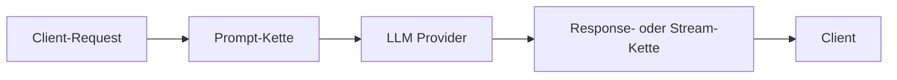

## Übersicht

Ein Guardrail ist eine benannte, konfigurierte Instanz eines
[Plugins](/de/advanced/plugins). Guardrails laufen in jedem
[Workflow](/de/advanced/workflows), der auf sie verweist, und zwar in einer von
drei Phasen:

- **prompt**: nach dem Routing, bevor der Request den Provider erreicht
- **response**: auf der vollständigen Response, bevor sie den Client erreicht
- **stream**: auf jedem gestreamten Event (oder je nach Plugin auf dem gepufferten Stream)

Ein Guardrail kann Inhalte bearbeiten, Header hinzufügen, den Request mit einem
Fehler ablehnen, ihn mit einer sicheren Nachricht beantworten oder ihn mit einer
Warnung durchlassen.

<Warning>
  Ein Guardrail in der Response-Phase benötigt die vollständige Response. Ein
  Workflow, der einen solchen Guardrail ausführt, puffert daher jeden
  streamenden Request, auf den er passt: Der Client hat weiterhin
  `stream: true` angefordert und erhält weiterhin SSE, allerdings in einem
  einzigen Schwall, sobald der Provider fertig ist, und die Zeit bis zum ersten
  Token entspricht der gesamten Antwortzeit. Ein Guardrail in der Stream-Phase
  hält die Auslieferung nur dann inkrementell, wenn auch sein Plugin streamt;
  ein Plugin, dessen Stream-Richtlinie puffert, hat denselben Effekt.
</Warning>

Bei `/v1/responses` kann ein Guardrail in der Stream-Phase Events verwerfen,
zusammenführen oder aufteilen, daher nummeriert GoModel das Ausgelieferte neu:
`sequence_number` läuft weiterhin lückenlos ab `0` bis zum abschließenden
`response.completed` (bzw. `response.incomplete` / `response.failed` bei einem
abgebrochenen Stream).

Guardrails funktionieren mit allen textbasierten Endpunkten:

- `/v1/chat/completions`
- `/v1/responses`
- `/v1/messages`
- `/v1/decisions` und `/v1/systemone`, nur in der Prompt-Phase (siehe
  [Zusammenspiel mit verschiedenen Endpunkten](/de/advanced/guardrails#zusammenspiel-mit-verschiedenen-endpunkten))

<Note>
  Guardrails für Bild-, TTS-, STT- und Videomodelle sind als separates System
  geplant und werden hier nicht behandelt.
</Note>

## Schnellstart

Fügen Sie Ihrer `config/config.yaml` einen Abschnitt `guardrails` hinzu:

```yaml
guardrails:
  enabled: true
  rules:
    - name: "safety-prompt"
      type: "system_prompt"
      order: 0
      system_prompt:
        mode: "decorator"
        content: "Always respond safely and respectfully."
```

Das ist alles. Jeder Request erhält jetzt den Sicherheits-Prompt vor seinen
System-Anweisungen.

## Verwaltung über das Dashboard

Guardrail-Definitionen lassen sich statt in `config.yaml` auch im
Admin-Dashboard erstellen und bearbeiten – nützlich, um Regeln ohne erneutes
Deployment weiterzuentwickeln, oder für Betreiber, die die Konfiguration dieses
Repos nicht direkt verwalten.


Öffnen Sie **Plugins & Guardrails** in der Seitenleiste und klicken Sie auf
**Create Guardrail**: Vergeben Sie einen Namen, wählen Sie einen Typ (jedes
geladene Plugin mit einem Prompt-, Response- oder Stream-Hook wird aufgeführt),
grenzen Sie ihn optional auf einen `user_path` ein und füllen Sie das Formular
aus, das das Plugin deklariert. Der Abschnitt **Advanced** enthält den
Fehlermodus und den Timeout. Einträge aus `config.yaml` werden beim Start in
denselben Speicher übernommen und bleiben mit ihm synchron, sodass im Dashboard
erstellte und in der Konfiguration deklarierte Guardrails nebeneinander
erscheinen. Die Liste **Plugins** unten auf der Seite zeigt jeden geladenen
Plugin-Typ mit seinen Hooks, seiner Quelle und seinem Zustand. Nicht jedes
Plugin ist ein Guardrail: Ein Plugin deklariert `Guardrail: true` in seinem
Manifest, wenn seine Instanzen eine Richtlinie auf Prompts, Responses oder
Streams anwenden, und das Dashboard kennzeichnet diese Plugins und die daraus
erstellten Instanzen mit einem Schild. Eine Routing-Strategie wie
`cheapest_healthy` wird auf derselben Seite aufgeführt, ist aber kein
Guardrail.

<Note>
  Die Ausführung von Guardrails zur Laufzeit hängt weiterhin von
  `GUARDRAILS_ENABLED` ab. Ist die Option deaktiviert, können Sie Definitionen
  auf der Seite trotzdem verwalten – sie laufen nur noch nicht auf dem
  Live-Traffic.
</Note>

## Funktionsweise



1. Der Request wird auf einen einheitlichen `Prompt` abgebildet (System-, User-, Assistant- und Tool-Nachrichten mit stabilen IDs)
2. Die **Prompt-Kette** läuft: Jeder Guardrail bearbeitet den Prompt oder entscheidet sich für Blockieren, Antworten oder Warnen
3. Die Bearbeitungen werden auf den ursprünglichen Request zurückübertragen, der dann an den Provider weitergeht
4. Die **Response-Kette** läuft auf der vollständigen Response (bzw. die **Stream-Kette** auf dem Stream), bevor irgendetwas den Client erreicht

Guardrails sehen nie die rohen API-Request-Typen – sie arbeiten auf dem
einheitlichen [`Exchange`](/de/advanced/plugins#der-exchange). Derselbe
Guardrail funktioniert für `/chat/completions`, `/responses` und `/messages`
identisch.

## Ausführungsreihenfolge

Jeder Guardrail hat einen `order`-Wert (den Workflow-Step), der steuert, wann er
innerhalb seiner Phase läuft:

- **Gleiche Reihenfolge** → Ausführung **parallel** (nebenläufig)
- **Unterschiedliche Reihenfolge** → Ausführung **sequenziell** (aufsteigend)

```mermaid
flowchart LR
    subgraph Order 0
        A[safety-prompt]
        B[content-policy]
    end
    subgraph Order 1
        C[compliance-check]
    end
    subgraph Order 2
        D[final-filter]
        E[audit-tag]
    end
    Order 0 --> Order 1 --> Order 2
```

Jede sequenzielle Gruppe erhält die Ausgabe der vorherigen Gruppe. Guardrails,
die **Inhalte bearbeiten** (`system_prompt`, `llm_based_altering`,
`string_replace`, `presidio`), können sich keinen `order`-Wert mit einem anderen
bearbeitenden Guardrail teilen; pro `order` ist nur ein bearbeitender Guardrail
erlaubt, daneben beliebig viele nicht bearbeitende Prüfungen (`llm_judge`,
`header_edit`). Entscheiden mehrere Guardrails mit demselben `order`-Wert
unterschiedlich, gewinnt die strengste Entscheidung: `block` > `respond` >
`warn` > `allow`.

## Konfiguration

### Vollständige Struktur

```yaml
guardrails:
  enabled: true    # Hauptschalter (Standard: false)
  enable_for_batch_processing: false   # Prompt-Kette auch auf Inline-Items von /v1/batches ausführen
  rules:
    - name: "rule-name"          # Eindeutiger Bezeichner dieser Instanz
      type: "system_prompt"      # Plugin-Name
      user_path: "/team/privacy" # Optionaler Basispfad für interne Hilfsaufrufe
      phase: "prompt"            # prompt (Standard) | response | stream
      order: 0                   # Step innerhalb der Phase
      fail_mode: "closed"        # closed (Standard) | open
      timeout_ms: 0              # Timeout pro Aufruf; 0 = keiner (Standard)
      config:                    # Plugin-Einstellungen, geprüft gegen das Schema des Plugins
        mode: "decorator"
        content: "Your prompt text here."
```

`system_prompt` und `llm_based_altering` akzeptieren ihre Einstellungen auch in
einem typisierten Block, der nach dem Typ benannt ist (`system_prompt:` /
`llm_based_altering:`), wie im Schnellstart. Der typisierte Block und `config:`
sind gleichwertig; verwenden Sie `config:` für alle anderen Typen.
Zeilenorientierte Schlüssel wie `string_replace.rules` und die
`header_edit`-Listen akzeptieren entweder einen Block-Skalar (`|`) oder eine
YAML-Liste von Strings, die mit Zeilenumbrüchen verbunden werden.

### Umgebungsvariable

Sie können Guardrails ein- und ausschalten, ohne die Konfigurationsdatei zu
bearbeiten:

```bash
export GUARDRAILS_ENABLED=true
```

Guardrails basieren auf [Plugins](/de/advanced/plugins), daher aktiviert das
Einschalten von Guardrails auch das Plugin-System (`PLUGINS_ENABLED`,
standardmäßig deaktiviert). Sind beide deaktiviert, stehen die
Guardrail-Endpunkte und die Dashboard-Seite nicht zur Verfügung.

### Regelfelder

| Feld | Erforderlich | Beschreibung |
| ----- | -------- | ----------- |
| `name` | Ja | Lesbarer Bezeichner. Unterstützt Leerzeichen und Unicode, aber kein `/`. |
| `type` | Ja | Plugin-Name: ein unten aufgeführter eingebauter Typ oder der Manifest-Name eines geladenen Plugins. |
| `user_path` | Nein | Optionaler Basis-User-Path für interne Hilfs-Requests. |
| `phase` | Nein | `prompt`, `response` oder `stream`. Standard: `prompt`. |
| `order` | Nein | Ausführungsreihenfolge innerhalb der Phase. Standard: `0`. Gleicher Wert = parallel, unterschiedlicher Wert = sequenziell. |
| `config` | Nein | Plugin-Einstellungen. Schlüssel, Standardwerte und Validierung stammen vom Plugin (`GET /admin/guardrails/types`). |
| `fail_mode` | Nein | `closed` lehnt den Request mit HTTP 500 ab, wenn der Guardrail einen Fehler liefert oder einen Timeout erreicht; `open` fährt ohne ihn fort. Standard: `closed`. |
| `timeout_ms` | Nein | Obergrenze für jeden Aufruf des Guardrails, durchgesetzt zur Deadline. Standard: `0` (keine). Ein inhaltsbearbeitender Guardrail, der seinen Timeout überschreitet, lässt den Request auch mit `fail_mode: open` fehlschlagen; siehe [Fehlermodi und Timeouts](/de/advanced/plugins#fehlermodi-und-timeouts). |

## Guardrail-Typen

GoModel liefert sechs Typen mit. Jeder ist ein eingebautes Plugin; die Tabellen
listen seine Konfigurationsschlüssel so auf, wie sie unter `config:` und im
Dashboard-Formular erscheinen.

### `system_prompt`

Fügt den System-Prompt bei jedem Request hinzu, ersetzt oder ergänzt ihn.

**Phasen:** prompt. **Bearbeitet Inhalte:** ja.

#### Einstellungen

| Schlüssel | Erforderlich | Standard | Beschreibung |
| --- | -------- | ------- | ----------- |
| `mode` | Nein | `inject` | `inject`, `override` oder `decorator`. |
| `content` | Ja | | Der anzuwendende Text des System-Prompts. |

#### Modi

<Tabs>
  <Tab title="inject">
    Fügt eine System-Nachricht **nur hinzu, wenn noch keine existiert**. Vorhandene System-Prompts bleiben unverändert.

    ```yaml
    - name: "default-system"
      type: "system_prompt"
      order: 0
      system_prompt:
        mode: "inject"
        content: "You are a helpful assistant."
    ```

    **Verhalten:**
    - Request hat keinen System-Prompt → einer wird hinzugefügt
    - Request hat bereits einen System-Prompt → keine Änderung
  </Tab>
  <Tab title="override">
    **Ersetzt** alle vorhandenen System-Nachrichten durch den konfigurierten Inhalt.

    ```yaml
    - name: "strict-system"
      type: "system_prompt"
      order: 0
      system_prompt:
        mode: "override"
        content: "You are a compliance-focused assistant. Follow all company policies."
    ```

    **Verhalten:**
    - Alle vorhandenen System-Prompts werden entfernt
    - Ein einziger neuer System-Prompt wird gesetzt
  </Tab>
  <Tab title="decorator">
    **Stellt** den konfigurierten Inhalt dem vorhandenen System-Prompt **voran** (getrennt durch einen Zeilenumbruch). Existiert kein System-Prompt, wird einer hinzugefügt.

    ```yaml
    - name: "safety-prefix"
      type: "system_prompt"
      order: 0
      system_prompt:
        mode: "decorator"
        content: "Always respond safely and respectfully."
    ```

    **Verhalten:**
    - Der vorhandene System-Prompt `"You are a coding assistant."` wird zu:
      ```
      Always respond safely and respectfully.
      You are a coding assistant.
      ```
    - Kein System-Prompt → einer wird erstellt, der nur den konfigurierten Inhalt enthält
  </Tab>
</Tabs>

### `llm_based_altering`

Schreibt den Text ausgewählter Nachrichtenrollen um, indem ein Hilfsmodell
aufgerufen wird. In der Prompt-Phase schreibt es den Request um, in der
Response-Phase die Antwort des Assistenten (wenn `roles` den Wert `assistant`
enthält). Das ist nützlich für die Anonymisierung personenbezogener Daten (PII)
und andere inhaltserhaltende Umformulierungen.

Der Standard-`prompt` ist vom Guardrail `data_anonymization` von LiteLLM
abgeleitet, sodass bereits eine minimale Konfiguration als anonymisierender
Vorverarbeitungsschritt wirkt.

**Phasen:** prompt, response. **Bearbeitet Inhalte:** ja.

#### Einstellungen

| Schlüssel | Erforderlich | Standard | Beschreibung |
| --- | -------- | ------- | ----------- |
| `model` | Ja | | Modell, Alias oder `provider/model`-Selektor für den Umformulierungsaufruf. |
| `provider` | Nein | | Optionaler Routing-Hinweis; wird als `provider/model` in `model` übernommen. |
| `roles` | Nein | `["user"]` | Umzuschreibende Rollen: `system` (einschließlich Developer), `user`, `assistant`, `tool`. |
| `max_tokens` | Nein | `4096` | `max_tokens` für den Hilfsaufruf zur Umformulierung. |
| `skip_content_prefix` | Nein | | Überspringt die Umformulierung, wenn der getrimmte Text mit diesem Präfix beginnt. |
| `prompt` | Nein | eingebauter Anonymisierungs-Prompt | Eigene Anweisungen für die Umformulierung. |

Umformulierungen laufen prozessintern über den normalen übersetzten
Request-Pfad, sodass Workflow-Auswahl, Failover, Nutzungserfassung, Audit und
Cache-Verhalten weiterhin gelten. Der interne Request verwendet:

- Pfad: `/v1/chat/completions`
- User Path: `{guardrail.user_path or caller user path}/guardrails/{guardrail name}`
- Request-Ursprung: `plugin`

Für diesen internen Request werden Guardrails übersprungen, um Rekursion zu
vermeiden. Eine fehlgeschlagene Umformulierung (ein Fehler, eine leere oder
abgeschnittene Antwort, ein Tool Call statt Text) lässt den Guardrail
fehlschlagen, sodass `fail_mode` entscheidet: `closed` lehnt den Request ab,
`open` fährt mit dem Originaltext fort.

#### Beispiel

```yaml
- name: "privacy-rewrite"
  type: "llm_based_altering"
  user_path: "/team/privacy"
  order: 1
  timeout_ms: 20000
  llm_based_altering:
    model: "gpt-4o-mini"
    roles: ["user"]
```

### `string_replace`

Ersetzt, markiert oder blockiert Text, der auf eine Liste literaler Regeln oder
regulärer Ausdrücke passt. Funktioniert auf Prompts, Responses und Streams.
Regeln passen in jedem Modus nur innerhalb eines Text-Parts (eines Content-Parts
oder eines Tool-Ergebnis-Parts); Text, der über zwei Parts verteilt ist, wird
nicht erkannt.

**Phasen:** prompt, response, stream. **Bearbeitet Inhalte:** ja.

#### Einstellungen

| Schlüssel | Erforderlich | Standard | Beschreibung |
| --- | -------- | ------- | ----------- |
| `rules` | Ja | | Eine Regel pro Zeile als `find => replace` (das Trennzeichen ist ` => ` mit Leerzeichen; die Ersetzung darf leer sein). Leerzeilen und Zeilen, die mit `#` beginnen, werden ignoriert. `\n`, `\t` und `\\` werden im Literal-Modus auf beiden Seiten und im Regex-Modus auf der Ersetzungsseite interpretiert. |
| `mode` | Nein | `literal` | `literal` sucht den Text wie geschrieben; `regex` verwendet Go-RE2-Syntax mit den Capture-Referenzen `$1`, `$2` in der Ersetzung (`$$` für ein literales Dollarzeichen). |
| `case_insensitive` | Nein | `false` | Ohne Berücksichtigung der Groß-/Kleinschreibung suchen. |
| `roles` | Nein | `["user"]` | Prompt-Nachrichten, für die die Regeln gelten: `system` (einschließlich Developer), `user`, `assistant`, `tool`. In der Response-Phase ist immer der Assistant-Text das Ziel. |
| `on_match` | Nein | `replace` | `replace` ersetzt; `block` lehnt mit einem Fehler ab; `respond` antwortet mit `message` als Assistant-Antwort; `warn` fährt fort und erfasst den Treffer. Nur `replace` bearbeitet den Text. |
| `message` | Nein | `Request blocked by policy` | Fehlermeldung für `block`, Assistant-Antwort für `respond`, Audit-Notiz für `warn`. |
| `block_status` | Nein | Standard der Phase | Ein HTTP-Statuscode zwischen 400 und 599 für `block`, zum Beispiel `403`. Leer bedeutet 400, wenn der Prompt blockiert wird, und 502, wenn die Response blockiert wird. |
| `stream_lookbehind` | Nein | `64` | Anzahl der Zeichen gestreamten Texts, die zurückgehalten werden, damit ein Treffer, der sich über zwei Chunks erstreckt, trotzdem umgeschrieben wird; setzen Sie den Wert mindestens auf die Länge des längsten Suchtexts. Ein Treffer am Ende des bisher gestreamten Texts wird zurückgehalten, bis er nicht mehr wächst, sodass ein offenes Muster wie `sk-[A-Za-z0-9]{20,}` den gesamten Wert maskiert, sofern er höchstens so lang ist. Wird von `replace` und `warn` verwendet. |

In der Stream-Phase transformieren `replace` und `warn` Events im laufenden
Betrieb mit dem konfigurierten Lookbehind. `block` und `respond` puffern den
gesamten Stream, damit vor der Entscheidung nichts nach außen dringt – auf
Kosten einer Verzögerung des ersten Tokens, bis die Response vollständig ist.

#### Beispiel

```yaml
- name: "mask-internal-names"
  type: "string_replace"
  order: 0
  config:
    mode: "literal"
    case_insensitive: true
    rules: |
      Project Falcon => [project]
      ACME Corp => [company]
```

### `tag_replace`

Ersetzt Platzhalter `{{gomodel.<tag>}}` im Prompt-Text unmittelbar vor dem
Provider-Aufruf durch Werte des aktuellen Requests. Damit können Sie dem Modell
mitteilen, als welches Modell es läuft oder welches Datum heute ist, ohne dass
der Client diese Angaben sendet. Es lässt sich gut mit `system_prompt`
kombinieren: Schreiben Sie die Tags in den System-Prompt und führen Sie
`tag_replace` mit einem späteren `order`-Wert aus.

**Phasen:** prompt. **Bearbeitet Inhalte:** ja.

#### Tags

| Tag | Wert |
| --- | ----- |
| `{{gomodel.requested_model}}` | Vom Client angefordertes Modell. |
| `{{gomodel.resolved_model}}` | Provider-Modell, an das der Request gesendet wird. |
| `{{gomodel.virtual_model}}` | Virtuelles Modell, das die Auflösung ergeben hat, sonst leer. |
| `{{gomodel.provider_type}}` | Provider-Typ, zum Beispiel `openai`. |
| `{{gomodel.provider_name}}` | Name der Provider-Instanz. |
| `{{gomodel.user_path}}` | Effektiver User Path. |
| `{{gomodel.request_id}}` | Request-ID des Gateways. |
| `{{gomodel.session_id}}` | Erkannte Session-ID, leer, wenn keine vorhanden ist. |
| `{{gomodel.date}}` | Aktuelles Datum, `2026-09-15`. |
| `{{gomodel.time}}` | Aktuelle Uhrzeit, `14:05:00`. |
| `{{gomodel.datetime}}` | Aktuelles Datum und aktuelle Uhrzeit im Format RFC 3339, `2026-09-15T14:05:00Z`. |
| `{{gomodel.weekday}}` | Aktueller Wochentag, `Tuesday`. |

Leerzeichen innerhalb der geschweiften Klammern sind erlaubt. Unbekannte Tags
bleiben unverändert stehen.

Ein Tag ohne Wert für den Request, etwa `session_id` ohne Session, wird leer.
Die Modell- und Provider-Tags benennen den zuerst ausgewählten Provider: Die
Prompt-Phase läuft nur einmal, daher erhält ein Failover-Versuch denselben Text.
Werte, die vom Aufrufer stammen, etwa `user_path` und `session_id`, werden so
eingefügt, wie sie gesendet wurden. Ein Request, in dessen Prompt ein Tag
expandiert wurde, wird nicht im Response-Cache gespeichert, da die Antwort
request-spezifische Werte wiederholen kann.

<Warning>
Zeitbasierte Tags können das Prompt-Caching des Providers aushebeln und die
Kosten erhöhen. Provider cachen den Anfang eines Prompts, meist die
System-Nachricht, und verwenden ihn nur wieder, wenn er identisch ist.
`{{gomodel.time}}` und `{{gomodel.datetime}}` ändern sich jede Sekunde und
`{{gomodel.request_id}}` bei jedem Request, sodass jeder Aufruf den vollen
Eingabepreis zahlt und länger wartet. `{{gomodel.date}}` und
`{{gomodel.weekday}}` ändern sich einmal pro Tag und kosten einen Cache-Miss pro
Tag. Bevorzugen Sie `date` gegenüber `time` oder `datetime`, und platzieren Sie
veränderliche Tags am Ende des Prompts statt am Anfang einer langen
System-Nachricht.
</Warning>

#### Einstellungen

| Schlüssel | Erforderlich | Standard | Beschreibung |
| --- | -------- | ------- | ----------- |
| `roles` | Nein | `["system"]` | Prompt-Nachrichten, in denen Tags expandiert werden: `system` (einschließlich Developer), `user`, `assistant`, `tool`. Wenn Sie `user` hinzufügen, können Aufrufer Request-Werte wie den User Path auslesen, und Template-Text in ihren Prompts wird umgeschrieben. |
| `timezone` | Nein | `UTC` | IANA-Zeitzone für die Datums- und Uhrzeit-Tags, zum Beispiel `Europe/Warsaw`. Die Host-Zone `Local` wird abgelehnt. |

#### Beispiel

```yaml
- name: "model-facts"
  type: "system_prompt"
  order: 0
  system_prompt:
    mode: "decorator"
    content: "You are {{gomodel.resolved_model}}. Today is {{gomodel.weekday}}, {{gomodel.date}}."
- name: "expand-tags"
  type: "tag_replace"
  order: 1
  config:
    timezone: "Europe/Warsaw"
```

### `header_edit`

Setzt, ergänzt und entfernt HTTP-Header am Request, an der Client-Response und
am Upstream-Aufruf des Providers. Es bearbeitet nie Inhalte und kann sich daher
einen `order`-Wert mit einem bearbeitenden Guardrail teilen.

**Phasen:** prompt, response. **Bearbeitet Inhalte:** nein.

#### Einstellungen

Jeder Schlüssel ist eine Liste von Zeilen. Zeilen zum Setzen und Ergänzen haben
die Form `Name: value`; Zeilen zum Entfernen bestehen nur aus `Name`.
Leerzeilen und `#`-Kommentare werden ignoriert.

| Schlüssel | Beschreibung |
| --- | ----------- |
| `request_set` | Ersetzt einen Header am laufenden Request nach der Prompt-Phase: sichtbar für spätere Guardrails und das Request-Logging, wird aber nicht an den Provider weitergeleitet. |
| `request_remove` | Entfernt einen Header vom laufenden Request nach der Prompt-Phase. |
| `response_set` | Ersetzt einen Header in der an den Client gesendeten Response. |
| `response_add` | Hängt einen Wert an einen Header der Client-Response an und behält vorhandene Werte bei. Wird einmal pro Request angewendet, auch wenn die Instanz in beiden Phasen läuft. |
| `response_remove` | Entfernt einen Header aus der Client-Response, einschließlich Headern, die GoModel selbst hinzufügt (zum Beispiel `X-Request-Id`). |
| `upstream_set` | Statische Header für den Provider-Aufruf. In diesem Release erfasst, aber nicht weitergeleitet. |

Header mit Zugangsdaten (`Authorization`, `X-Api-Key`, `Cookie`, ...) können nie
bearbeitet werden, und Namen, die `secret` oder `token` enthalten, können nicht
gesetzt werden.

#### Beispiel

```yaml
- name: "served-by"
  type: "header_edit"
  order: 0
  config:
    response_add: |
      X-Served-By: gomodel
    response_remove: |
      X-Request-Id
```

### `llm_judge`

Fragt ein Judge-Modell, ob der Prompt (oder die Response) gegen eine Richtlinie
verstößt, und blockiert, beantwortet oder markiert ihn je nach Urteil. Der Judge
ist entweder ein Chat-Modell oder ein Decision-Modell:

- Ein **Chat-Modell** muss mit genau einem JSON-Objekt
  `{"verdict":"allow"|"block","reason":"..."}` antworten. Die Standardanweisungen
  verlangen das und weisen das Modell an, Anweisungen innerhalb des Inhalts zu ignorieren.
- Einem **Decision-Modell** (Jev, Kev, den Decision-Modellen von OpenRouter oder einem
  OpenAI-Modell über die [Decisions API](/de/advanced/decisions-api)) wird eine
  Ja-oder-Nein-Frage gestellt, und es liefert die Wahrscheinlichkeit für Ja. Es gibt
  keinen Text zu parsen, und berechnet werden nur Input-Tokens. Siehe
  [Mit einem Decision-Modell urteilen](#mit-einem-decision-modell-urteilen).

**Phasen:** prompt, response, stream (gepuffert). **Bearbeitet Inhalte:** nein.

#### Einstellungen

| Schlüssel | Erforderlich | Standard | Beschreibung |
| --- | -------- | ------- | ----------- |
| `model` | Ja | | Judge-Modell: `provider/model`, ein Alias oder ein virtuelles Modell; ein Chat-Modell oder ein Decision-Modell. Seine Nutzung wird mit dem Ursprung `plugin` erfasst. |
| `engine` | Nein | `auto` | Wie der Judge befragt wird: `chat`, `decision` oder `auto`, das `decision` für ein Modell verwendet, das ausschließlich Decisions beantwortet (jedes `jev`-Modell, die Decision-Modelle von OpenRouter oder ein virtuelles Modell, dessen Ziele alle solche Modelle sind), und andernfalls `chat`. |
| `user_path` | Nein | Pfad des aktuellen Requests | User Path, auf den der Judge-Aufruf für Budgets und Audit eingegrenzt wird. |
| `prompt` | Nein | eingebaute Richtlinie | Chat-Engine: System-Prompt für den Judge. |
| `decision_question` | Nein | eingebaute Richtlinie | Decision-Engine: die Ja-oder-Nein-Frage, die zum Inhalt gestellt wird. Ja bedeutet, dass er gegen die Richtlinie verstößt. |
| `block_threshold` | Nein | `0.5` | Decision-Engine: Wahrscheinlichkeit für Ja, von 0 bis 1, ab der (einschließlich) der Inhalt als Block-Urteil gilt. |
| `judge_images` | Nein | `false` | Decision-Engine: auch die Bilder der beurteilten Nachrichten senden. |
| `target` | Nein | `auto` | Was der Judge in der Prompt-Phase sieht: `auto` oder `last_user` (letzte User-Nachricht), `all_user`, `conversation`. In der Response-Phase sieht er immer den Assistant-Text. |
| `action` | Nein | `block` | Bei einem Block-Urteil: `block` lehnt ab, `respond` antwortet mit `respond_text`, `warn` fährt fort und erfasst das Urteil. |
| `message` | Nein | `This request was blocked by policy` | Fehlermeldung für `block`, Audit-Notiz für `warn`. |
| `block_status` | Nein | Standard der Phase | Ein HTTP-Statuscode zwischen 400 und 599 für `block`, zum Beispiel `403`. Leer bedeutet 400, wenn der Prompt blockiert wird, und 502, wenn die Response blockiert wird. |
| `respond_text` | Nein | `I can't help with that request.` | Assistant-Antwort für `respond`. |
| `on_unclear` | Nein | `warn` | Wenn die Antwort des Judges nicht geparst werden kann, durch `max_tokens` abgeschnitten wurde oder vollständig für Reasoning verbraucht wurde: `allow`, `warn` oder `block` (wendet `action` an). Als Urteil zählt nur ein JSON-Objekt oder ein alleinstehendes `allow` oder `block`, nie ein Wort innerhalb eines Satzes. |
| `max_tokens` | Nein | `2048` | Chat-Engine: Completion-Obergrenze für den Judge-Aufruf. Nicht verbrauchte Tokens kosten nichts; bemessen Sie den Wert für das Reasoning des Judge-Modells, nicht für das Urteil. |
| `temperature` | Nein | `0` | Chat-Engine: Sampling-Temperatur für den Judge-Aufruf (0 bis 2). |

Identischer Text wird pro Request nur einmal beurteilt, sodass eine Instanz, die
sowohl in der Prompt- als auch in der Response-Phase läuft, denselben Inhalt
nicht doppelt berechnet. In der Stream-Phase wird der gesamte Stream gepuffert
und als vollständige Response beurteilt.

#### Mit einem Decision-Modell urteilen

Mit einem Decision-Modell sendet der Judge den beurteilten Text ohne Tags als
Decisions-Input und stellt genau eine Prädikatfrage, `decision_question`. Er
verwendet weder `prompt` noch `max_tokens` oder `temperature`. Eine
Wahrscheinlichkeit größer oder gleich `block_threshold` ist ein Block-Urteil, und
`action` greift. Eine niedrigere Wahrscheinlichkeit lässt den Inhalt zu. Der Aufruf
durchläuft dasselbe Routing wie [`POST /v1/decisions`](/de/advanced/decisions-api):
virtuelle Modelle, Failover auf Ziele, die Decisions bedienen, den exakten
Response-Cache, Nutzung und Audit, unter dem User Path der Instanz.

Jedes Urteil erfasst die Wahrscheinlichkeit im Decision-Detail (`probability`),
und die Instanz meldet sie als Histogramm
`plugin_llm_judge_decision_probability`. Nutzen Sie beides, um `block_threshold`
pro Richtlinie abzustimmen: Erhöhen Sie den Wert, um nur eindeutige Verstöße zu
blockieren, oder senken Sie ihn, um mehr Grenzfälle zu erfassen.

`engine: auto` erkennt reine Decision-Modelle anhand des Modellkatalogs. Ein
OpenAI-Modell mit Decisions-Unterstützung kann auch chatten, daher befragt `auto`
es per Chat. Setzen Sie `engine: decision`, um stattdessen seine Decisions API zu
verwenden.

Lassen Sie `judge_images` bei einem Judge, der nur Text liest, etwa einem
Kev-Server, ausgeschaltet: Mit Bildern schlägt jeder Aufruf fehl, und `fail_mode`
entscheidet. Gehostetes Jev liest Bilder, die als Base64-Data-URLs gesendet
werden. Ist `judge_images` eingeschaltet, wird auch ein Prompt beurteilt, der nur
ein Bild enthält; andernfalls wird er ohne Judge-Aufruf zugelassen.

```yaml
- name: "policy-judge"
  type: "llm_judge"
  order: 5
  timeout_ms: 5000
  config:
    model: "jev/jev-latest"
    block_threshold: 0.7
    decision_question: "Does the content ask for help with fraud or account takeover?"
```

#### `max_tokens` für einen Reasoning-Judge bemessen

Ein Reasoning-Judge-Modell verbraucht seine Completion für das Nachdenken, bevor
es irgendetwas schreibt: Ist die Obergrenze vorher erreicht, liefert der Judge
kein Urteil, und die Instanz setzt nichts durch – sie folgt stattdessen
`on_unclear`, das standardmäßig nur warnt. Die Standardobergrenze von `2048`
lässt dafür Spielraum; nicht verbrauchte Tokens werden nie berechnet. Erhöhen
Sie den Wert daher eher weiter, statt ihn zu kürzen, wenn das Judge-Modell viel
Reasoning betreibt.

Ein Judge, der zu keinem Urteil kommt, wird getrennt von einer Antwort erfasst,
die zwar gegeben wurde, aber nicht geparst werden konnte:

| Code | Bedeutung |
| ---- | ------- |
| `llm_judge_block` | Der Judge hat ein Block-Urteil geliefert; `action` greift. |
| `llm_judge_no_verdict` | Die Antwort wurde abgeschnitten (`finish_reason: length`) oder bestand nur aus Reasoning, oder ein Decision-Modell hat keine Antwort geliefert. Bei einer abgeschnittenen Antwort wird eine Warnung mit dem Judge-Modell und der Obergrenze protokolliert. `on_unclear` greift. |
| `llm_judge_unclear` | Der Judge hat geantwortet, aber die Antwort ist kein Urteil, oder ein Decision-Modell hat die Frage abgelehnt. `on_unclear` greift. |

Prüfen Sie nach dem Konfigurieren einer Instanz das Gateway-Log auf
`judge returned no verdict`, und setzen Sie `on_unclear: block` für eine
Richtlinie, die auch dann gelten muss, wenn der Judge nichts Verwertbares
liefert. Ein Judge-Aufruf, der vollständig fehlschlägt – Provider-Fehler,
Timeout –, ist kein unklares Urteil: Darüber entscheidet `fail_mode`, wie bei
jedem anderen Guardrail-Fehler.

#### Beispiel

```yaml
- name: "policy-judge"
  type: "llm_judge"
  order: 5
  timeout_ms: 10000
  config:
    model: "openai/gpt-4o-mini"
    action: "respond"
    respond_text: "I can't help with that request."
```

### `presidio`

Erkennt personenbezogene Daten mit einem
[Presidio](https://presidio.dataprivacystack.org/)-Analyzer und anonymisiert,
markiert oder blockiert sie. Es wird nur der Analyzer-Dienst benötigt; GoModel
schreibt den Text selbst um und kann daher die Originalwerte wieder in die
Response einsetzen.

```bash
docker run -d -p 5002:3000 ghcr.io/data-privacy-stack/presidio-analyzer:latest
```

**Phasen:** prompt, response, stream. **Bearbeitet Inhalte:** ja.

#### Einstellungen

| Schlüssel | Erforderlich | Standard | Beschreibung |
| --- | -------- | ------- | ----------- |
| `analyzer_url` | Nein | `http://localhost:5002` | Base-URL des Analyzer-Dienstes. |
| `api_key` | Nein | | Bearer-Token, das als `Authorization` gesendet wird, für einen Analyzer hinter einem authentifizierenden Proxy. Erfordert eine `https://`-URL, sofern der Analyzer nicht auf localhost läuft. |
| `language` | Nein | `en` | Sprachcode, mit dem der Analyzer arbeitet. Das Standard-Image enthält nur `en`; die Instanz wird als beeinträchtigt angezeigt, wenn der Analyzer kein Modell für die Sprache hat. |
| `entities` | Nein | alle | Zu suchende Entitätstypen (`PERSON`, `EMAIL_ADDRESS`, `PHONE_NUMBER`, `CREDIT_CARD`, `US_SSN`, ...; siehe `GET /supportedentities` am Analyzer). |
| `block_entities` | Nein | | Entitätstypen, die den Request unabhängig von der Aktion ablehnen (oder mit `message` beantworten, wenn die Aktion `respond` ist). |
| `score_threshold` | Nein | Standard des Analyzers | Mindestkonfidenz, 0 bis 1. Erhöhen Sie den Wert, wenn gewöhnliche Wörter für Namen oder Datumsangaben gehalten werden. |
| `allow_list` | Nein | | Exakte Wörter, die nie als personenbezogene Daten behandelt werden: Produktnamen, Ihr Unternehmen. |
| `ad_hoc_recognizers` | Nein | | JSON-Array mit Presidio-Pattern-Recognizern (`supported_entity` plus `patterns` oder `deny_list`) für eigene Bezeichner. |
| `roles` | Nein | `["user", "assistant", "tool"]` | Analysierte Prompt-Nachrichten, einschließlich Tool-Ergebnistext, Tool-Call-Argumenten und dem Reasoning wiedergegebener Assistant-Turns. In der Response-Phase werden der Assistant-Text und die Tool-Call-Argumente immer analysiert. |
| `action` | Nein | `anonymize` | `anonymize` schreibt die Werte um; `block` lehnt mit einem Fehler ab; `respond` antwortet mit `message` als Assistant-Antwort; `warn` fährt fort und erfasst die Entitätstypen. |
| `operator` | Nein | `replace` | Wie `anonymize` einen Wert umschreibt: `replace` durch einen nummerierten Platzhalter (`<PERSON_1>`, derselbe für jedes Vorkommen dieses Werts im Request), `mask` mit `*` pro Zeichen, `redact` (entfernt), `hash` (SHA-256). |
| `placeholder_format` | Nein | `<{entity}_{n}>` | Wie `replace` einen Platzhalter schreibt. `{entity}` ist der Entitätstyp, `{n}` seine Nummer; das Format muss mit einem Satzzeichen beginnen und enden und zwischen den beiden etwas enthalten. |
| `restore` | Nein | `false` | Setzt die Originalwerte dort wieder ein, wo das Modell einen Platzhalter wiederholt. Erfordert `operator: replace`; siehe unten. |
| `restore_roles` | Nein | `["user", "assistant", "tool"]` | Prompt-Rollen, deren Werte wieder eingesetzt werden. Wird von der Instanz berücksichtigt (Prompt- oder Response-Phase), die es setzt; ist es bei beiden gesetzt, muss eine Rolle in beiden Listen stehen. |
| `restore_tools` | Nein | alle | Tools (Funktionsnamen), deren Aufrufargumente die Werte zurückerhalten. Die übrigen behalten die Platzhalter. |
| `restore_tools_exclude` | Nein | | Tools, deren Aufrufargumente die Platzhalter behalten, selbst wenn `restore_tools` sie auswählt. |
| `message` | Nein | `Request blocked: it contains personal data` | Fehlermeldung für `block`, Assistant-Antwort für `respond`, Audit-Notiz für `warn`. |
| `block_status` | Nein | Standard der Phase | Ein HTTP-Statuscode zwischen 400 und 599 für `block`. Leer bedeutet 400, wenn der Prompt blockiert wird, und 502, wenn die Response blockiert wird. |
| `stream_chunk` | Nein | `256` | Anzahl der Zeichen gestreamten Texts (oder Tool-Call-Argumente), die gesammelt werden, bevor der Analyzer darauf läuft, damit er ganze Sätze sieht und einmal pro Chunk läuft. Der Client wartet jeweils höchstens auf diese Textmenge. |
| `stream_lookbehind` | Nein | `64` | Anzahl der Zeichen gestreamten Texts (oder Tool-Call-Argumente), die zurückgehalten werden, damit ein Wert oder Platzhalter, der über zwei Chunks verteilt ist, trotzdem verarbeitet wird. Höchstens 4096. |

Jeder Text-Part wird einzeln analysiert (je ein Analyzer-Aufruf, bis zu acht
gleichzeitig), sodass der Analyzer nie die gesamte Unterhaltung als einen Text
sieht und seine eigenen Limits pro Part gelten. Das Audit-Detail erfasst
Entitätstypen und Anzahlen, nie die Werte, und Fehlermeldungen des Analyzers
enthalten nie den übergebenen Text. Der Analyzer erhält den Text im Klartext.
Betreiben Sie ihn daher als Sidecar auf demselben Host oder erreichen Sie ihn
über `https://` oder ein privates Netzwerk.

<Tip>
  Beginnen Sie mit einer expliziten `entities`-Liste. Sind alle Typen aktiviert,
  meldet das Sprachmodell des Analyzers auch `DATE_TIME`, `LOCATION`, `NRP` und
  `URL`, wodurch Wendungen wie „a nice day“ oder „Paris“ sowohl im Prompt als
  auch in der Antwort zu Platzhaltern werden. `PERSON`, `EMAIL_ADDRESS`,
  `PHONE_NUMBER`, `CREDIT_CARD`, `IBAN_CODE` und die benötigten nationalen
  Kennungen decken die meisten Deployments ab. Manche Modelle, darunter Claude,
  begegnen unerklärten Tokens im Stil von `<PERSON_1>` mit Misstrauen und
  verweigern womöglich, sie zu wiederholen; eine Zeile im System-Prompt wie
  `Values like <PERSON_1> are privacy placeholders;
  use them as ordinary values` behebt das.
</Tip>

In der Stream-Phase transformieren `anonymize` und `warn` Events im laufenden
Betrieb in Chunks von `stream_chunk` Zeichen mit `stream_lookbehind` Zeichen
Überlappung; wird mitten im Stream ein Typ aus `block_entities` gefunden, wird
der Stream abgebrochen, bevor dieser Chunk den Client erreicht. `block` und
`respond` puffern den gesamten Stream, damit vor der Entscheidung nichts nach
außen dringt.

#### Werte wiederherstellen

Mit `restore: true` ersetzt die Prompt-Phase Werte durch nummerierte
Platzhalter und merkt sie sich für den Request; die Response- oder Stream-Phase
setzt die Werte dort wieder ein, wo das Modell einen Platzhalter wiederholt – in
Text, Reasoning (`reasoning_content` oder `reasoning`) und Tool-Call-Argumenten.
So sieht der Client seine eigenen Daten, der Provider dagegen nie. Setzen Sie
`restore` bei den Instanzen in beiden Phasen: Die Instanz in der Prompt-Phase
erfasst die Werte, die Instanz in der Response-Phase stellt sie wieder her.
Reasoning wird nur wiederhergestellt, nicht analysiert. Wiederhergestelltes
Reasoning, das ein Chat-Client im nächsten Turn zurücksendet
(`reasoning_content`, das DeepSeek bei Tool Calls verlangt), wird in der
Prompt-Phase wie der restliche Verlauf erneut anonymisiert. Signierte
Thinking-Blöcke von Anthropic werden separat übertragen und nie bearbeitet; bei
`/v1/messages`, wo der Client den Thinking-Text mit seiner Signatur zurücksendet,
behält das Anthropic-Thinking seine Platzhalter. Auch Reasoning-Items einer
`/v1/responses`-Ausgabe (Zusammenfassungen und Reasoning-Text) behalten die
Platzhalter: Clients geben sie unverändert in `input` wieder, sodass
wiederhergestellte Werte im nächsten Turn den Provider erreichen würden.

Die Instanz in der Prompt-Phase benötigt `restore`, um die Werte zu erfassen;
die wiederherstellende Instanz liest `restore_tools` und
`restore_tools_exclude`. `restore_roles` wird von beiden gelesen: Die Werte
einer Rolle werden wiederhergestellt, wenn jede Instanz, die `restore_roles`
setzt, diese Rolle aufführt, oder – wenn keine von beiden es setzt –, wenn die
Standardliste sie enthält.

Nur Werte aus den `restore_roles` (standardmäßig User-Nachrichten, frühere
Assistant-Turns und Tool-Ergebnisse) werden wieder eingesetzt; ein Wert aus
einer System- oder Developer-Nachricht bleibt ein Platzhalter, sodass ein
Benutzer das Modell nicht dazu bringen kann, ihn preiszugeben. Fügen Sie
`system` hinzu, wenn die System-Nachricht die eigenen Daten des Benutzers
enthält (den Benutzernamen oder gespeicherte Erinnerungen eines Chat-Frontends)
und jeder, der das Deployment nutzen kann, sie sehen darf. Ein Wert, den das
Modell selbst erzeugt hat, wird auf dem Weg nach außen weiterhin anonymisiert.
Solche Responses werden nicht in den [Response-Cache](/de/features/cache)
aufgenommen. Text in Platzhalterform, der bereits in der Unterhaltung steht,
etwa ein `<PERSON_2>`, das eine frühere Antwort zurückgebracht hat, bleibt
unverändert, und seine Nummer wird nie für einen neuen Wert wiederverwendet.

Platzhalter werden in jeder Groß-/Kleinschreibung (`<Person_1>`) sowie in
Markdown- oder HTML-maskierter Form (`\<PERSON\_1\>`, `&lt;PERSON_1&gt;`)
erkannt. Gestreamter Text, Reasoning und die Tool-Call-Argumente jedes Aufrufs
werden im laufenden Betrieb wiederhergestellt, jeweils als eigenes Fenster
unter `stream_lookbehind`, einschließlich Platzhaltern, deren spitze Klammern
der Provider maskiert hat (Gemini liefert `\u003cPERSON_1\u003e`).

Tool-Call-Argumente werden standardmäßig für jedes Tool wiederhergestellt. Ein
clientseitig ausgeführtes Tool, das seine Argumente an Dritte sendet, etwa eine
Websuche, sollte die Platzhalter behalten: Führen Sie es in
`restore_tools_exclude` auf, oder listen Sie in `restore_tools` nur die Tools
auf, die die Werte benötigen (Wissenssuche, Rückfragen an den Benutzer,
Dokumenterstellung).

Ein Markdown-Renderer, der HTML bereinigt, kann einen in der Antwort
verbliebenen Platzhalter ausblenden (einen, den das Modell erfunden hat, oder
einen aus dem System-Prompt). Setzen Sie `placeholder_format: "[{entity}_{n}]"`,
damit sie sichtbar bleiben. Die Instanzen, die an einem Request arbeiten, teilen
sich die Platzhalter im Format der zuerst laufenden Instanz. Geben Sie ihnen
daher dasselbe Format.

#### Beispiel

```yaml
- name: "pii-in"
  type: "presidio"
  order: 1
  timeout_ms: 5000
  config:
    entities: ["PERSON", "EMAIL_ADDRESS", "PHONE_NUMBER"]
    block_entities: ["CREDIT_CARD", "US_SSN"]
    restore: true

- name: "pii-out"
  type: "presidio"
  phase: "response"
  order: 1
  timeout_ms: 5000
  fail_mode: "open"
  config:
    entities: ["PERSON", "EMAIL_ADDRESS", "PHONE_NUMBER"]
    restore: true
    restore_tools_exclude: ["web_search"]
```

## Beispiele

### Einzelner Sicherheits-Guardrail

Das einfachste Setup – jedem Request ein Sicherheitspräfix hinzufügen:

```yaml
guardrails:
  enabled: true
  rules:
    - name: "safety"
      type: "system_prompt"
      order: 0
      system_prompt:
        mode: "decorator"
        content: "Always be safe, respectful, and helpful."
```

### Prüfungen parallel zu einem bearbeitenden Guardrail

Eine nicht bearbeitende Prüfung teilt sich `order` `0` mit dem
System-Prompt-Editor und läuft nebenläufig zu ihm:

```yaml
guardrails:
  enabled: true
  rules:
    - name: "safety-prompt"
      type: "system_prompt"
      order: 0
      system_prompt:
        mode: "decorator"
        content: "Always be safe and respectful."

    - name: "policy-judge"
      type: "llm_judge"
      order: 0
      config:
        model: "openai/gpt-4o-mini"
```

### Sequenzielle Pipeline

Guardrails mit unterschiedlichen `order`-Werten laufen nacheinander. Spätere
Gruppen sehen die Ausgabe der früheren:

```yaml
guardrails:
  enabled: true
  rules:
    # Schritt 1: sicherstellen, dass ein System-Prompt existiert
    - name: "default-system"
      type: "system_prompt"
      order: 0
      system_prompt:
        mode: "inject"
        content: "You are a helpful assistant."

    # Schritt 2: den nun vorhandenen System-Prompt ergänzen
    - name: "safety-prefix"
      type: "system_prompt"
      order: 1
      system_prompt:
        mode: "decorator"
        content: "[SAFETY] Always respond within company guidelines."

    # Schritt 3: User-Text anonymisieren, bevor er das Hauptmodell erreicht
    - name: "privacy-rewrite"
      type: "llm_based_altering"
      order: 2
      llm_based_altering:
        model: "gpt-4o-mini"
        roles: ["user"]
```

### Response-Phase: Secrets auf dem Weg nach außen schwärzen

Läuft auf der vollständigen Response, bevor sie den Client erreicht. Setzen Sie
`fail_mode: open`, wenn Ihnen eine ungeschwärzte Antwort lieber ist als ein 500,
falls der Guardrail selbst fehlschlägt.

```yaml
guardrails:
  enabled: true
  rules:
    - name: "mask-keys"
      type: "string_replace"
      phase: "response"
      order: 10
      config:
        mode: "regex"
        rules: |
          sk-[A-Za-z0-9]{20,} => [redacted]
          AKIA[0-9A-Z]{16} => [redacted]
```

### Stream-Phase: Im laufenden Betrieb schwärzen und die gesamte Antwort beurteilen

Dieselbe Instanz kann in mehreren Phasen referenziert werden. `mask-keys`
transformiert gestreamte Chunks im laufenden Betrieb (64 Zeichen Lookbehind,
sodass ein über zwei Chunks verteilter Key trotzdem erkannt wird).
`answer-judge` benötigt die gesamte Antwort, puffert daher den Stream, und der
Client erhält ihn, sobald das Urteil vorliegt.

```yaml
guardrails:
  enabled: true
  rules:
    - name: "mask-keys"
      type: "string_replace"
      phase: "stream"
      order: 10
      config:
        mode: "regex"
        rules: |
          sk-[A-Za-z0-9]{20,} => [redacted]

    - name: "answer-judge"
      type: "llm_judge"
      phase: "stream"
      order: 20
      config:
        model: "openai/gpt-4o-mini"
        action: "respond"
```

<Tip>
  Eine Regel in `config.yaml` platziert eine Instanz in einer Phase. Um dieselbe
  Instanz in zwei Phasen auszuführen, fügen Sie sie dem Workflow im Dashboard
  oder über `POST /admin/workflows` zweimal mit unterschiedlichen
  `phase`-Werten hinzu; siehe
  [Workflows](/de/advanced/workflows#guardrail-steps).
</Tip>

## Zusammenspiel mit verschiedenen Endpunkten

Guardrails arbeiten intern auf einem einheitlichen Nachrichtenformat. Die
Anpassung zwischen den API-spezifischen Request-Typen und diesem Format erfolgt
automatisch:

| Endpunkt | Quelle des System-Prompts | Quelle der User-Nachrichten |
| --- | --- | --- |
| `/v1/chat/completions` | `messages` mit `role: "system"` | Array `messages` |
| `/v1/responses` | Feld `instructions` | Feld `input` |
| `/v1/messages` | Feld `system` | Array `messages` |
| `/v1/decisions` | — | `input` (Text- und Bild-Parts) |
| `/v1/systemone` | — | `state` |

<Tip>
  Sie müssen sich keine Gedanken darüber machen, welchen Endpunkt Ihre Benutzer
  aufrufen. Eine einzige Guardrail-Regel funktioniert für alle unterstützten
  Text-Endpunkte identisch.
</Tip>

`/v1/decisions` und `/v1/systemone` führen nur die Prompt-Phase aus: Ihre
Antworten sind typisierte Werte statt Completions, daher werden Guardrails der
Response- und Stream-Phase dort übersprungen, mit einer Warnung pro Guardrail.
Bearbeitungen, die sie nicht aufnehmen können, etwa ein eingefügter
System-Prompt, werden verworfen.

Bei `/v1/messages` nimmt ein Request, auf dem ein Guardrail läuft, den
übersetzten Pfad (der native Passthrough wird übersprungen). Eine von einem
Guardrail abgeschnittene Response wird an OpenAI-kompatiblen Endpunkten mit
`finish_reason: "content_filter"` und an `/v1/messages` mit
`stop_reason: "end_turn"` gemeldet.

## Guardrails und der Response-Cache

Der [Response-Cache](/de/features/cache) speichert die Antwort, die die
Response- und Stream-Ketten bereits erzeugt haben, und ein Cache-Treffer spielt
sie ab, ohne diese Ketten erneut auszuführen. Beide Cache-Ebenen verwenden daher
die Guardrail-Kette, zu der der Request aufgelöst wird, über alle drei Phasen
hinweg als Teil des Keys:

- Wird ein Step bearbeitet, hinzugefügt oder entfernt, sind alle unter der alten
  Kette gespeicherten Einträge nicht mehr erreichbar; der nächste Request
  durchläuft die vollständige Pipeline und speichert seinen eigenen Eintrag.
- Zwei Workflows mit unterschiedlichen Ketten teilen sich nie Einträge, sodass
  ein Tenant, dessen Workflow auf dem Weg nach außen schwärzt, nie die
  ungeschwärzte Antwort eines anderen Tenants erhält.
- Eine blockierte Response ist nicht cachebar, daher kann ein blockierender
  Guardrail nie durch einen Cache-Treffer umgangen werden.

Guardrails der Prompt-Phase laufen, bevor der Cache abgefragt wird, sodass ein
Blockieren oder Beantworten in der Prompt-Phase auch für einen Request gilt, der
sonst ein Cache-Treffer gewesen wäre. Eine Response, in die ein Guardrail
request-spezifische Daten wieder einsetzt, wird überhaupt nicht gecacht (siehe
`restore` unter [`presidio`](/de/advanced/guardrails#presidio)).

Da die Response-Kette bei einem Cache-Treffer nicht läuft, erfasst der
Audit-Eintrag für einen Treffer nur die Ergebnisse der Prompt-Phase sowie den
Cache-Typ.

## Entscheidungen, Fehler und Ablehnung

| Ergebnis | Was der Client sieht |
| --- | --- |
| **block** | Einen Fehler im nativen Format des Endpunkts: HTTP 400 (Prompt-Phase) oder 502 (Response- und Stream-Phase), sofern der Guardrail kein `block_status` setzt; Code `guardrail_blocked`, sofern das Plugin keinen eigenen setzt. |
| **respond** | Eine gewöhnliche Assistant-Antwort mit HTTP 200 (bei streamenden Requests ein Stream mit einem Turn). |
| **warn** | Die unveränderte Response plus einen Header `X-GoModel-Guardrail: warn; code=<code>`; das Detail wird im Audit-Trail gespeichert. Bei einem Stream wird der Header nur gesendet, wenn die Warnung entschieden wurde, bevor die ersten Bytes hinausgingen (gepufferte Response); spätere Warnungen erscheinen nur im Audit. |
| **Guardrail-Fehler** (`fail_mode: closed`) | HTTP 500 mit dem Code `plugin_failure`. Der Name des Guardrails steht in den Logs und im Audit-Datensatz, nicht in der Client-Nachricht. |

Ein blockierter Request erreicht nie den Provider; eine blockierte Response
erreicht nie den Client. Unter [Plugins](/de/advanced/plugins#entscheidungen)
erfahren Sie, wie Entscheidungen zusammengeführt werden, wenn mehrere Guardrails
mit demselben `order`-Wert laufen.

Jedes Ergebnis, auch ein stilles Zulassen, wird im Audit-Eintrag des Requests
unter `data.guardrails` erfasst – mit Phase, Step, Entscheidung, der Angabe, ob
der Guardrail den Request oder die Response bearbeitet hat, und wie er
fehlgeschlagen ist. Das Dashboard färbt die Guardrail-Steps im Workflow-Diagramm
eines Audit-Eintrags danach ein: grün, wenn der Step bestanden oder bearbeitet
hat; gelb bei einer Warnung oder einem Fail-open-Fehler; rot bei einem
Blockieren, einer Antwort oder einem Fail-closed-Fehler; abgedunkelt, wenn der
Step nie gelaufen ist. Die Felder finden Sie unter
[Plugins](/de/advanced/plugins#audit-trail).
