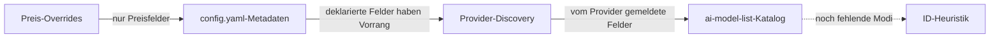

Jedes Modell im Katalog trägt Metadaten – Preise, Kontextfenster, maximale Output-Tokens,
Fähigkeiten und Modi (die entscheiden, ob es als Chat-, Embeddings-, Bild- oder Audiomodell
erscheint). GoModel setzt sie aus fünf Quellen zusammen, die stärkste zuerst:



## Die Quellen

1. **Preis-Overrides** – werden pro Modell auf der Seite **Models** im Dashboard festgelegt.
   Sie bilden die oberste Ebene, allerdings nur für Preisfelder; nicht gesetzte Preistypen werden
   weiterhin geerbt. Siehe [Kostenerfassung](/de/features/cost-tracking).
2. **Metadaten in `config.yaml`** – Einträge unter `providers.<name>.models` können `metadata`
   anhängen (`pricing`, `context_window`, `modes`, `capabilities`, …). Deklarierte Felder haben
   Feld für Feld Vorrang vor allen darunterliegenden Ebenen; weggelassene Felder werden geerbt. Dies
   ist der Ausweg für lokale Modelle: Die Deklaration `modes: [embedding]` leitet zugleich die
   Kategorie des Modells ab.
3. **Provider-Discovery** – die meisten Provider beschreiben ihre Modelle in eigenen Listings, und
   was ein Provider über sein eigenes Deployment angibt, hat Feld für Feld Vorrang vor dem Katalog:
   bei Anthropic Anzeigename, Token-Limits und Capability-Flags; bei Gemini Anzeigename,
   Beschreibung, Token-Limits und Thinking-Unterstützung (auch auf Vertex); bei Groq
   Kontextfenster, Output-Limit, Modalitäten, Features und Preise; bei xAI Kontextfenster, Preise
   (mit der Long-Context-Stufe) und Reasoning-Unterstützung; bei Fireworks Modellart, Kontextfenster
   und Feature-Flags; bei OpenRouter Name, Beschreibung, Modalitäten, unterstützte Parameter und
   Preise; bei Cohere Endpunkte, Kontextlänge und Features; bei Bedrock Anzeigename, Modalitäten und
   Streaming-Unterstützung; bei Chutes Kontextlänge, maximaler Output, Features und Preise; bei
   Ollama die Fähigkeiten aus `/api/show`, Modellfamilie und Kontextlänge; bei vLLM, SGLang und
   llm-d `max_model_len`; und bei llama.cpp Kontextfenster und Modalitäten
   (siehe [llama.cpp](/de/providers/llamacpp)). Fähigkeitsnamen werden auf das Vokabular des
   Katalogs abgebildet (`function_calling`, `vision`, `reasoning`, ...), sodass beide Ebenen ein
   Feature unter demselben Key beschreiben. Das ist vor allem bei self-hosted Servern wichtig, bei
   denen der laufende Prozess die einzige Quelle ist, die das tatsächliche Kontextfenster kennen
   kann. Modelle, die über konfigurierte Modelllisten deklariert sind, überspringen diesen Schritt.
4. **Der Modellkatalog** – die Registry
   [`ai-model-list`](https://github.com/ENTERPILOT/ai-model-list), die beim Start und bei jeder
   Aktualisierung des Katalogs von `MODEL_LIST_URL` abgerufen wird (Standardwert: die Datei
   `models.min.json` der Registry auf GitHub). Sie liefert die umfangreichen Standardwerte – Preise,
   Kontextfenster, Fähigkeiten, Modi – für die meisten gehosteten Modelle. IDs werden direkt, über
   Aliase und mit entfernten Releasedatum-Suffixen abgeglichen, und der Katalog ergänzt jedes Feld,
   das der Provider auf der Ebene darüber nicht gemeldet hat. Input-Modalitäten zählen als
   Fähigkeiten: Ein Eintrag, der `image` akzeptiert, weist `vision` aus (ebenso `audio_input`,
   `video_input`, `pdf_input`), sofern seine Fähigkeiten diesen Key nicht explizit setzen. Falsche
   oder fehlende Daten werden am besten durch einen Beitrag zur Registry korrigiert; für eine
   sofortige Korrektur verwenden Sie einen Override.
5. **ID-Heuristik** – eine Namensprüfung als letztes Mittel für Modelle, die am Ende gar keine Modi
   haben (typisch für llama.cpp und LM Studio): IDs, die `embed` enthalten oder bekannten
   Embedding-Familien entsprechen (`bge`, `e5`, `gte`, `minilm`), werden zu Embedding-Modellen; IDs,
   die `rerank` enthalten, werden zu Reranking-Modellen. IDs mit Namensraum werden anhand ihres
   letzten Pfadsegments abgeglichen. Im Zweifel ordnet die Heuristik nichts zu.

## Herkunft eines Werts prüfen

Klappen Sie auf der Seite **Models** im Dashboard eine Zeile auf, um die effektiven Metadaten des
Modells zusammen mit der Ebene zu sehen, die jedes Feld geliefert hat, und schalten Sie das Panel
auf **Provider**, **Catalog** oder **Config** um, um eine einzelne Ebene für sich zu sehen. Dieselben
Daten liefert
[`GET /admin/models/metadata`](/de/advanced/admin-endpoints#get-/admin/models/metadata).

## Worauf sich Metadaten auswirken

- **Preise** steuern die [Kostenerfassung](/de/features/cost-tracking), Budgets und das
  `cost`-Load-Balancing. Jedes Preisfeld merkt sich seine Quelle, sodass das Dashboard anzeigen
  kann, woher ein Tarif stammt.
- **Modi und Kategorien** steuern nur die Gruppierung im Dashboard – das Routing blockiert nie
  aufgrund dieser Angaben, sodass `/v1/embeddings` jedes Modell erreicht, das der Provider
  bereitstellt.
- **Kontextfenster und Fähigkeiten** werden über `GET /v1/models` (und für ein einzelnes Modell
  über `GET /v1/models/{model}`) für Clients ausgewiesen, die Modelle dynamisch auswählen.

## Verhalten ohne Netzwerkzugriff

Wenn der Abruf des Katalogs fehlschlägt oder das Deployment air-gapped ist, läuft das Gateway
normal weiter – es fehlen lediglich die vom Katalog gelieferten Standardwerte (einschließlich der
Katalogpreise). Preis-Overrides, Metadaten in `config.yaml`, Signale aus der Provider-Discovery und
die ID-Heuristik gelten weiterhin.

`MODEL_LIST_URL` akzeptiert neben einer HTTP-URL auch eine lokale Datei:

```bash
MODEL_LIST_URL=/etc/gomodel/models.json          # einfacher Pfad
MODEL_LIST_URL=file:///etc/gomodel/models.json   # Datei-URL
```

Eine Datei wird beim Start und bei jeder Cache-Aktualisierung gelesen und nur dann neu geparst,
wenn sich ihr Inhalt ändert, sodass Sie Preise durch Ersetzen der Datei aktualisieren können. Da
für eine Datei kein Netzwerk-Request nötig ist, funktioniert sie auch mit `GOMODEL_OFFLINE=true`,
wodurch HTTP-Katalog-URLs verworfen werden. Setzen Sie `MODEL_LIST_URL=off`, um den Katalog
vollständig zu deaktivieren und Metadaten in `config.yaml` zu deklarieren; die vollständige
Air-Gap-Checkliste finden Sie im
[Leitfaden für den Produktivbetrieb](/de/guides/production#air-gapped-und-offline-deployments).
