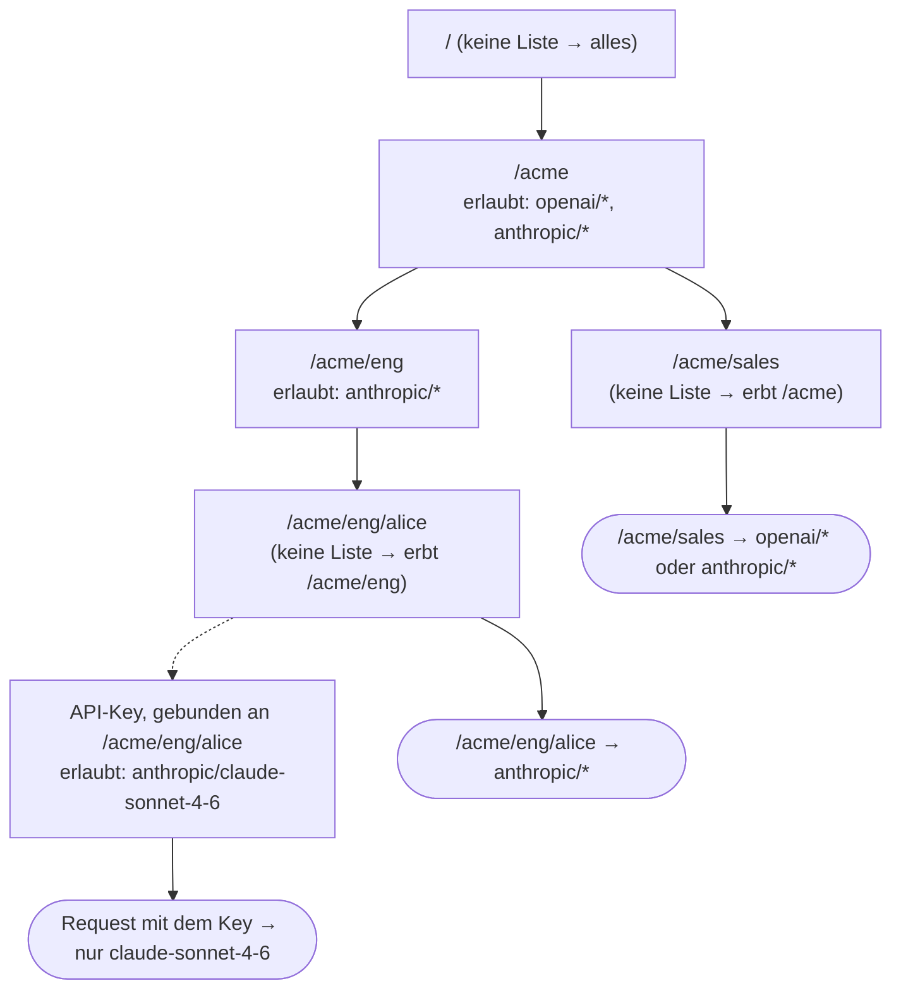
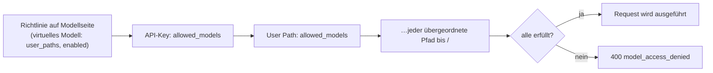

## Übersicht

Die Seite **Users** macht aus der [`user_path`](/de/features/user-path)-Hierarchie
hinter Ihren API-Keys einen Baum aus Gruppen und Benutzern und erlaubt es,
für jeden Knoten einzuschränken, welche Modelle Requests darunter aufrufen
dürfen:

- `/acme` und `/acme/eng` sind **Gruppen** – sie enthalten weitere Pfade.
- `/acme/eng/alice` ist ein **Benutzer** – API-Keys sind direkt daran gebunden.

Nichts muss vorab angelegt werden. Der Baum wird aus den User Paths
bestehender API-Keys abgeleitet; fügen Sie einem Knoten nur dann eine
Richtlinie hinzu, wenn Sie ihn einschränken möchten.

## Regeln

1. **Neue Keys und Knoten erlauben alles.** Ein Knoten oder Key ohne
   `allowed_models` legt selbst keine Einschränkung fest.
2. **Das Auflisten von Modellen schränkt ein.** Sobald ein Knoten Modelle
   auflistet, dürfen Requests darunter nur Modelle verwenden, die zu dieser
   Liste passen.
3. **Listen werden im Baum nach unten geschnitten.** Ein Request muss die
   Allowlist seines API-Keys, seines User Paths und jedes übergeordneten
   Knotens bis `/` erfüllen. Ein untergeordneter Knoten kann das, was seine
   Gruppe erlaubt, einschränken, aber niemals erweitern.
4. Modellseitige Regeln gelten weiterhin. Eine
   [Zugriffsrichtlinie eines virtuellen Modells](/de/features/virtual-models),
   die ein Modell vor einem Teilbaum verbirgt, verbirgt es weiterhin.

`GET /v1/models` liefert nur die Modelle, die der Aufrufer verwenden darf,
sodass Clients dasselbe Bild sehen, das das Gateway durchsetzt.

Requests, die auf anderem Weg authentifiziert werden, folgen denselben
Pfadregeln: Eine [OIDC-SSO](/de/pro/sso)-Session oder ein Request, der nur den
User-Path-Header mitbringt, wird durch die Richtlinien auf seinem
`user_path` eingeschränkt; nur verwaltete API-Keys bringen zusätzlich eine
Allowlist pro Key mit. Der Master-Key hat keinen gebundenen User Path: Ohne
den Header ist er uneingeschränkt, mit dem Header wird er wie jeder andere
Request auf diesem Pfad eingeschränkt.

## Wie der Zugriff ermittelt wird

Richtlinien hängen am Baum der User Paths und werden von oben nach unten
kombiniert. Jede Liste auf dem Weg von der Wurzel zum Pfad des Requests muss
passen, und die eigene Liste des API-Keys wird zuletzt angewendet:



Für einen einzelnen Request prüft das Gateway der Reihe nach:



Woher die einzelnen Bausteine stammen:

| Baustein                   | Quelle                                                       |
| ----------------------- | ------------------------------------------------------------ |
| der User Path des Requests | der `user_path` des verwalteten API-Keys, eine SSO-Session oder der Header `X-GoModel-User-Path` |
| der Baum                | abgeleitet aus den User Paths bestehender API-Keys – nichts anzulegen |
| Richtlinien der Knoten           | die Seite **Users**, `users:` in `config.yaml` oder die Umgebungsvariable `USERS` |
| Richtlinien der Keys            | die Seite **API Keys** oder `allowed_models` bei `POST /admin/auth-keys` |
| modellseitige Richtlinien     | [virtuelle Modelle](/de/features/virtual-models) mit `user_paths` oder `enabled: false` |

Ein Knoten ohne Liste trägt nichts zur Kette bei; er erweitert nichts und
schränkt nichts ein. Deshalb hat ein neuer Key oder eine neue Gruppe zunächst
Zugriff auf alles, und deshalb sieht `/acme/sales` oben weiterhin beide
Provider.

## Selektoren

Jeder Eintrag in einer Allowlist ist ein Selektor:

| Eintrag              | Passt auf                                             |
| ------------------ | --------------------------------------------------- |
| `anthropic/*`      | jedes Modell des Providers `anthropic`             |
| `openai/gpt-4o`    | ein Modell bei einem Provider                           |
| `gpt-4o`           | diese Modell-ID bei jedem Provider                       |
| `*`                | jedes Modell; überflüssig, sofern Sie keine explizite Zeile wünschen, und erweitert niemals die Liste eines übergeordneten Knotens (Regel 3) |

Provider-Namen müssen einem konfigurierten Provider entsprechen; unbekannte
Namen werden beim Speichern der Richtlinie abgelehnt. Virtuelle Modelle sind
keine Selektoren: Ein Alias oder ein Load Balancer wird vor der Prüfung in das
konkrete Provider-Modell aufgelöst. Erlauben Sie daher die Zielmodelle, nicht
das virtuelle Modell. Ein Name eines virtuellen Modells in einer Liste wird als
reine Modell-ID akzeptiert, passt aber nie auf etwas. Ein Load Balancer, dessen
Ziele sich über mehrere Provider erstrecken, ist nur nutzbar, wenn jedes Ziel,
das er wählen kann, erlaubt ist; andernfalls schlagen Requests mit `400` fehl,
sobald er ein nicht erlaubtes Ziel wählt. Der Benutzerbaum zeigt einen solchen
Knoten mit einer leeren effektiven Liste.

## Beispiel

```yaml
users:
  - path: /acme
    allowed_models: [openai/*, anthropic/*]
  - path: /acme/eng
    allowed_models: [anthropic/*]
    description: Engineering only ships on Claude
```

| User Path des Requests  | `openai/gpt-4o` | `anthropic/claude-sonnet-4-6` |
| ------------------ | --------------- | ----------------------------- |
| `/acme/sales`      | erlaubt         | erlaubt                       |
| `/acme/eng/alice`  | abgelehnt          | erlaubt                       |
| `/other`           | erlaubt         | erlaubt                       |

Ein an `/acme/eng/alice` gebundener API-Key mit eigenem
`allowed_models: [anthropic/claude-sonnet-4-6]` schränkt Alice weiter auf
dieses eine Modell ein.

Ein abgelehnter Request erhält `400` mit dem Code `model_access_denied`.

## Request-Policy

Ein Knoten kann außerdem die Requests unter ihm formen. Alle drei Felder sind
standardmäßig leer; solange keines gesetzt ist, ändert sich nichts:

| Feld                   | Wirkung                                                  | Vererbung                        |
| ---------------------- | -------------------------------------------------------- | -------------------------------- |
| `default_model`        | bedient einen Request, der kein Modell nennt             | der nächstgelegene Pfad gewinnt  |
| `max_reasoning_effort` | senkt einen höheren Reasoning-Effort auf diese Stufe     | die niedrigste Obergrenze gilt   |
| `max_output_tokens`    | senkt ein höheres Ausgabe-Token-Limit auf diesen Wert und setzt ihn bei einem Request ohne Limit | die niedrigste Obergrenze gilt   |

```yaml
users:
  - path: /acme
    max_output_tokens: 8192
  - path: /acme/eng
    default_model: team-model # ein Modell oder ein virtuelles Modell
    max_reasoning_effort: medium
  - path: /acme/eng/interns
    max_reasoning_effort: low
```

| Request von             | Client sendet                                 | Upstream gesendet                        |
| ----------------------- | --------------------------------------------- | ---------------------------------------- |
| `/acme/eng/alice`       | kein `model`                                  | `team-model`, wie üblich aufgelöst       |
| `/acme/eng/alice`       | `reasoning_effort: high`, `max_tokens: 32000` | `medium`, `8192`                         |
| `/acme/eng/alice`       | `reasoning_effort: low`, `max_tokens: 100`    | unverändert                              |
| `/acme/eng/alice`       | weder Effort noch Limit                       | kein Effort, `max_tokens: 8192`          |
| `/acme/eng/interns/bob` | `reasoning_effort: medium`                    | `low`                                    |
| `/acme/sales`           | `max_tokens: 32000`                           | `8192`                                   |

**Obergrenzen** sind Höchstwerte. Es gilt die niedrigste Obergrenze zwischen
einem Pfad und `/`: Ein Kind kann die Obergrenze seiner Gruppe verschärfen,
eine höhere Obergrenze am Kind ändert nichts. Efforts nutzen die Skala `none`,
`minimal`, `low`, `medium`, `high`, `xhigh`, `max`. Die Token-Obergrenze deckt
`max_tokens`, `max_completion_tokens` und `max_output_tokens` ab, in der
Schreibweise, die der Client verwendet hat, und ein Request ohne Limit erhält
die Obergrenze als Limit, in dem Feld, das das Upstream-Modell erwartet. Die
Effort-Obergrenze senkt nur einen Effort, den der Request mitbringt, und fügt
nie einen hinzu, weil ein hinzugefügter Effort Reasoning für Requests
einschalten würde, die nicht danach gefragt haben. Ein Request ohne Effort
läuft daher mit dem Standard des Modells, und ein Modell, das nicht unter eine
bestimmte Stufe denken kann (Gemini 3, OpenAI o-Serie, OpenCode Zen), erhält
diese Stufe auch unter einer niedrigeren Obergrenze.

Neben `reasoning_effort` und `reasoning.effort` prüft eine Effort-Obergrenze
die providerspezifischen Reasoning-Steuerungen, die Upstreams erreichen, auf
oberster Ebene des Bodys oder in `extra_body`:

| Steuerung                                                  | Gelesen von                               |
| ---------------------------------------------------------- | ----------------------------------------- |
| `thinking` (`{"type": "enabled", "budget_tokens"/"token_budget": N}`) | Cohere, Xiaomi MiMo, DeepSeek, Kimi, GLM-Upstreams |
| `enable_thinking`, `thinking_budget`                       | Qwen, Bailian, vLLM- und SGLang-Server    |
| `think` (Boolean oder Stufe)                               | Ollama                                    |
| `chat_template_kwargs.enable_thinking`, `.thinking`, `.reasoning_effort`, `.thinking_budget` | vLLM, SGLang, llama.cpp |
| `extra_body.google.thinking_config` `thinking_budget`/`thinking_level` (Namen in beliebiger Schreibweise) | Gemini |
| Messages `thinking.budget_tokens`                          | Anthropic                                 |

Eine Steuerung, die Reasoning ausschaltet (`false`, ein Budget von null,
`{"type": "disabled"}`), und eine Stufe innerhalb der Obergrenze bleiben
erhalten. Alles, was die Skala nicht einordnen kann, etwa ein Token-Budget oder
`true`, gilt als über der Obergrenze: Das Gateway entfernt alle
Reasoning-Steuerungen des Clients und sendet stattdessen die Obergrenze als
Effort. Ein Messages-`budget_tokens` über dem Budget, das das Gateway selbst für
die Stufe der Obergrenze sendet (5000 für `low`, 10000 für `medium`, 20000 ab
`high`), wird auf dieses Budget gesenkt. Wo ein Adapter selbst einen Wert
einsetzt (Anthropics Standard-`max_tokens` und der Platz über einem
Thinking-Budget, der Standard-Effort von OpenCode Zen), bleibt auch dieser
innerhalb der Obergrenzen: Ein Thinking-Budget schrumpft, bis es unter das
begrenzte `max_tokens` passt, und Thinking wird ausgeschaltet, wenn nicht
einmal das Mindestbudget passt.

Obergrenzen greifen nach den [Overrides virtueller Modelle](/de/features/virtual-models#reasoning-effort-erzwingen)
bei jedem Versuch, auch bei Failover-Versuchen, und begrenzen daher auch einen
Effort oder ein `max_tokens`, das ein virtuelles Modell erzwingt oder als
Standard setzt. Sie gelten für Chat Completions, die Responses API und die
Anthropic Messages API; ein Messages-Request innerhalb der Obergrenzen wird
weiterhin nativ an Anthropic weitergeleitet, einer darüber nimmt den
übersetzten Pfad, damit er gesenkt werden kann. Embeddings und
Medien-Endpunkte werden nicht umgeschrieben.

<Warning>
Batches und Provider-Passthrough unter `/p/` werden **nicht** begrenzt: Ihre
Bodys gehen unverändert upstream. Ein begrenzter Key, der auch Batches oder
`/p/` nutzen darf, kann die Policy umgehen; sperren Sie diese Endpunkte daher
für Keys, die Sie begrenzen.
</Warning>

Eine Policy auf `/` gilt für jeden Request, auch für Requests ohne User Path
(der Master-Key oder ein Key ohne gebundenen Pfad, der keinen Header sendet).
Ein Credential ohne gebundenen Pfad wählt seinen Pfad selbst über den
[User-Path-Header](/de/features/user-path) und damit die Policy seines eigenen
Teilbaums, sodass es einer weiter unten gesetzten Obergrenze ausweichen kann.
Binden Sie Obergrenzen über [API-Keys](/de/features/user-path#api-keys) mit
festem `user_path` an Aufrufer oder setzen Sie sie auf `/`.

Das **Standardmodell** wird nur verwendet, wenn ein Chat-Completions-,
Responses- oder Messages-Request (einschließlich Messages-Token-Zählung) weder
`model` noch `provider` nennt; ein vom Client genanntes Modell gewinnt immer.
Es wird genau wie ein vom Client gesendetes Modell aufgelöst: Es darf ein
[virtuelles Modell](/de/features/virtual-models) sein und wird weiterhin gegen
die Allowlists geprüft, sodass ein Standardmodell, das der Pfad nicht nutzen
darf, abgelehnt wird. Ein Request ohne User Path nutzt das Standardmodell von
`/`, falls gesetzt; Pfade ohne Standardmodell erhalten weiterhin
`400 model is required`.

## Richtlinien verwalten

### Dashboard

`Users` listet jeden Knoten mit seiner eigenen Allowlist, seinen **effective
models** – dem Ergebnis auf Pfadebene, nachdem seine eigene Liste, die Listen
aller übergeordneten Knoten und die modellseitigen Richtlinien virtueller
Modelle angewendet wurden (ein rotes **None** kennzeichnet einen Knoten, dessen
Listen keine gemeinsame Schnittmenge haben) – und der Anzahl der daran
gebundenen API-Keys. Die eigenen `allowed_models` eines verwalteten API-Keys
können einen Request weiter einschränken, als der Pfad anzeigt. Der Editor
warnt bereits während der Eingabe, wenn die Liste kein Modell mehr übrig
lassen würde. Fügen Sie einen Knoten hinzu oder bearbeiten Sie ihn, um seine
Modelle, sein Standardmodell und seine Obergrenzen festzulegen; entfernen Sie
die Richtlinie, um auf die Limits der übergeordneten Knoten zurückzufallen. Die
Spalte **Request-Policy** zeigt die geltenden Werte und den Pfad, aus dem jeder
stammt.

Die Anzahl der Keys verlinkt auf die Seite **API Keys**, gefiltert auf den
Teilbaum dieses Pfads, und jede Zeile hat eine Aktion *Add API key*, die das
Formular zum Anlegen eines Keys mit vorausgefülltem Pfad öffnet.

Allowlists pro Key befinden sich auf der Seite **API Keys**: Setzen Sie
`Allowed models` beim Anlegen eines Keys oder bearbeiten Sie sie später in der
Zeile des Keys. Die Spalte **Effective models** dort ist die endgültige
Antwort für diese Zugangsdaten – Pfadrichtlinien, die eigene Liste des Keys und
modellseitige Richtlinien kombiniert.

### Konfiguration

Deklarieren Sie Richtlinien in `config.yaml` unter `users:` (siehe Beispiel
oben) oder in der Umgebungsvariable `USERS` als JSON-Array mit denselben
Feldern:

```bash
USERS='[{"path":"/acme/eng","allowed_models":["anthropic/*"],"default_model":"team-model","max_reasoning_effort":"medium","max_output_tokens":4096}]'
```

Deklarierte Richtlinien überdecken Dashboard-Zeilen für denselben Pfad und
sind im Dashboard schreibgeschützt. Ein falsch geschriebener Provider in einer
deklarierten Richtlinie lässt den Start fehlschlagen, ebenso ein unbekannter
Effort, eine negative Token-Obergrenze oder ein Wildcard-Standardmodell.

### Admin API

| Methode   | Endpunkt                                | Beschreibung                               |
| -------- | --------------------------------------- | ----------------------------------------- |
| `GET`    | `/admin/users`                          | Der Baum mit eigenen und geerbten Limits    |
| `PUT`    | `/admin/users`                          | Legt die Richtlinie eines Knotens an oder ersetzt sie       |
| `DELETE` | `/admin/users?user_path=/acme/eng`      | Entfernt die Richtlinie eines Knotens                  |
| `PUT`    | `/admin/auth-keys/{id}/allowed-models`  | Ersetzt die Allowlist eines API-Keys           |

`PUT /admin/users` nimmt `user_path`, `allowed_models`, `default_model`,
`max_reasoning_effort`, `max_output_tokens` und `description` entgegen und
ersetzt die ganze Zeile: Ein weggelassenes Feld wird geleert. `GET /admin/users`
liefert die eigenen Felder jedes Knotens und ein Objekt `request_policy` mit den
geltenden Werten und dem Pfad, aus dem jeder stammt (`default_model_from`,
`max_reasoning_effort_from`, `max_output_tokens_from`). Ein auf einen Teilbaum
beschränktes Credential kann die Policy seiner eigenen Scope-Wurzel nicht
ändern, nur die von Pfaden darunter.

`POST /admin/auth-keys` akzeptiert `allowed_models` beim Anlegen. Request- und
Response-Formate finden Sie unter [Admin-Endpunkte](/de/advanced/admin-endpoints).
