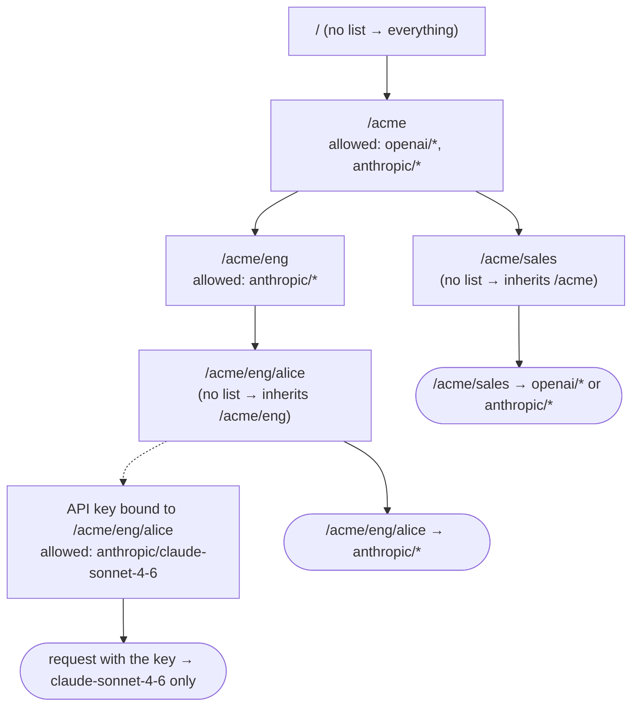
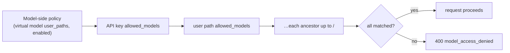

## Overview

The **Users** page turns the [`user_path`](/features/user-path) hierarchy
behind your API keys into a tree of groups and users, and lets each node
restrict which models requests under it may call:

- `/acme` and `/acme/eng` are **groups** — they contain other paths.
- `/acme/eng/alice` is a **user** — API keys are bound directly to it.

Nothing needs to be created up front. The tree is derived from the user paths
of existing API keys; add a policy to a node only when you want to restrict it.

## Rules

1. **New keys and nodes allow everything.** A node or key with no
   `allowed_models` imposes no restriction of its own.
2. **Listing models restricts.** Once a node lists models, requests under it
   may only use models matching that list.
3. **Lists intersect down the tree.** A request must satisfy the allowlist of
   its API key, of its user path, and of every ancestor up to `/`. A child
   can narrow what its group allows but never widen it.
4. Model-side rules still apply. A [virtual model access policy](/features/virtual-models)
   that hides a model from a subtree keeps hiding it.

`GET /v1/models` returns only the models the caller may use, so clients see
the same picture the gateway enforces.

Requests authenticated by other means follow the same path rules: an
[OIDC SSO](/pro/sso) session or a request carrying only the
user-path header is limited by the policies on its `user_path`; only managed
API keys additionally carry a per-key allowlist. The master key has no bound
user path: without the header it is unrestricted, with the header it is
scoped like any other request on that path.

## How access is resolved

Policies hang off the user-path tree and are combined top-down. Every list on
the way from the root to the request's path must match, and the API key's own
list is applied last:



For one request the gateway checks, in order:



Where the pieces come from:

| Piece                   | Source                                                       |
| ----------------------- | ------------------------------------------------------------ |
| the request's user path | the managed API key's `user_path`, an SSO session, or the `X-GoModel-User-Path` header |
| the tree                | derived from the user paths of existing API keys — nothing to create |
| node policies           | the **Users** page, `users:` in `config.yaml`, or the `USERS` env var |
| key policies            | the **API Keys** page or `allowed_models` on `POST /admin/auth-keys` |
| model-side policies     | [virtual models](/features/virtual-models) with `user_paths` or `enabled: false` |

A node without a list contributes nothing to the chain; it neither widens nor
narrows. This is why a new key or a fresh group starts with access to
everything, and why `/acme/sales` above still sees both providers.

## Selectors

Each entry in an allowlist is one selector:

| Entry              | Matches                                             |
| ------------------ | --------------------------------------------------- |
| `anthropic/*`      | every model of the `anthropic` provider             |
| `openai/gpt-4o`    | one model on one provider                           |
| `gpt-4o`           | that model ID on any provider                       |
| `*`                | every model; redundant unless you want an explicit row, and it never widens a parent's list (rule 3) |

Provider names must match a configured provider; unknown names are rejected
when the policy is saved. Virtual models are not selectors: an alias or a load
balancer resolves to the concrete provider model before the check runs, so allow
the target models, not the virtual model. A virtual model name in a list is
accepted as a bare model ID but never matches anything; a load balancer whose
targets span providers is only usable when every target it can pick is allowed,
otherwise requests fail with `400` whenever it picks a disallowed target. The
user tree shows such a node with an empty effective list.

## Example

```yaml
users:
  - path: /acme
    allowed_models: [openai/*, anthropic/*]
  - path: /acme/eng
    allowed_models: [anthropic/*]
    description: Engineering only ships on Claude
```

| Request user path  | `openai/gpt-4o` | `anthropic/claude-sonnet-4-6` |
| ------------------ | --------------- | ----------------------------- |
| `/acme/sales`      | allowed         | allowed                       |
| `/acme/eng/alice`  | denied          | allowed                       |
| `/other`           | allowed         | allowed                       |

An API key bound to `/acme/eng/alice` with its own
`allowed_models: [anthropic/claude-sonnet-4-6]` narrows Alice further to that
single model.

A denied request receives `400` with code `model_access_denied`.

## Request policy

A node can also shape the requests below it. All three fields are unset by
default, so nothing changes until you set one:

| Field                  | Effect                                                         | Inheritance           |
| ---------------------- | -------------------------------------------------------------- | --------------------- |
| `default_model`        | serves a request that names neither a `model` nor a `provider` | the nearest path wins |
| `max_reasoning_effort` | lowers a higher reasoning effort to this level                 | the lowest ceiling wins |
| `max_output_tokens`    | lowers a higher output token limit to this number, and sets it on a request that sends none | the lowest ceiling wins |

```yaml
users:
  - path: /acme
    max_output_tokens: 8192
  - path: /acme/eng
    default_model: team-model # a model or a virtual model
    max_reasoning_effort: medium
  - path: /acme/eng/interns
    max_reasoning_effort: low
```

| Request from          | Client sends                         | Sent upstream                          |
| --------------------- | ------------------------------------ | -------------------------------------- |
| `/acme/eng/alice`     | no `model`                           | `team-model`, resolved as usual        |
| `/acme/eng/alice`     | `reasoning_effort: high`, `max_tokens: 32000` | `medium`, `8192`              |
| `/acme/eng/alice`     | `reasoning_effort: low`, `max_tokens: 100`    | unchanged                     |
| `/acme/eng/alice`     | no effort, no limit                  | no effort, `max_tokens: 8192`          |
| `/acme/eng/interns/bob` | `reasoning_effort: medium`         | `low`                                  |
| `/acme/sales`         | `max_tokens: 32000`                  | `8192`                                 |

**Ceilings** are upper bounds. The lowest ceiling between a path and `/`
applies, so a child can tighten its group's ceiling but setting a higher one on
a child changes nothing. Efforts use the scale `none`, `minimal`, `low`,
`medium`, `high`, `xhigh`, `max`. The token ceiling covers `max_tokens`,
`max_completion_tokens`, and `max_output_tokens` in whichever spelling the
client used, and a request that sends no limit gets the ceiling as its limit,
in the field the upstream model takes. A limit sent only in a spelling the
endpoint does not have (`max_output_tokens` on Chat Completions, `max_tokens`
on the Responses API) is moved to the endpoint's own field, and a value that is
not a whole number of at least 1 is replaced by the ceiling. The effort ceiling only lowers an effort
the request sends and never adds one, because adding an effort would switch
reasoning on for requests that did not ask for it. A request without an effort
therefore runs at the model's default, and a model that cannot think less than
some level (Gemini 3, OpenAI o-series, OpenCode Zen) still gets that level under
a lower ceiling.

Besides `reasoning_effort` and `reasoning.effort`, an effort ceiling checks the
provider-specific reasoning controls that reach upstreams, at the top level of
the body or inside `extra_body`:

| Control                                                    | Read by                                   |
| ---------------------------------------------------------- | ----------------------------------------- |
| `thinking` (`{"type": "enabled", "budget_tokens"/"token_budget": N}`) | Cohere, Xiaomi MiMo, DeepSeek, Kimi, GLM upstreams |
| `enable_thinking`, `thinking_budget`                       | Qwen, Bailian, vLLM and SGLang servers    |
| `think` (boolean or level)                                 | Ollama                                    |
| `chat_template_kwargs.enable_thinking`, `.thinking`, `.reasoning_effort`, `.thinking_budget` | vLLM, SGLang, llama.cpp |
| `extra_body.google.thinking_config` `thinking_budget`/`thinking_level` (names in any case) | Gemini |
| Messages `thinking.budget_tokens`                          | Anthropic                                 |

A control that turns reasoning off (`false`, a zero budget,
`{"type": "disabled"}`) and a level within the ceiling are kept. Anything the
scale cannot place, such as a token budget or `true`, counts as above the
ceiling: the gateway drops every client reasoning control and sends the ceiling
as the effort instead. A Messages `budget_tokens` above the budget the gateway
itself sends for the ceiling level (5000 for `low`, 10000 for `medium`, 20000
for `high` and up) is lowered to that budget. Where an adapter fills in a value
of its own (Anthropic's default `max_tokens` and the room it adds above a
thinking budget, OpenCode Zen's default effort), that value is kept within the
ceilings too: a thinking budget shrinks to fit under the capped `max_tokens`,
and thinking is turned off when not even the minimum budget fits.

Ceilings apply after [virtual model overrides](/features/virtual-models#force-a-reasoning-effort),
on every attempt, including failover legs, so they also bound an effort or a
`max_tokens` that a virtual model forces or defaults. They apply to Chat
Completions, the Responses API, and the Anthropic Messages API; a Messages
request within the ceilings is still forwarded natively to Anthropic, and one
above them takes the translated path so it can be lowered. Embeddings and
media endpoints are not rewritten. [Response cache](/features/cache) entries
are scoped to the ceilings in force, so an answer cached before a ceiling was
set or changed is not served under the new one.

<Warning>
Batches and provider passthrough under `/p/` are **not** capped: their bodies
go upstream as sent. A capped key that may also use batches or `/p/` can
bypass the policy, so deny those endpoints to keys you cap. The
[ChatGPT](/providers/chatgpt) provider accepts no output token limit, so
`max_output_tokens` is not enforced on its models.
</Warning>

A policy on `/` binds every request, including those with no user path (the
master key, or a key without a bound path that sends no header). A credential
without a bound path chooses its own path through the
[user path header](/features/user-path) and with it its own subtree's policy,
so it can step out of a cap set lower in the tree. Bind caps to callers through
[API keys](/features/user-path#api-keys) with a fixed `user_path`, or set them on `/`.

The **default model** is used only when a Chat Completions, Responses, or
Messages request (including Messages token counting) names neither a `model`
nor a `provider`; a model the client names always wins. It is resolved exactly
like a model the client sent: it may be a [virtual model](/features/virtual-models),
and it is still checked against the allowlists, so a default the path may not
use is denied. A request without a user path answers to the default on `/`,
if any; paths without a default keep getting `400 model is required`.

## Managing policies

### Dashboard

`Users` lists every node with its own allowlist, the **request policy** in
force on it (with the path each value comes from), its **effective models** —
the path-level result once its own list, every parent's list, and the
model-side virtual-model policies are applied (a red **None** flags a node
whose lists intersect to nothing) — and how many API keys are bound to it. A
managed API key's own `allowed_models` can narrow a request further than the
path shows. The editor warns while you type when the
list would leave no model available. Add or edit a node to
set its models, default model, and ceilings; remove the policy to fall back to
the parents' limits.

The key count links to the **API Keys** page filtered to that path's subtree,
and each row has an *Add API key* action that opens the create-key form with
the path prefilled.

Per-key allowlists live on the **API Keys** page: set `Allowed models` when
creating a key or edit them later from the key's row. Its **Effective models**
column is the final answer for that credential — path policies, the key's own
list, and model-side policies combined.

### Configuration

Declare policies in `config.yaml` under `users:` (see the example above) or
in the `USERS` environment variable as a JSON array with the same fields:

```bash
USERS='[{"path":"/acme/eng","allowed_models":["anthropic/*"],"default_model":"team-model","max_reasoning_effort":"medium","max_output_tokens":4096}]'
```

Declared policies shadow dashboard rows for the same path and are read-only
in the dashboard. A misspelled provider, an unknown effort, a negative token
ceiling, or a wildcard default model in a declared policy fails startup.

### Admin API

| Method   | Endpoint                                | Description                               |
| -------- | --------------------------------------- | ----------------------------------------- |
| `GET`    | `/admin/users`                          | The tree with own and inherited limits    |
| `PUT`    | `/admin/users`                          | Create or replace one node's policy       |
| `DELETE` | `/admin/users?user_path=/acme/eng`      | Remove one node's policy                  |
| `PUT`    | `/admin/auth-keys/{id}/allowed-models`  | Replace one API key's allowlist           |

`PUT /admin/users` takes `user_path`, `allowed_models`, `default_model`,
`max_reasoning_effort`, `max_output_tokens`, and `description`, and replaces
the whole row: a field left out is cleared. `GET /admin/users` returns each
node's own fields and a `request_policy` object with the values in force and
the path each comes from (`default_model_from`, `max_reasoning_effort_from`,
`max_output_tokens_from`). A credential scoped to a subtree cannot change the
policy of its own scope root, only of paths below it.

`POST /admin/auth-keys` accepts `allowed_models` at creation time. See
[Admin Endpoints](/advanced/admin-endpoints) for request and response shapes.
