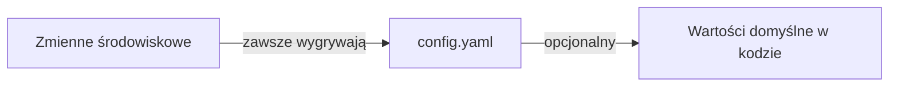

## Dobre wartości domyślne

GoModel kieruje się filozofią dobrych wartości domyślnych. Oznacza to, że ustawienia domyślne powinny wystarczyć, żeby z niego korzystać.

## Jak nadpisać ustawienia domyślne?

Konfiguracja przechodzi przez trzy warstwy. Każde ustawienie ma rozsądną wartość domyślną, więc możesz uruchomić serwer bez żadnej konfiguracji.

{/* Zmienne środowiskowe (zawsze wygrywają) → config.yaml (opcjonalny) → wartości domyślne w kodzie */}



<Tip>
  GoModel działa od razu, bez plików konfiguracyjnych, więc możesz go
  wypróbować w minutę.

Zacznij tutaj: [Szybki start](/pl/getting-started/quickstart)

</Tip>

GoModel automatycznie wykrywa providerów na podstawie dobrze znanych zmiennych środowiskowych.

## Metody konfiguracji

### 1. Zmienne środowiskowe

Najczęstszy sposób konfigurowania GoModel. Ustaw dowolną z poniższych zmiennych, żeby nadpisać wartości domyślne.

#### Serwer

| Zmienna              | Opis                                                  | Wartość domyślna       |
| -------------------- | ----------------------------------------------------- | ---------------------- |
| `PORT`               | Port serwera HTTP                                     | `8080`                 |
| `BASE_PATH`          | Prefiks ścieżki montowania, na przykład `/g`          | `/`                    |
| `GOMODEL_MASTER_KEY` | Klucz uwierzytelniający zabezpieczający gateway       | _(pusty, tryb niezabezpieczony)_ |
| `MASTER_KEY_DISABLED` | Wyłącza uwierzytelnianie master key, tak że jedynymi danymi uwierzytelniającymi pozostają [zarządzane klucze](/pl/features/users) i rozszerzenia uwierzytelniania | `false`                |
| `GOMODEL_DEMO_MODE`  | Włącza ostrzeżenia o publicznym demo w logach i w dashboardzie | `false`                |
| `BODY_SIZE_LIMIT`    | Maksymalny rozmiar body requestu (np. `10M`, `1024K`, `500KB`), po kompresji i po dekompresji | `10M`                  |
| `STREAM_STALL_TIMEOUT` | Liczba sekund, przez którą pojedynczy zapis odpowiedzi na trasie modelu może czekać, aż klient go odczyta; `0` wyłącza | `60`                   |
| `USER_PATH_HEADER`   | Nagłówek używany do odczytu/zapisu wartości `user_path` requestu | `X-GoModel-User-Path`  |
| `SERVER_TRUSTED_PROXIES` | Sieci, w których stoją Twoje własne proxy; włącza odczyt adresu klienta z nagłówka | _(pusty)_ |
| `SERVER_CLIENT_IP_HEADER` | Nagłówek, w którym zaufane proxy przekazuje adres klienta | `X-Forwarded-For` |
| `SERVER_TRUSTED_HOPS` | Liczba proxy między klientem a gatewayem; `0` oznacza skanowanie łańcucha | `0` |
| `SWAGGER_ENABLED`    | Udostępnia [Swagger UI](/pl/advanced/swagger-ui); wymaga buildu z `-tags=swagger` | `false`                |
| `AUTH_VERIFY_ENABLED` | Udostępnia [`GET /v1/auth/verify`](/pl/advanced/api-endpoints#weryfikacja-klucza), który informuje, czy klucz API przesłany w requeście jest ważny | `false`                |
| `PID_FILE`           | Miejsce, w którym działający gateway zapisuje identyfikator procesu na potrzeby `gomodel --reload`. Zmiana wymaga restartu | `data/gomodel.pid` obok katalogu `./data`, w przeciwnym razie katalog danych użytkownika |

Body requestów może być skompresowane za pomocą `Content-Encoding: gzip` (lub `x-gzip`)
albo `zstd`; SDK TypeSafe domyślnie kompresują zstd body o rozmiarze 1 KiB lub
większym. Gateway dekoduje je przed routingiem, więc guardrails, audyt i
providerzy widzą zwykłe body, a `BODY_SIZE_LIMIT` dotyczy zarówno rozmiaru
po kompresji, jak i po zdekodowaniu (`413`, gdy którykolwiek go przekracza). Inne kodowania
zwracają `415`.

`STREAM_STALL_TIMEOUT` (`server.stream_stall_timeout` w YAML) chroni
gateway przed klientami, którzy otwierają odpowiedź streamingową i przestają ją czytać. Każdy
zapis do klienta dostaje nowy termin, więc timeout zadziała tylko wtedy, gdy socket
klienta pozostaje pełny przez cały ten czas, a nigdy wtedy, gdy wolny model po prostu nie ma nic do wysłania.
Gdy timeout zadziała, połączenie zostaje zamknięte, request do upstreamowego providera jest
anulowany, a wpis audytowy zapisuje `client_stalled` – również wtedy, gdy stream
został zaserwowany z cache'u odpowiedzi. Zwiększ tę wartość dla klientów, którzy w uzasadniony sposób
wstrzymują odczyt streamu na dłużej niż minutę; ustaw `0`, żeby ją wyłączyć.

#### Adresy klientów za proxy

Każdy adres klienta raportowany przez GoModel – we wpisach audytowych, kluczach rate limitów, logach –
to adres połączenia, które dotarło do gatewaya, więc za reverse
proxy wszystkie wskazują na proxy. Ustaw `SERVER_TRUSTED_PROXIES` na sieci,
w których stoją Twoje własne proxy, a GoModel odczyta przekazany adres klienta.
Nic nie jest zaufane, dopóki tego nie wpiszesz – nawet loopback – a zmiana tych
ustawień wymaga restartu.

```bash
SERVER_TRUSTED_PROXIES=10.42.0.0/16,loopback
```

Wpisy to sieci CIDR, pojedyncze adresy (jeden host) lub preset:

| Preset     | Rozwija się do                                       |
| ---------- | ---------------------------------------------------- |
| `loopback` | `127.0.0.0/8`, `::1/128`                             |
| `private`  | `10.0.0.0/8`, `172.16.0.0/12`, `192.168.0.0/16`, `fc00::/7` |

Wybieraj jedną podsieć, w której stoi Twoje proxy. `private` pozwala każdemu prywatnemu
klientowi ustawić własny przekazany adres, co jest złym rozwiązaniem, gdy Twoi
klienci również korzystają z prywatnych adresów – domowy lab, którego klienci są w
`192.168.1.0/24`, a klaster działa w `10.42.0.0/16`, powinien wpisać
wyłącznie `10.42.0.0/16`.

Domyślnie GoModel odczytuje `X-Forwarded-For`, do którego każdy hop dopisuje adres,
który widział, i zapisuje najbliższy hop spoza Twoich zaufanych sieci:
ostatni adres zapisany przez Twoją własną infrastrukturę i zarazem najdalszy, którego klient
nie może nadpisać. Request spoza wpisanych sieci, łańcuch, którego nie da się
sparsować, oraz łańcuch złożony wyłącznie z zaufanych sieci – wszystkie zachowują adres
połączenia. W tym ostatnim przypadku każdy wpis to deklaracja, którą wewnętrzny klient mógłby
zmyślić.

Dwa ustawienia zmieniają sposób odczytu nagłówka:

- `SERVER_CLIENT_IP_HEADER` wskazuje inny nagłówek. Każdy nagłówek inny niż
  `X-Forwarded-For` zawiera pojedynczy adres i jest przyjmowany dosłownie, co
  jest właściwym odczytem za brzegiem sieci, który sam ustala adres klienta:
  `SERVER_CLIENT_IP_HEADER=CF-Connecting-IP` za Cloudflare lub `X-Real-IP`
  za nginx, który go ustawia. Nagłówek `Forwarded` z RFC 7239 nie jest obsługiwany.
- `SERVER_TRUSTED_HOPS` pobiera wpis z `X-Forwarded-For` ze stałej głębokości
  zamiast skanować łańcuch – `1` to wpis skrajnie prawy, `2` ten
  przed nim. Użyj go, gdy Twój brzeg sieci znajduje się na znanej głębokości, ale rotuje
  adresy, których nie możesz wyliczyć. Połączenie nadal musi pochodzić z zaufanej
  sieci, a łańcuch krótszy niż skonfigurowana głębokość powoduje powrót do
  adresu połączenia.

Oba wymagają `SERVER_TRUSTED_PROXIES`; ustawione samodzielnie powodują błąd przy starcie,
a nie są ustawieniem, które po cichu nic nie robi.

Ustaw `GOMODEL_DEMO_MODE=true` dla publicznej lub współdzielonej instancji demonstracyjnej.
GoModel loguje ostrzeżenie przy starcie i co pięć minut, wyświetla stałe
ostrzeżenie na górze dashboardu i udostępnia `DEMO_MODE=on` w
odpowiedzi `/admin/runtime/config` z listy dozwolonych wartości. Tryb demo nie resetuje storage'u;
zaplanuj to osobno we wdrożeniu.

Tryb demo nie omija też uwierzytelniania. Tryb logowania przy starcie
`managed_keys` oznacza, że skonfigurowany storage nadal zawiera co najmniej jeden zarządzany
klucz API gatewaya, więc requesty wymagają bearer tokena nawet wtedy, gdy
`GOMODEL_MASTER_KEY` jest pusty. Wyłączone lub wygasłe zarządzane klucze utrzymują
włączone uwierzytelnianie jako zabezpieczenie typu fail closed. Usuń wszystkie zarządzane
klucze, żeby wrócić do trybu bez uwierzytelniania, albo skonfiguruj master key do odzyskiwania dostępu.

#### Wyłączanie master key

Master key to pojedyncze, globalne dane uwierzytelniające: kto go posiada, jest jednocześnie każdym użytkownikiem
gatewaya. Gdy wydasz już zarządzane klucze API gatewaya, ustaw
`MASTER_KEY_DISABLED=true` (`server.master_key_disabled` w YAML), żeby go wycofać
i zostawić te klucze – razem z każdym używanym rozszerzeniem uwierzytelniania,
takim jak SSO – jako jedyną drogę dostępu. Ścieżki użytkownika, budżety, rate limity
i ślady audytowe przypisane do kluczy obowiązują wtedy dla każdego requestu, także w Admin API.

```bash
MASTER_KEY_DISABLED=true
```

GoModel zapomina skonfigurowany master key przy starcie, więc nic go nie akceptuje ani
nic z niego nie wynika: nie działa wobec gatewaya, wobec
[`GET /v1/auth/verify`](/pl/advanced/api-endpoints#weryfikacja-klucza) ani wobec
`/admin`. Klucz pozostawiony w środowisku lub w `config.yaml` jest nieaktywny, a nie
powoduje błędu – dzięki temu przełącznik można bezpiecznie włączyć jeszcze przed jego usunięciem.

Wyłączenie to nie to samo co pozostawienie pustego `GOMODEL_MASTER_KEY`, które uruchamia
gateway bez uwierzytelniania i otwiera `/admin/*`, żeby dashboard mógł utworzyć
pierwszy zarządzany klucz. Jeśli nie skonfigurowano rozszerzenia uwierzytelniania,
`/admin/*` pozostaje otwarte nawet po utworzeniu zarządzanych kluczy, a GoModel loguje
ostrzeżenie bezpieczeństwa przy starcie, dopóki tak jest – ustaw więc master key lub go wyłącz,
gdy tylko wydasz pierwszy klucz z dostępem do dashboardu. Wyłączony master
key działa natomiast w trybie fail closed: każdy request
wymaga danych uwierzytelniających, a Admin API pozostaje dostępne tylko z takimi, które mają
dostęp do dashboardu. Wydaj je, zanim włączysz przełącznik – bez master key,
bez zarządzanego klucza i bez rozszerzenia uwierzytelniania gateway odrzuca każdy
request i loguje o tym ostrzeżenie przy starcie.

#### MCP Gateway

Pełny przewodnik po funkcji znajdziesz w [MCP Gateway](/pl/features/mcp-gateway).

| Zmienna       | Opis                                                                                                                             | Wartość domyślna   |
| ------------- | -------------------------------------------------------------------------------------------------------------------------------- | ------------------ |
| `MCP_ENABLED` | Udostępnia endpointy MCP `/mcp` i `/mcp/{server}`                                                                                | `true`             |
| `MCP_SERVERS` | Obiekt JSON z upstreamowymi serwerami MCP, scalany per nazwa z mapą YAML `mcp.servers` (wpisy są w dashboardzie tylko do odczytu) | _(brak)_           |
| `MCP_ALLOWED_ORIGINS` | Rozdzielone przecinkami originy przeglądarki (`scheme://host[:port]`), które mogą wywoływać `/mcp`; domyślnie żaden nie jest zaufany, co blokuje DNS rebinding. `*` wyłącza sprawdzanie | _(brak)_           |
| `MCP_TOOL_DISCOVERY` | `off` wyświetla każde narzędzie; `search` udostępnia zamiast tego `search_tools` i `call_tool`, żeby duże katalogi nie zapełniały kontekstu modelu. Klienci nadpisują to per sesja nagłówkiem `X-MCP-Tool-Discovery` | `off` |
| `MCP_VIRTUAL_SERVERS` | Obiekt JSON z serwerami wirtualnymi, scalany per nazwa z mapą YAML `mcp.virtual_servers`. Każdy serwuje podzbiór serwerów MCP pod `/mcp/{name}` | _(brak)_ |

#### Logowanie

Wyjście loggera w czasie działania. Trwały ślad audytowy API (body
requestów/odpowiedzi, nagłówki) opisuje sekcja [Logowanie audytowe](#logowanie-audytowe) poniżej.

| Zmienna      | Opis                                                                                                                                                                              | Wartość domyślna     |
| ------------ | --------------------------------------------------------------------------------------------------------------------------------------------------------------------------------- | -------------------- |
| `LOG_FORMAT` | `text` dla kolorowego wyjścia czytelnego dla człowieka, `json` dla logów strukturalnych. Brak wartości oznacza autodetekcję: tekst na TTY, w pozostałych przypadkach JSON. Wymuś `json` na produkcji / w CloudWatch / Datadog / GCP. | _(autodetekcja)_     |
| `LOG_LEVEL`  | Minimalny poziom logów: `debug`, `info`, `warn`, `error`. Akceptowane są też aliasy `dbg`, `inf`, `warning`, `err`.                                                              | `info`               |

#### Cache

| Zmienna             | Opis                              | Wartość domyślna |
| ------------------- | --------------------------------- | ---------------- |
| `GOMODEL_CACHE_DIR` | Katalog na lokalne pliki cache'u  | `.cache`         |
| `CACHE_REFRESH_INTERVAL` | Liczba sekund między kolejnymi przebiegami ponownego wykrywania modeli providerów | `3600` (1h) |
| `PROVIDER_RECHECK_INTERVAL` | Liczba sekund między ponownym sprawdzaniem providerów, których ostatnie odświeżenie się nie powiodło (`0` wyłącza) | `60` |
| `MODEL_LIST_URL`    | Katalog metadanych modeli: URL HTTP, ścieżka do lokalnego pliku (`/etc/gomodel/models.json` lub `file://...`) albo `off` | publiczny katalog na GitHubie |
| `GOMODEL_OFFLINE`   | Przełącznik dla środowisk air-gapped: wyłącza sprawdzanie aktualizacji i pomija URL-e katalogów HTTP. Nie wpływa na lokalne pliki katalogu ani na skonfigurowanych providerów | `false` |
| `REDIS_URL`         | URL połączenia z Redisem          | _(pusty)_        |
| `REDIS_KEY_MODELS`     | Klucz Redisa dla cache'u modeli     | `gomodel:models`    |
| `REDIS_KEY_RESPONSES`  | Klucz Redisa dla cache'u odpowiedzi | `gomodel:response:` |
| `REDIS_TTL_MODELS`     | TTL cache'u modeli w sekundach      | `86400` (24h)    |
| `REDIS_TTL_RESPONSES`  | TTL cache'u odpowiedzi w sekundach  | `3600` (1h)      |

<Tip>
  W sekcji [Cache](/pl/features/cache) znajdziesz opis działania exact cache, nagłówki odpowiedzi,
  endpointy analityczne oraz uwagę, że samo `user_path` nie partycjonuje
  exact cache.
</Tip>

<Note>
  `CACHE_REFRESH_INTERVAL` określa też, jak często dashboard ponownie sprawdza
  stan providerów („Last checked”), a `PROVIDER_RECHECK_INTERVAL` – jak
  szybko provider, który uległ awarii, jest ponownie sprawdzany pod kątem powrotu do działania. Zobacz
  [Odporność na awarie](/pl/advanced/resilience#circuit-breaker-a-stan-providerów-w-dashboardzie).
</Note>

#### Storage

Storage jest współdzielony przez logowanie audytowe, śledzenie użycia i przyszłe funkcje, takie jak IAM.

| Zmienna              | Opis                                          | Wartość domyślna  |
| -------------------- | --------------------------------------------- | ----------------- |
| `STORAGE_TYPE`       | Backend: `sqlite`, `postgresql` lub `mongodb` | `sqlite`          |
| `SQLITE_PATH`        | Ścieżka do pliku bazy SQLite                  | `data/gomodel.db` |
| `POSTGRES_URL`       | Connection string PostgreSQL                  | _(pusty)_         |
| `POSTGRES_MAX_CONNS` | Rozmiar puli połączeń PostgreSQL              | `10`              |
| `MONGODB_URL`        | Connection string MongoDB; używana jest baza danych wskazana w jego ścieżce | _(pusty)_ |
| `MONGODB_DATABASE`   | Nazwa bazy danych MongoDB; nadpisuje ścieżkę z URL-a | `gomodel`         |
| `GOMODEL_ENCRYPTION_KEY` | Szyfruje sekrety zarządzane z dashboardu w spoczynku; zobacz [Szyfrowanie danych w spoczynku](/pl/advanced/encryption-at-rest) | _(pusty)_ |
| `GOMODEL_ENCRYPTION_KEY_PREVIOUS` | Poprzedni klucz podczas rotacji kluczy | _(pusty)_ |

<Warning>
  **Aktualizacja wdrożenia na PostgreSQL powyżej v0.1.59.** Tabela `workflow_versions`
  przechowywała `created_at` jako `TIMESTAMPTZ` w PostgreSQL i jako sekundy uniksowe
  w SQLite. Oba backendy używają teraz sekund uniksowych, a pierwsze uruchomienie
  konwertuje kolumnę na miejscu. Ręczna migracja nie jest potrzebna, ale zmiana
  jest jednokierunkowa: starsza binarka uruchomiona na przekonwertowanej bazie nie
  wystartuje. Zrób backup przed aktualizacją, jeśli możesz potrzebować rollbacku, i wykonuj
  rollback przez przywrócenie backupu, a nie przez podmianę binarki. Wartości
  `created_at` workflowów są zaokrąglane w dół do pełnych sekund i wyświetlane w UTC.
  Nie dotyczy to wdrożeń na SQLite i MongoDB.
</Warning>

#### Storage mediów

Pliki multimedialne – audio i obrazy przechwytywane do logu audytowego, gdy
włączone jest `LOGGING_LOG_AUDIO_BODIES` lub `LOGGING_LOG_IMAGE_BODIES` – są przechowywane
poza bazą danych. Ich metadane trafiają do opisanego wyżej backendu storage'u; tutaj
trafiają tylko same bajty, więc ich rozmiar nie jest ograniczany, a baza danych pozostaje
mała. Zobacz [ADR-0013](https://github.com/ENTERPILOT/GoModel/blob/main/docs/adr/0013-media-storage.md).

| Zmienna              | Opis                                                         | Wartość domyślna |
| -------------------- | ------------------------------------------------------------ | ------------ |
| `MEDIA_STORAGE_TYPE` | Backend blobów: `filesystem` lub `memory` (tracony przy restarcie) | `filesystem` |
| `MEDIA_STORAGE_PATH` | Katalog dla backendu systemu plików                          | `data/media` |

Ścieżka domyślna działa według tej samej reguły co SQLite: `./data/media`, gdy obok procesu
istnieje katalog `./data`, w przeciwnym razie systemowy katalog danych
użytkownika. W kontenerach zamontuj tam wolumen; przy kilku replikach użyj
współdzielonego montowania (EFS, montowanie S3 przez FUSE), żeby każda instancja mogła serwować każdy plik.
Pliki są przechowywane tak długo jak wpisy audytowe, które się do nich odwołują
(`LOGGING_RETENTION_DAYS`), i usuwane przez cogodzinne czyszczenie.

#### Logowanie audytowe

| Zmienna                           | Opis                                       | Wartość domyślna |
| --------------------------------- | ------------------------------------------ | ------- |
| `LOGGING_ENABLED`                 | Włącza logowanie audytowe                  | `true`  |
| `LOGGING_LOG_BODIES`              | Loguje body requestów/odpowiedzi           | `true`  |
| `LOGGING_LOG_REVISION_BODIES`     | Loguje body przepisane przez request rewritery i guardrails promptów | `true`  |
| `LOGGING_LOG_GUARDRAIL_STEPS`     | Jedna rewizja audytowa na każdy guardrail edytujący prompt (wyłączone: jedna na łańcuch) | `true`  |
| `LOGGING_LOG_AUDIO_BODIES`        | Loguje wejścia/wyjścia endpointów audio    | `false` |
| `LOGGING_LOG_IMAGE_BODIES`        | Loguje wejścia/wyjścia endpointów obrazów  | `false` |
| `LOGGING_LOG_IMAGE_BODIES_SCOPE`  | Które bajty obrazów zapisywać: `all`, `input`, `output` | `all` |
| `LOGGING_LOG_HEADERS`             | Loguje nagłówki (wrażliwe są automatycznie maskowane) | `true`  |
| `LOGGING_ONLY_MODEL_INTERACTIONS` | Loguje tylko endpointy modeli AI           | `true`  |
| `LOGGING_BUFFER_SIZE`             | Bufor w pamięci przed zapisem              | `1000`  |
| `LOGGING_FLUSH_INTERVAL`          | Interwał zapisu w sekundach                | `5`     |
| `LOGGING_RETENTION_DAYS`          | Automatyczne usuwanie po N dniach (0 = nigdy) | `30`    |

Wpisy audytowe zapisują adres klienta ustalony przez gateway. Za reverse
proxy jest to adres proxy, dopóki nie wpiszesz jego sieci do
`SERVER_TRUSTED_PROXIES` – zobacz [adresy klientów za
proxy](#adresy-klientów-za-proxy).

Podgląd na żywo w dashboardzie i trwałe logi audytowe to osobne funkcje.
Przy `DASHBOARD_LIVE_LOGS_ENABLED=true` i `LOGGING_ENABLED=false` requesty
mogą pojawiać się na żywo, ale nie są zapisywane w storage'u i znikają po odświeżeniu
strony. Gdy logowanie audytowe jest włączone, zapisy są asynchroniczne i może minąć do
`LOGGING_FLUSH_INTERVAL` sekund, zanim pojawią się w API zapisanych logów.

<Note>
  W PostgreSQL wyszukiwanie pełnotekstowe w logu audytowym korzysta z indeksu trigramowego z
  dołączonego rozszerzenia `pg_trgm`. GoModel instaluje rozszerzenie i buduje
  indeks przy starcie, jeśli jego rola w bazie danych ma do tego uprawnienia; w przeciwnym razie wyszukiwanie
  nadal działa, ale skanuje każdy wpis w wybranym zakresie dat. Żeby włączyć je przy
  roli z ograniczonymi uprawnieniami, uruchom raz `CREATE EXTENSION pg_trgm;` jako superuser i
  zrestartuj GoModel.
</Note>

<Warning>
  Gdy `LOGGING_LOG_BODIES` jest włączone, body requestów i odpowiedzi są zapisywane
  w całości. Mogą zawierać dane wrażliwe, takie jak dane osobowe (PII) lub klucze API osadzone w
  promptach.
</Warning>

<Note>
  `LOGGING_LOG_REVISION_BODIES` doprecyzowuje `LOGGING_LOG_BODIES` dla łańcucha
  przepisywania requestów na wejściu – nie działa, jeśli logowanie body nie jest włączone. Gdy
  oba są włączone, każdy rewriter, który zmienił request (na przykład kompresja tokenów w GoModel Pro),
  i każdy guardrail promptu, który edytował prompt, zapisują
  request w takiej postaci, w jakiej go zostawiły, obok oryginalnego body klienta we wpisie
  audytowym, więc łańcuch edycji można prześledzić krok po kroku. `LOGGING_LOG_GUARDRAIL_STEPS`
  steruje tym zapisem per krok (body requestów są kodowane poza ścieżką
  requestu): wyłącz go, żeby zapisywać edycje łańcucha jako jedną rewizję zawierającą
  request w przekazanej dalej postaci, bez snapshotów poszczególnych kroków.
  Wyłączenie `LOGGING_LOG_REVISION_BODIES` zachowuje metadane rewizji (nazwę rewritera, rozmiary w bajtach, zaoszczędzone
  tokeny, szczegóły zmiany), ale pomija dodatkowe kopie body, mniej więcej o połowę zmniejszając
  rozmiar danych audytowych na każdy przepisany request.
</Note>

<Note>
  `LOGGING_LOG_AUDIO_BODIES` doprecyzowuje `LOGGING_LOG_BODIES` dla endpointów audio –
  nie działa, jeśli logowanie body nie jest włączone. Gdy oba są włączone, `/v1/audio/speech`
  zapisuje swoje wejście tekstowe i wygenerowane audio (base64, maksymalnie 8 MB), żeby
  dashboard mógł je odtworzyć, a `/v1/audio/transcriptions` zapisuje przesłane
  audio (base64, maksymalnie 8 MB, również do odtworzenia) wraz z metadanymi uploadu.
  Domyślnie ma wartość `false`, bo payloady audio są
  duże i szybko powiększają magazyn audytowy. Gdy logowanie body jest włączone, a to ustawienie wyłączone,
  body audio (odpowiedź speech i upload do transkrypcji, który zachowuje swoje
  metadane) są zapisywane jako lekki placeholder `{__audio__, content_type, bytes, stored: false}`;
  gdy logowanie body jest wyłączone, body audio nie jest zapisywane wcale.
</Note>

<Note>
  `LOGGING_LOG_IMAGE_BODIES` doprecyzowuje `LOGGING_LOG_BODIES` dla
  [Images API](/pl/advanced/images-api) – nie działa, jeśli logowanie body nie jest
  włączone. Gdy oba są włączone, wygenerowane obrazy (`/v1/images/generations`,
  `/v1/images/edits`) oraz przesłane obrazy źródłowe do edycji i maski są zapisywane jako base64
  (8 MB na wpis, obrazy ponad ten budżet stają się placeholderami), żeby
  dashboard mógł je wyświetlić. `LOGGING_LOG_IMAGE_BODIES_SCOPE` zawęża to do
  `input` (tylko uploady) lub `output` (tylko wyniki); domyślne `all` zapisuje
  oba. Domyślnie ma wartość `false`, bo payloady obrazów są duże i szybko powiększają
  magazyn audytowy. Gdy logowanie body jest włączone, a to ustawienie wyłączone, wpisy obrazów
  zachowują wszystko poza pikselami: prompt i parametry, kopertę
  odpowiedzi (`usage`, `size`, `quality`), hostowane URL-e i placeholder z rozmiarem
  `{role, content_type, bytes, stored: false}` dla każdego obrazu.
</Note>

#### Śledzenie użycia tokenów

| Zmienna                        | Opis                                           | Wartość domyślna |
| ------------------------------ | ---------------------------------------------- | ------- |
| `USAGE_ENABLED`                | Włącza śledzenie użycia tokenów                | `true`  |
| `USAGE_PRICING_RECALCULATION_ENABLED` | Włącza w panelu administracyjnym akcję przeliczania cen użycia, jeśli jest obsługiwana | `true` |
| `ENFORCE_RETURNING_USAGE_DATA` | Automatycznie dodaje `include_usage` do requestów streamingowych | `true`  |
| `USAGE_BUFFER_SIZE`            | Bufor w pamięci przed zapisem                  | `1000`  |
| `USAGE_FLUSH_INTERVAL`         | Interwał zapisu w sekundach                    | `5`     |
| `USAGE_RETENTION_DAYS`         | Automatyczne usuwanie po N dniach (0 = nigdy)  | `90`    |

#### Budżety

Budżety korzystają ze śledzonych rekordów kosztów użycia. Jeśli śledzenie użycia jest wyłączone, GoModel
startuje z wyłączonym zarządzaniem budżetami i loguje ostrzeżenie.

| Zmienna                      | Opis                                                                               | Wartość domyślna |
| ---------------------------- | ---------------------------------------------------------------------------------- | --------- |
| `BUDGETS_ENABLED`            | Włącza zarządzanie budżetami i sprawdzanie budżetów w workflowach, gdy śledzenie użycia jest włączone | `true`    |
| `SET_BUDGET_<PATH>`          | Wstępnie ustawia limity budżetu dla ścieżki użytkownika, np. `daily=10`            | _(pusty)_ |
| `SET_PROVIDER_BUDGET_<NAME>` | Wstępnie ustawia limity budżetu dla instancji providera, np. `daily=100`           | _(pusty)_ |

`SET_BUDGET_<PATH>` obsługuje standardowe okresy `hourly`, `daily`, `weekly`
i `monthly`. Sufiks `<PATH>` jest zamieniany na małe litery; używaj podwójnych podkreślników
(`__`) między segmentami ścieżki, a pojedyncze podkreślniki pozostają wewnątrz segmentu.
Na przykład `SET_BUDGET_TEAM__ALPHA__SERVICE="daily=10"` konfiguruje
`/team/alpha/service`, a `SET_BUDGET_TEAM_ALPHA="daily=10"` konfiguruje
`/team_alpha`. To różni się od opisanych niżej zmiennych `<SUFFIX>` providerów, które
zamieniają podkreślniki na myślniki w nazwach providerów; `SET_PROVIDER_BUDGET_<NAME>`
stosuje konwencję providerów, więc `SET_PROVIDER_BUDGET_OPENAI_PROD` ogranicza
`openai-prod`.

`SET_BUDGET_="monthly=500"` oznacza zmienną środowiskową o dosłownej nazwie
`SET_BUDGET_`, która konfiguruje ścieżkę główną `/`. POSIX dopuszcza taką nazwę, ale
niektóre powłoki i orkiestratory, w tym niektóre walidatory Kubernetesa, mogą ją
odrzucić. Jeśli Twoje środowisko nie pozwala jej ustawić, użyj YAML lub dashboardu.

Uwaga dotycząca migracji: zarządzanie budżetami zależy od śledzenia użycia. Jeśli
`USAGE_ENABLED=false`, GoModel startuje z wyłączonymi budżetami i loguje ostrzeżenie,
nawet gdy `BUDGETS_ENABLED=true`. Ustaw zarówno `USAGE_ENABLED=true`, jak i
`BUDGETS_ENABLED=true`, żeby egzekwować budżety.

Przykłady YAML, okresy, dopasowywanie i egzekwowanie w workflowach opisuje strona
[Budżety](/pl/features/budgets).

#### Metryki

<Note>
  Obsługa Prometheusa jest **eksperymentalna**. Szczegóły znajdziesz w
  [przewodniku po metrykach Prometheusa](/pl/guides/prometheus-metrics).
</Note>

| Zmienna            | Opis                                     | Wartość domyślna |
| ------------------ | ---------------------------------------- | ---------- |
| `METRICS_ENABLED`  | Włącza metryki Prometheusa (eksperymentalne) | `false`    |
| `METRICS_ENDPOINT` | Ścieżka HTTP dla metryk                  | `/metrics` |
| `OTEL_ENABLED`     | Eksportuje trace'y i metryki OpenTelemetry przez OTLP (zobacz [OpenTelemetry](/pl/guides/opentelemetry)) | `false`    |

#### Admin

| Zmienna                               | Opis                                             | Wartość domyślna |
| ------------------------------------- | ------------------------------------------------ | ------- |
| `ADMIN_ENDPOINTS_ENABLED`             | Włącza administracyjne REST API                  | `true`  |
| `ADMIN_UI_ENABLED`                    | Włącza UI dashboardu administracyjnego           | `true`  |
| `DASHBOARD_LIVE_LOGS_ENABLED`         | Streamuje podgląd audytu/użycia na żywo w dashboardzie | `true`  |
| `DASHBOARD_LIVE_LOGS_BUFFER_SIZE`     | Okno odtwarzania w pamięci dla zdarzeń dashboardu na żywo | `10000` |
| `DASHBOARD_LIVE_LOGS_REPLAY_LIMIT`    | Maksymalna liczba zdarzeń odtwarzanych jednemu ponownie łączącemu się klientowi | `1000`  |
| `DASHBOARD_LIVE_LOGS_HEARTBEAT_SECONDS` | Interwał heartbeatu bezczynnego streamu w sekundach | `15`    |

Logi na żywo w dashboardzie to kompaktowe podglądy dla stron Audit Logs i Usage.
Aktualizują wiersze, zanim zakończy się asynchroniczny zapis do bazy danych. Zapisane tabele audytu i
użycia pozostają źródłem prawdy; jeśli przeglądarka połączy się ponownie z kursorem
spoza okna odtwarzania, dashboard przeładuje dane przez standardowe REST API.

#### Klient HTTP

Te ustawienia sterują timeoutami upstreamowych requestów API do providerów LLM.

| Zmienna                        | Opis                                         | Wartość domyślna |
| ------------------------------ | -------------------------------------------- | -------------- |
| `HTTP_TIMEOUT`                 | Całkowity timeout requestu w sekundach       | `600` (10 min) |
| `HTTP_RESPONSE_HEADER_TIMEOUT` | Czas oczekiwania na nagłówki odpowiedzi w sekundach | `600` (10 min) |
| `HTTP_STREAM_IDLE_TIMEOUT`     | Najdłuższa cisza w sekundach, jaką stream może utrzymać po nadejściu pierwszych bajtów; `0` wyłącza | `300` (5 min) |

Stream, który milczy dłużej niż `HTTP_STREAM_IDLE_TIMEOUT`, jest zamykany
z błędem providera `504`, zamiast wisieć do `HTTP_TIMEOUT`. Czas oczekiwania
na pierwszy token się nie liczy, więc nie dotyczy to wolnych modeli reasoningowych.
Zwiększ tę wartość tylko dla providera, który w uzasadniony sposób robi kilkuminutowe przerwy w trakcie streamu.

#### Klucze API providerów

Ustaw je, żeby automatycznie rejestrować providerów. Konfiguracja YAML nie jest wymagana.

| Zmienna              | Provider                                           |
| -------------------- | -------------------------------------------------- |
| `OPENAI_API_KEY`     | OpenAI                                             |
| `ANTHROPIC_API_KEY`  | Anthropic                                          |
| `COHERE_API_KEY`     | Cohere                                             |
| `GEMINI_API_KEY`     | Google Gemini                                      |
| `DEEPSEEK_API_KEY`   | DeepSeek                                           |
| `DEEPINFRA_API_KEY`  | DeepInfra (`DEEPINFRA_BASE_URL` opcjonalny)        |
| `OPENROUTER_API_KEY` | OpenRouter                                         |
| `KILO_API_KEY`       | Kilo AI Gateway                                    |
| `EDENAI_API_KEY`     | Eden AI                                            |
| `ZAI_API_KEY`        | Z.ai                                               |
| `XAI_API_KEY`        | xAI (Grok)                                         |
| `GROQ_API_KEY`       | Groq                                               |
| `CHUTES_API_KEY`     | Chutes AI (`CHUTES_BASE_URL` opcjonalny)           |
| `AZURE_API_KEY`      | Azure OpenAI (wymagany też `AZURE_BASE_URL`)      |
| `ORACLE_API_KEY`     | Oracle GenAI (wymagany też `ORACLE_BASE_URL`)     |
| `OLLAMA_BASE_URL`    | Ollama (klucz API niepotrzebny)                   |
| `SGLANG_BASE_URL`    | SGLang (klucz API niepotrzebny, chyba że wymaga go upstream) |
| `VLLM_BASE_URL`      | vLLM (klucz API niepotrzebny, chyba że wymaga go upstream) |
| `LLAMACPP_BASE_URL`  | llama.cpp llama-server / LM Studio (klucz API niepotrzebny, chyba że serwer uruchomiono z `--api-key`) |
| `LLMD_BASE_URL`      | llm-d Router/EPP (klucz API niepotrzebny, chyba że wymaga go jego Gateway) |

Większość providerów może korzystać z niestandardowego bazowego URL-a przez `<PROVIDER>_BASE_URL` (na przykład `OPENAI_BASE_URL`). Chutes AI domyślnie używa `https://llm.chutes.ai/v1`; możesz to nadpisać przez `CHUTES_BASE_URL`. DeepSeek domyślnie używa `https://api.deepseek.com`; ustawiaj `DEEPSEEK_BASE_URL` tylko dla kompatybilnego proxy lub alternatywnego endpointu DeepSeek. OpenRouter domyślnie używa `https://openrouter.ai/api/v1`; możesz to nadpisać przez `OPENROUTER_BASE_URL`. Kilo AI domyślnie używa `https://api.kilo.ai/api/gateway`; możesz to nadpisać przez `KILO_BASE_URL`. Eden AI domyślnie używa `https://api.edenai.run/v3`; możesz to nadpisać przez `EDENAI_BASE_URL`. Z.ai domyślnie używa `https://api.z.ai/api/paas/v4`; ustaw `ZAI_BASE_URL=https://api.z.ai/api/coding/paas/v4` dla endpointu GLM Coding Plan. SGLang domyślnie używa `http://localhost:30000/v1`, gdy ustawiono `SGLANG_API_KEY`, ale wdrożenia bez klucza powinny jawnie ustawić `SGLANG_BASE_URL`, żeby zarejestrować providera. vLLM działa tak samo, z adresem `http://localhost:8000/v1`. `LLAMACPP_BASE_URL` dla llama.cpp jest zawsze wymagany (domyślny port llama-server koliduje z portem 8080 samego GoModel, więc nie ma wartości domyślnej); `LLAMACPP_API_KEY` jest opcjonalny. llm-d nie ma uniwersalnego endpointu, więc `LLMD_BASE_URL` jest zawsze wymagany; `LLMD_API_KEY` jest opcjonalny. Azure używa `AZURE_BASE_URL` jako bazowego URL-a deploymentu i akceptuje opcjonalne nadpisanie `AZURE_API_VERSION`; w przeciwnym razie domyślnie używa `2024-10-21`. Oracle wymaga `ORACLE_BASE_URL`, bo jego endpoint kompatybilny z OpenAI zależy od regionu.

Każdy typ providera akceptuje też rozdzieloną przecinkami listę skonfigurowanych modeli przez
`<PROVIDER>_MODELS`, na przykład `OPENROUTER_MODELS`, `ORACLE_MODELS`,
`AZURE_MODELS`, `SGLANG_MODELS`, `VLLM_MODELS` lub `LLMD_MODELS`. Domyślnie
`CONFIGURED_PROVIDER_MODELS_MODE=fallback` używa skonfigurowanych list tylko wtedy, gdy
upstreamowe `/models` zwraca błąd, nil lub pustą listę.
Provider kompatybilny z OpenAI bez endpointu `/models` (404 lub 405) jest obsługiwany
na podstawie skonfigurowanej listy i raportowany jako sprawny, co pasuje do serwerów z jednym API,
takich jak speech-to-text. Ustaw
`CONFIGURED_PROVIDER_MODELS_MODE=allowlist`, żeby udostępniać tylko skonfigurowane modele
providerów, które definiują listę, i pomijać ich upstreamowe wywołania `/models`. W YAML
`providers.<name>.models` dostarcza tę samą listę modeli dla nazwanych bloków
providerów.

`GET /v1/models` domyślnie zwraca identyfikatory z prefiksem providera (`openai/gpt-5`). Ustaw
`UNQUALIFIED_MODEL_IDS_AT_MODELS_ENDPOINT=true` (YAML:
`models.unqualified_model_ids_at_models_endpoint`), żeby zwracać same identyfikatory modeli
(`gpt-5`) – dla klientów, które sprawdzają żądany model względem
listy i znają tylko zwykłe nazwy. Zastrzeżenie: gdy dwóch providerów udostępnia ten sam
identyfikator modelu, na liście pojawia się tylko provider, do którego trafia request bez prefiksu (pierwszy
zarejestrowany). Przypnij nazwę do konkretnego providera za pomocą
[modelu wirtualnego](/pl/features/virtual-models#wypisywanie-samych-identyfikatorów-modeli), na przykład
`source: gpt-5` z `target: azure/gpt-5`.

Każdy model providera jest domyślnie dostępny. Ustaw
`MODELS_ENABLED_BY_DEFAULT=false` (YAML: `models.enabled_by_default`), żeby
wymagać jawnego wpisu zezwalającego w
[modelach wirtualnych](/pl/features/virtual-models#domyślna-dostępność-modeli):
requesty o inne modele kończą się wtedy błędem `400 model_access_denied`,
a modele nie pojawiają się w `GET /v1/models`. Żeby ukryć modele providerów w
`GET /v1/models`, zachowując możliwość routowania do nich, ustaw
`KEEP_ONLY_ALIASES_AT_MODELS_ENDPOINT=true`
(YAML: `models.keep_only_aliases_at_models_endpoint`); endpoint zwraca wtedy
tylko włączone przekierowania modeli wirtualnych.

Żeby zawęzić inwentarz providera bez wypisywania modeli jeden po drugim, użyj
`<PROVIDER>_MODEL_FILTER_INCLUDE`, `<PROVIDER>_MODEL_FILTER_EXCLUDE` i
`<PROVIDER>_MODEL_FILTER_MAX_PRICE_PER_MTOK` (YAML:
`providers.<name>.model_filter`). Zobacz
[Filtrowanie modeli providera](/pl/advanced/config-yaml#filtrowanie-modeli-providera).

Dla OpenRoutera GoModel wysyła też domyślne nagłówki atrybucji, chyba że request już je ustawia. Nadpisz te wartości domyślne przez `OPENROUTER_SITE_URL` i `OPENROUTER_APP_NAME`.

### 2. Plik `.env`

GoModel przy starcie automatycznie wczytuje plik `.env` z katalogu roboczego. To wygodne przy lokalnym developmencie.

```bash
# .env
PORT=3000
BASE_PATH=/g
OPENAI_API_KEY=sk-...
ANTHROPIC_API_KEY=sk-ant-...
```

Skopiuj `.env.template` do `.env` i odkomentuj potrzebne wartości:

```bash
cp .env.template .env
```

<Note>
  Prawdziwe zmienne środowiskowe zawsze nadpisują wartości z pliku `.env`. Plik
  `.env` jest wczytywany tylko wtedy, gdy istnieje – jego brak nie jest błędem.
</Note>

### 3. Plik konfiguracyjny (YAML)

Przy bardziej złożonych konfiguracjach możesz użyć opcjonalnego pliku konfiguracyjnego YAML. GoModel szuka go w dwóch lokalizacjach (w tej kolejności):

1. `config/config.yaml`
2. `config.yaml`

Jeśli zastanawiasz się, czy w ogóle potrzebujesz YAML, zajrzyj do
[config.yaml](/pl/advanced/config-yaml).

Na początek skopiuj przykład:

```bash
cp config/config.example.yaml config/config.yaml
```

Następnie odkomentuj i zmień ustawienia, które chcesz zmodyfikować:

```yaml
server:
  port: "3000"
  base_path: "/g"
  user_path_header: "X-GoModel-User-Path"
  master_key: "my-secret-key"

cache:
  model:
    redis:
      url: "redis://my-redis:6379"

budgets:
  enabled: true
  user_paths:
    - path: "/team/alpha"
      limits:
        - period: "daily"
          amount: 10.00
        - period: "weekly"
          amount: 50.00

providers:
  openai:
    type: openai
    api_key: "sk-..."

  anthropic:
    type: anthropic
    api_key: "sk-ant-..."

  # Własny provider kompatybilny z OpenAI
  my-custom-llm:
    type: openai
    base_url: "https://api.example.com/v1"
    api_key: "..."
```

Plik YAML obsługuje rozwijanie zmiennych środowiskowych za pomocą składni `${VAR}` i `${VAR:-default}`:

```yaml
server:
  port: "${PORT:-8080}"

providers:
  openai:
    type: openai
    api_key: "${OPENAI_API_KEY}"
```

Żeby odczytać wartość z zamontowanego pliku albo przerwać start, gdy zmienna
nie jest ustawiona, użyj [referencji do sekretu](/pl/advanced/secret-references):
`${file:/run/secrets/openai}` lub `${env:OPENAI_API_KEY}`.

<Tip>
  Plik YAML jest całkowicie opcjonalny. Każde ustawienie, które możesz umieścić w YAML, możesz też
  ustawić przez zmienne środowiskowe. Używaj YAML, gdy potrzebujesz nadpisań odporności na awarie
  per provider, generowane nazwy providerów nie wystarczają albo wolisz
  ustrukturyzowany plik konfiguracyjny.
</Tip>

## Konfiguracja providerów

### Automatyczne wykrywanie ze zmiennych środowiskowych

Najprostszy sposób dodawania providerów. GoModel sprawdza dobrze znane zmienne środowiskowe z kluczami API i automatycznie rejestruje providerów:

```bash
export OPENAI_API_KEY="sk-..."      # Rejestruje providera "openai"
export ANTHROPIC_API_KEY="sk-ant-..." # Rejestruje providera "anthropic"
export COHERE_API_KEY="..."           # Rejestruje providera "cohere"
export GEMINI_API_KEY="..."          # Rejestruje providera "gemini"
export DEEPSEEK_API_KEY="..."        # Rejestruje providera "deepseek"
export DEEPINFRA_API_KEY="..."       # Rejestruje providera "deepinfra"
export XAI_API_KEY="..."             # Rejestruje providera "xai"
export GROQ_API_KEY="gsk_..."        # Rejestruje providera "groq"
export CHUTES_API_KEY="cpk_..."      # Rejestruje providera "chutes"
export OPENROUTER_API_KEY="sk-or-..." # Rejestruje providera "openrouter"
export KILO_API_KEY="..."            # Rejestruje providera "kilo"
export EDENAI_API_KEY="..."          # Rejestruje providera "edenai"
export ZAI_API_KEY="..."             # Rejestruje providera "zai"
# Opcjonalnie: export ZAI_BASE_URL="https://api.z.ai/api/coding/paas/v4"
export AZURE_API_KEY="..."           # Rejestruje providera "azure" w parze z AZURE_BASE_URL
export AZURE_BASE_URL="https://your-resource.openai.azure.com/openai/deployments/your-deployment"
export ORACLE_API_KEY="..."          # Rejestruje providera "oracle" w parze z ORACLE_BASE_URL
export ORACLE_BASE_URL="https://inference.generativeai.us-chicago-1.oci.oraclecloud.com/20231130/actions/v1"
export ORACLE_MODELS="openai.gpt-oss-120b,xai.grok-3" # Opcjonalna lista skonfigurowanych modeli
export OPENROUTER_MODELS="openai/gpt-oss-120b,anthropic/claude-sonnet-4"
export KILO_MODELS="anthropic/claude-sonnet-4.5,openai/gpt-5.5"
export CONFIGURED_PROVIDER_MODELS_MODE="fallback" # fallback lub allowlist
export OLLAMA_BASE_URL="http://localhost:11434/v1" # Rejestruje providera "ollama"
export SGLANG_BASE_URL="http://localhost:30000/v1" # Rejestruje providera "sglang" bez klucza
# Opcjonalnie: export SGLANG_API_KEY="token-abc123"
export VLLM_BASE_URL="http://localhost:8000/v1" # Rejestruje providera "vllm" bez klucza
# Opcjonalnie: export VLLM_API_KEY="token-abc123"
export LLMD_BASE_URL="http://quickstart-epp.llm-d.svc.cluster.local/v1" # Rejestruje providera "llmd" bez klucza
export LLMD_MODELS="Qwen/Qwen2.5-0.5B-Instruct"
# Opcjonalnie: export LLMD_INFERENCE_OBJECTIVE="standard-traffic"
# Opcjonalnie: export LLMD_FAIRNESS_FROM_USER_PATH="true"
```

Zmienne `<PROVIDER>_*` bez sufiksu mają pierwszeństwo przed providerem z `config.yaml` nazwanym
tak jak typ (`openai`). Provider, któremu zmieniłeś nazwę (`alpha: {type: openai}`), przejmuje
tylko te pola, które zostawił puste; jego jawne `api_key` lub `base_url` zostaje zachowane, a
zignorowane zmienne są logowane jako ostrzeżenie przy starcie. Gdy kilku providerów o zmienionych nazwach
ma ten sam typ, zmienne bez sufiksu są ignorowane z tym samym ostrzeżeniem.

Używaj zmiennych z sufiksem, żeby zarejestrować więcej niż jedną instancję tego samego typu
providera bez YAML. GoModel zamienia sufiks na małe litery i zamienia
podkreślniki na myślniki w nazwie skonfigurowanego providera:

```bash
export OPENAI_EAST_API_KEY="sk-..." # Rejestruje "openai-east", typ "openai"
export OPENAI_EAST_BASE_URL="https://east.example.com/v1"

export OPENAI_WEST_API_KEY="sk-..." # Rejestruje "openai-west", typ "openai"
export OPENAI_WEST_BASE_URL="https://west.example.com/v1"
```

Ten sam wzorzec działa dla każdego zarejestrowanego typu providera:
`<PROVIDER>_<SUFFIX>_API_KEY`, `<PROVIDER>_<SUFFIX>_BASE_URL` i
`<PROVIDER>_<SUFFIX>_MODELS`. Azure obsługuje też
`<PROVIDER>_<SUFFIX>_API_VERSION`. Azure i Oracle nadal wymagają
wartości `BASE_URL` z sufiksem, bo ich endpointy zależą od deploymentu lub
regionu.

Google Vertex AI używa prefiksu `VERTEX_*` i stosuje tę samą
regułę zamiany sufiksu na nazwę co pozostali providerzy:

```bash
export VERTEX_PROJECT="prod-ai"
export VERTEX_LOCATION="us-central1" # Rejestruje "vertex", typ "vertex"

export VERTEX_US_PROJECT="prod-ai"
export VERTEX_US_LOCATION="us-central1" # Rejestruje "vertex-us", typ "vertex"
```

### Bloki providerów w YAML

Gdy potrzebujesz większej kontroli (własne nazwy, odporność na awarie per provider lub większe
ustrukturyzowane ustawienia), użyj pliku YAML:

```yaml
models:
  # fallback to wartość domyślna. Użyj allowlist, gdy skonfigurowane listy modeli
  # providerów mają ukrywać modele upstreamu i pomijać wywołania /models, albo merge,
  # żeby dodać skonfigurowane modele do wykrytego inwentarza (modele, które provider
  # serwuje, ale ich nie wypisuje).
  configured_provider_models_mode: fallback
  # Zwracaj z GET /v1/models same identyfikatory modeli (gpt-5) zamiast identyfikatorów
  # z prefiksem providera (openai/gpt-5). Gdy dwóch providerów udostępnia ten sam ID, na liście jest
  # tylko provider, do którego trafia request bez prefiksu (pierwszy zarejestrowany); przypnij nazwę
  # modelem wirtualnym (source gpt-5 -> target azure/gpt-5).
  unqualified_model_ids_at_models_endpoint: false

providers:
  # Nadpisanie bazowego URL-a OpenAI
  openai:
    type: openai
    api_key: "sk-..."
    base_url: "https://my-proxy.example.com/v1"

  # Drugi endpoint kompatybilny z OpenAI
  azure:
    type: azure
    base_url: "https://my-resource.openai.azure.com/openai/deployments/gpt-4"
    api_key: "..."
    api_version: "2024-10-21"

  # Endpoint Oracle kompatybilny z OpenAI
  oracle:
    type: oracle
    base_url: "https://inference.generativeai.us-chicago-1.oci.oraclecloud.com/20231130/actions/v1"
    api_key: "..."
    models:
      - openai.gpt-oss-120b
      - xai.grok-3

  # DeepSeek. GoModel tłumaczy /v1/responses na chat completions DeepSeeka.
  deepseek:
    type: deepseek
    base_url: "https://api.deepseek.com"
    api_key: "..."

  # Serwer vLLM kompatybilny z OpenAI
  vllm:
    type: vllm
    base_url: "http://localhost:8000/v1"
    # api_key jest opcjonalny; ustaw go tylko, gdy vllm serve używa --api-key.
    # api_key: "token-abc123"

  # Serwer SGLang kompatybilny z OpenAI
  sglang:
    type: sglang
    base_url: "http://localhost:30000/v1"
    # api_key jest opcjonalny; ustaw go tylko, gdy launch_server używa --api-key.
    # api_key: "token-abc123"

  # Lista modeli dla trybu fallback lub allowlist
  gemini:
    type: gemini
    api_key: "..."
    models:
      - gemini-2.0-flash
      - gemini-1.5-pro

  # Google Vertex AI. Projekt i lokalizacja są wymagane.
  vertex:
    type: vertex
    auth_type: gcp_adc
    vertex_project: "prod-ai"
    vertex_location: "us-central1"
    api_mode: native
    models:
      - google/gemini-2.5-flash
```

<Note>
  `models:` działa w każdym bloku providera. W trybie fallback to zabezpieczenie
  na wypadek, gdy upstreamowe `/models` jest niedostępne lub puste. W trybie allowlist staje się
  udostępnianym inwentarzem tego providera i pomija upstreamowe `/models`. Wymaganą politykę OCI
  i przetestowaną konfigurację dla Oracle GenAI znajdziesz w [przewodniku po Oracle
  GenAI](/pl/providers/oracle).
</Note>

### Ollama (modele lokalne)

Ollama nie wymaga klucza API. Ustaw bazowy URL, żeby ją włączyć:

```bash
export OLLAMA_BASE_URL="http://localhost:11434/v1"
```

Albo w YAML:

```yaml
providers:
  ollama:
    type: ollama
    base_url: "http://localhost:11434/v1"
```

### vLLM

vLLM korzysta ze swojego API `/v1` kompatybilnego z OpenAI. W Dockerze ustaw `VLLM_BASE_URL`, żeby
zarejestrować serwer vLLM bez klucza:

```bash
docker run --rm -p 8080:8080 \
  -e GOMODEL_MASTER_KEY="change-me" \
  -e VLLM_BASE_URL="http://host.docker.internal:8000/v1" \
  enterpilot/gomodel
```

Jeśli serwer upstreamowy został uruchomiony przez `vllm serve ... --api-key token-abc123`,
ustaw również:

```bash
docker run --rm -p 8080:8080 \
  -e GOMODEL_MASTER_KEY="change-me" \
  -e VLLM_BASE_URL="http://host.docker.internal:8000/v1" \
  -e VLLM_API_KEY="token-abc123" \
  enterpilot/gomodel
```

Możesz też zarejestrować więcej niż jedną instancję vLLM bez YAML:

```bash
docker run --rm -p 8080:8080 \
  -e GOMODEL_MASTER_KEY="change-me" \
  -e VLLM_BASE_URL="http://host.docker.internal:8000/v1" \
  -e VLLM_TEST_BASE_URL="http://host.docker.internal:8000/v1" \
  enterpilot/gomodel
```

To rejestruje providerów `vllm` i `vllm-test`. Używaj YAML tylko wtedy, gdy
generowane nazwy providerów nie wystarczają lub potrzebujesz większego, ustrukturyzowanego bloku.

## Uwagi o zachowaniu providerów

### Domyślne `max_tokens` dla Anthropic

Anthropic wymaga `max_tokens` w każdym requeście `/v1/messages`. Jeśli klient
go pominie, GoModel wstawia wartość zastępczą, żeby request mimo to się powiódł. OpenAI i
Gemini traktują to pole jako opcjonalne i GoModel nie wstawia dla nich wartości
domyślnej.

| Zmienna                        | Opis                                              | Wartość domyślna |
| ------------------------------ | ------------------------------------------------- | ------- |
| `ANTHROPIC_DEFAULT_MAX_TOKENS` | Wartość wstawiana, gdy wywołujący pominie `max_tokens` | `4096`  |

Zwiększ ją dla nowszych modeli, które rutynowo generują dłuższe odpowiedzi (Sonnet 4.6,
Opus 4.7). Jawne ustawienie `max_tokens` w requeście zawsze ma pierwszeństwo przed
wartością domyślną ze zmiennej środowiskowej. Nieprawidłowe lub niedodatnie wartości powodują powrót do `4096`.
