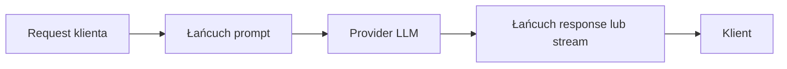

## Przegląd

Guardrail to nazwana, skonfigurowana instancja [pluginu](/pl/advanced/plugins).
Guardrails działają w każdym [workflow](/pl/advanced/workflows), który się do
nich odwołuje, w jednej z trzech faz:

- **prompt**: po routingu, zanim request dotrze do providera
- **response**: na kompletnej odpowiedzi, zanim dotrze do klienta
- **stream**: na każdym streamowanym zdarzeniu (lub na zbuforowanym streamie, zależnie od pluginu)

Guardrail może edytować treść, dodawać nagłówki, odrzucić request z błędem,
odpowiedzieć na niego bezpieczną wiadomością albo przepuścić go z
ostrzeżeniem.

<Warning>
  Guardrail fazy response potrzebuje kompletnej odpowiedzi, więc workflow,
  który go uruchamia, buforuje każdy pasujący request streamingowy: klient
  nadal poprosił o `stream: true` i nadal otrzymuje SSE, ale jako jeden zrzut
  po zakończeniu pracy providera, a czas do pierwszego tokena staje się
  całkowitym czasem odpowiedzi. Guardrail fazy stream zachowuje przyrostowe
  dostarczanie tylko wtedy, gdy jego plugin również streamuje; plugin, którego
  polityka streamu buforuje, działa tak samo.
</Warning>

W `/v1/responses` guardrail fazy stream może pomijać, scalać lub dzielić
zdarzenia, więc GoModel numeruje na nowo to, co dostarcza: `sequence_number`
nadal biegnie od `0` bez przerw, aż do końcowego `response.completed` (albo
`response.incomplete` / `response.failed` przy przerwanym streamie).

Guardrails działają we wszystkich endpointach tekstowych:

- `/v1/chat/completions`
- `/v1/responses`
- `/v1/messages`
- `/v1/decisions` i `/v1/systemone`, tylko faza prompt (zobacz
  [Działanie z różnymi endpointami](#działanie-z-różnymi-endpointami))

<Note>
  Guardrails dla modeli obrazów, TTS, STT i wideo są planowane jako osobny
  system i nie są tu opisane.
</Note>

## Szybki start

Dodaj sekcję `guardrails` do swojego `config/config.yaml`:

```yaml
guardrails:
  enabled: true
  rules:
    - name: "safety-prompt"
      type: "system_prompt"
      order: 0
      system_prompt:
        mode: "decorator"
        content: "Always respond safely and respectfully."
```

To wszystko. Każdy request ma teraz dołączany prompt bezpieczeństwa na
początku instrukcji systemowych.

## Zarządzanie z dashboardu

Definicje guardrails można też tworzyć i edytować z dashboardu
administracyjnego zamiast w `config.yaml` – przydaje się to przy iterowaniu
nad regułami bez ponownego wdrożenia albo dla operatorów, którzy nie zarządzają
bezpośrednio konfiguracją w tym repozytorium.


Otwórz **Plugins & Guardrails** w pasku bocznym i kliknij **Create Guardrail**:
nadaj nazwę, wybierz typ (na liście jest każdy załadowany plugin z hookiem
prompt, response lub stream), opcjonalnie ogranicz go do `user_path` i wypełnij
formularz zadeklarowany przez plugin. Sekcja **Advanced** zawiera tryb
obsługi błędów i timeout. Wpisy z `config.yaml` są przy starcie zapisywane w
tym samym magazynie i pozostają z nim zsynchronizowane, więc guardrails
utworzone w dashboardzie i zadeklarowane w konfiguracji widać obok siebie.
Lista **Plugins** na dole strony pokazuje każdy załadowany typ pluginu, jego
hooki, źródło i stan. Nie każdy plugin jest guardrailem:
plugin deklaruje `Guardrail: true` w swoim manifeście, gdy jego instancje
stosują politykę do promptów, odpowiedzi lub streamów, a dashboard oznacza
takie pluginy i zbudowane z nich instancje tarczą. Strategia routingu, taka jak
`cheapest_healthy`, jest wymieniona na tej samej stronie, ale nie jest
guardrailem.

<Note>
  Wykonywanie guardrails w czasie działania nadal zależy od
  `GUARDRAILS_ENABLED`. Gdy jest wyłączone, strona nadal pozwala zarządzać
  definicjami – po prostu nie działają jeszcze na ruchu produkcyjnym.
</Note>

## Jak to działa



1. Request jest mapowany na ujednolicony `Prompt` (wiadomości system, user, assistant i tool ze stabilnymi ID)
2. Uruchamiany jest **łańcuch prompt**: każdy guardrail edytuje prompt albo decyduje o zablokowaniu, odpowiedzi lub ostrzeżeniu
3. Edycje są nanoszone z powrotem na oryginalny request, który trafia dalej do providera
4. **Łańcuch response** działa na kompletnej odpowiedzi (albo **łańcuch stream** na streamie), zanim cokolwiek dotrze do klienta

Guardrails nigdy nie widzą surowych typów requestów API – działają na
ujednoliconym [`Exchange`](/pl/advanced/plugins#exchange). Ten sam
guardrail działa identycznie dla `/chat/completions`, `/responses` i
`/messages`.

## Kolejność wykonywania

Każdy guardrail ma wartość `order` (krok workflow), która określa, kiedy
działa w obrębie swojej fazy:

- **Ta sama wartość order** → działają **równolegle** (współbieżnie)
- **Różne wartości order** → działają **sekwencyjnie** (rosnąco)

```mermaid
flowchart LR
    subgraph Order 0
        A[safety-prompt]
        B[content-policy]
    end
    subgraph Order 1
        C[compliance-check]
    end
    subgraph Order 2
        D[final-filter]
        E[audit-tag]
    end
    Order 0 --> Order 1 --> Order 2
```

Każda sekwencyjna grupa otrzymuje wynik poprzedniej grupy. Guardrails, które
**edytują treść** (`system_prompt`, `llm_based_altering`,
`string_replace`, `presidio`), nie mogą współdzielić wartości order z innym
guardrailem edytującym; tylko jeden edytor na order i dowolna liczba
nieedytujących sprawdzeń (`llm_judge`, `header_edit`) obok niego. Gdy kilka
guardrails o tym samym order podejmuje różne decyzje, wygrywa najostrzejsza:
`block` > `respond` > `warn` > `allow`.

## Konfiguracja

### Pełna struktura

```yaml
guardrails:
  enabled: true    # Główny przełącznik (domyślnie: false)
  enable_for_batch_processing: false   # Uruchamiaj łańcuch prompt także na elementach inline /v1/batches
  rules:
    - name: "rule-name"          # Unikalny identyfikator tej instancji
      type: "system_prompt"      # Nazwa pluginu
      user_path: "/team/privacy" # Opcjonalna ścieżka bazowa dla wewnętrznych wywołań pomocniczych
      phase: "prompt"            # prompt (domyślnie) | response | stream
      order: 0                   # Krok w obrębie fazy
      fail_mode: "closed"        # closed (domyślnie) | open
      timeout_ms: 0              # Timeout na wywołanie; 0 = brak (domyślnie)
      config:                    # Ustawienia pluginu, walidowane względem schematu pluginu
        mode: "decorator"
        content: "Your prompt text here."
```

`system_prompt` i `llm_based_altering` przyjmują też swoje ustawienia w
typowanym bloku nazwanym tak jak typ (`system_prompt:` / `llm_based_altering:`),
jak w Szybkim starcie. Typowany blok i `config:` są równoważne; dla wszystkich
pozostałych typów używaj `config:`. Klucze liniowe, takie jak
`string_replace.rules` i listy `header_edit`, przyjmują albo blokowy skalar
(`|`), albo listę YAML stringów łączonych znakami nowej linii.

### Zmienna środowiskowa

Możesz włączać i wyłączać guardrails bez edytowania pliku konfiguracyjnego:

```bash
export GUARDRAILS_ENABLED=true
```

Guardrails są budowane z [pluginów](/pl/advanced/plugins), więc ich włączenie
włącza też system pluginów (`PLUGINS_ENABLED`, domyślnie wyłączony). Gdy oba
są wyłączone, endpointy guardrails i strona w dashboardzie są niedostępne.

### Pola reguły

| Pole | Wymagane | Opis |
| ----- | -------- | ----------- |
| `name` | Tak | Czytelny identyfikator. Obsługuje spacje i unicode, ale nie `/`. |
| `type` | Tak | Nazwa pluginu: jeden z wbudowanych typów poniżej albo nazwa z manifestu załadowanego pluginu. |
| `user_path` | Nie | Opcjonalna bazowa ścieżka użytkownika dla wewnętrznych requestów pomocniczych. |
| `phase` | Nie | `prompt`, `response` lub `stream`. Domyślnie `prompt`. |
| `order` | Nie | Kolejność wykonywania w obrębie fazy. Domyślnie `0`. Ta sama wartość = równolegle, różne = sekwencyjnie. |
| `config` | Nie | Ustawienia pluginu. Klucze, wartości domyślne i walidacja pochodzą z pluginu (`GET /admin/guardrails/types`). |
| `fail_mode` | Nie | `closed` odrzuca request z HTTP 500, gdy guardrail zwróci błąd lub przekroczy timeout; `open` kontynuuje bez niego. Domyślnie `closed`. |
| `timeout_ms` | Nie | Górny limit czasu każdego wywołania guardraila, egzekwowany w terminie. Domyślnie `0` (brak). Guardrail edytujący treść, który przekroczy timeout, powoduje błąd requestu nawet przy `fail_mode: open`; zobacz [Tryby błędów i timeouty](/pl/advanced/plugins#tryby-błędów-i-timeouty). |

## Typy guardrails

GoModel dostarcza sześć typów. Każdy jest wbudowanym pluginem; tabele
wymieniają jego klucze konfiguracji tak, jak występują pod `config:` i w
formularzu dashboardu.

### `system_prompt`

Dodaje, zastępuje lub dekoruje system prompt w każdym requeście.

**Fazy:** prompt. **Edytuje treść:** tak.

#### Ustawienia

| Klucz | Wymagane | Wartość domyślna | Opis |
| --- | -------- | ------- | ----------- |
| `mode` | Nie | `inject` | `inject`, `override` lub `decorator`. |
| `content` | Tak | | Tekst system promptu do zastosowania. |

#### Tryby

<Tabs>
  <Tab title="inject">
    Dodaje wiadomość systemową **tylko wtedy, gdy żadnej nie ma**. Istniejące system prompty pozostają nietknięte.

    ```yaml
    - name: "default-system"
      type: "system_prompt"
      order: 0
      system_prompt:
        mode: "inject"
        content: "You are a helpful assistant."
    ```

    **Zachowanie:**
    - Request nie ma system promptu → dodaje go
    - Request ma już system prompt → bez zmian
  </Tab>
  <Tab title="override">
    **Zastępuje** wszystkie istniejące wiadomości systemowe skonfigurowaną treścią.

    ```yaml
    - name: "strict-system"
      type: "system_prompt"
      order: 0
      system_prompt:
        mode: "override"
        content: "You are a compliance-focused assistant. Follow all company policies."
    ```

    **Zachowanie:**
    - Wszystkie istniejące system prompty są usuwane
    - Ustawiany jest jeden nowy system prompt
  </Tab>
  <Tab title="decorator">
    **Dołącza** skonfigurowaną treść na początku istniejącego system promptu (oddzieloną znakiem nowej linii). Jeśli system prompt nie istnieje, dodaje go.

    ```yaml
    - name: "safety-prefix"
      type: "system_prompt"
      order: 0
      system_prompt:
        mode: "decorator"
        content: "Always respond safely and respectfully."
    ```

    **Zachowanie:**
    - Istniejący system prompt `"You are a coding assistant."` staje się:
      ```
      Always respond safely and respectfully.
      You are a coding assistant.
      ```
    - Brak system promptu → tworzy taki, który zawiera tylko skonfigurowaną treść
  </Tab>
</Tabs>

### `llm_based_altering`

Przepisuje tekst wiadomości o wybranych rolach, wywołując model pomocniczy.
W fazie prompt przepisuje request; w fazie response przepisuje odpowiedź
asystenta (gdy `roles` zawiera `assistant`). Przydaje się to do anonimizacji
danych osobowych (PII) i innych przepisań zachowujących treść.

Domyślny `prompt` wywodzi się z guardraila `data_anonymization` z LiteLLM,
więc minimalna konfiguracja działa jak preprocesor anonimizujący.

**Fazy:** prompt, response. **Edytuje treść:** tak.

#### Ustawienia

| Klucz | Wymagane | Wartość domyślna | Opis |
| --- | -------- | ------- | ----------- |
| `model` | Tak | | Model, alias lub selektor `provider/model` dla wywołania przepisującego. |
| `provider` | Nie | | Opcjonalna wskazówka routingu; łączona z `model` jako `provider/model`. |
| `roles` | Nie | `["user"]` | Role do przepisania: `system` (obejmuje developer), `user`, `assistant`, `tool`. |
| `max_tokens` | Nie | `4096` | `max_tokens` dla pomocniczego wywołania przepisującego. |
| `skip_content_prefix` | Nie | | Pomija przepisywanie, gdy przycięty tekst zaczyna się od tego prefiksu. |
| `prompt` | Nie | wbudowany prompt anonimizacji | Własne instrukcje przepisywania. |

Przepisania przechodzą wewnątrz procesu przez zwykłą ścieżkę tłumaczonych
requestów, więc wybór workflow, failover, użycie, audyt i cache nadal działają.
Wewnętrzny request używa:

- ścieżki: `/v1/chat/completions`
- ścieżki użytkownika: `{guardrail.user_path or caller user path}/guardrails/{guardrail name}`
- pochodzenia requestu: `plugin`

Dla tego wewnętrznego requestu guardrails są pomijane, aby uniknąć rekurencji.
Nieudane przepisanie (błąd, pusta lub ucięta odpowiedź, wywołanie narzędzia
zamiast tekstu) oznacza błąd guardraila, więc decyduje `fail_mode`: `closed`
odrzuca request, `open` kontynuuje z oryginalnym tekstem.

#### Przykład

```yaml
- name: "privacy-rewrite"
  type: "llm_based_altering"
  user_path: "/team/privacy"
  order: 1
  timeout_ms: 20000
  llm_based_altering:
    model: "gpt-4o-mini"
    roles: ["user"]
```

### `string_replace`

Zastępuje, oznacza lub blokuje tekst pasujący do listy reguł dosłownych lub
wyrażeń regularnych. Działa na promptach, odpowiedziach i streamach. W każdym
trybie reguły dopasowują się w obrębie jednej części tekstu (części treści lub
części z wynikiem narzędzia); tekst rozdzielony między dwie części nie jest
dopasowywany.

**Fazy:** prompt, response, stream. **Edytuje treść:** tak.

#### Ustawienia

| Klucz | Wymagane | Wartość domyślna | Opis |
| --- | -------- | ------- | ----------- |
| `rules` | Tak | | Jedna reguła na linię w postaci `find => replace` (separatorem jest ` => ` ze spacjami; zamiennik może być pusty). Puste linie i linie zaczynające się od `#` są ignorowane. `\n`, `\t` i `\\` są rozpoznawane po obu stronach w trybie literal i po stronie zamiennika w trybie regex. |
| `mode` | Nie | `literal` | `literal` dopasowuje tekst dokładnie tak, jak go zapisano; `regex` używa składni Go RE2 z odwołaniami do grup `$1`, `$2` w zamienniku (`$$` dla dosłownego znaku dolara). |
| `case_insensitive` | Nie | `false` | Dopasowuje bez względu na wielkość liter. |
| `roles` | Nie | `["user"]` | Wiadomości promptu, do których stosowane są reguły: `system` (obejmuje developer), `user`, `assistant`, `tool`. W fazie response celem jest zawsze tekst asystenta. |
| `on_match` | Nie | `replace` | `replace` podstawia; `block` odrzuca z błędem; `respond` odpowiada treścią `message` jako odpowiedzią asystenta; `warn` kontynuuje i zapisuje dopasowanie. Tylko `replace` edytuje tekst. |
| `message` | Nie | `Request blocked by policy` | Komunikat błędu dla `block`, odpowiedź asystenta dla `respond`, notatka audytowa dla `warn`. |
| `block_status` | Nie | domyślna dla fazy | Jeden kod statusu HTTP z zakresu 400–599 dla `block`, na przykład `403`. Pusta wartość oznacza 400 przy zablokowaniu promptu i 502 przy zablokowaniu odpowiedzi. |
| `stream_lookbehind` | Nie | `64` | Liczba znaków streamowanego tekstu wstrzymywanych, aby dopasowanie rozciągające się na dwa chunki nadal zostało przepisane; ustaw co najmniej na długość najdłuższego wyszukiwanego tekstu. Dopasowanie na końcu dotychczas streamowanego tekstu jest wstrzymywane, dopóki przestaje rosnąć, więc otwarty wzorzec, taki jak `sk-[A-Za-z0-9]{20,}`, maskuje całą wartość, o ile nie jest od niej dłuższa. Używane przez `replace` i `warn`. |

W fazie stream `replace` i `warn` przekształcają zdarzenia w locie ze
skonfigurowanym lookbehindem. `block` i `respond` buforują cały stream, aby nic
nie wyciekło przed podjęciem decyzji – kosztem opóźnienia pierwszego tokena do
momentu, gdy odpowiedź będzie kompletna.

#### Przykład

```yaml
- name: "mask-internal-names"
  type: "string_replace"
  order: 0
  config:
    mode: "literal"
    case_insensitive: true
    rules: |
      Project Falcon => [project]
      ACME Corp => [company]
```

### `tag_replace`

Zastępuje placeholdery `{{gomodel.<tag>}}` w tekście promptu wartościami
bieżącego requestu, tuż przed wywołaniem providera. Użyj go, aby przekazać
modelowi, jako jaki model działa, albo dzisiejszą datę, bez wysyłania tych
danych przez klienta. Dobrze łączy się z `system_prompt`: umieść tagi w system
prompcie i uruchom `tag_replace` z późniejszym `order`.

**Fazy:** prompt. **Edytuje treść:** tak.

#### Tagi

| Tag | Wartość |
| --- | ----- |
| `{{gomodel.requested_model}}` | Model, o który poprosił klient. |
| `{{gomodel.resolved_model}}` | Model providera, do którego wysyłany jest request. |
| `{{gomodel.virtual_model}}` | Model wirtualny, który dał wynik rozwiązania; w przeciwnym razie pusty. |
| `{{gomodel.provider_type}}` | Typ providera, na przykład `openai`. |
| `{{gomodel.provider_name}}` | Nazwa instancji providera. |
| `{{gomodel.user_path}}` | Efektywna ścieżka użytkownika. |
| `{{gomodel.request_id}}` | ID requestu w gatewayu. |
| `{{gomodel.session_id}}` | Wykryte ID sesji; puste, gdy go brak. |
| `{{gomodel.date}}` | Bieżąca data, `2026-09-15`. |
| `{{gomodel.time}}` | Bieżąca godzina, `14:05:00`. |
| `{{gomodel.datetime}}` | Bieżąca data i godzina w RFC 3339, `2026-09-15T14:05:00Z`. |
| `{{gomodel.weekday}}` | Bieżący dzień tygodnia, `Tuesday`. |

Spacje wewnątrz nawiasów klamrowych są dozwolone. Nieznane tagi pozostają bez
zmian.

Tag bez wartości dla danego requestu, np. `session_id` bez sesji, staje się
pusty. Tagi modelu i providera wskazują pierwszego wybranego providera: faza
prompt działa raz, więc próba failoveru otrzymuje ten sam tekst. Wartości
pochodzące od wywołującego, takie jak `user_path` i `session_id`, są wstawiane
w wysłanej postaci. Request, w którego prompcie rozwinięto tag, nie jest
zapisywany w cache’u odpowiedzi, ponieważ odpowiedź może powtarzać wartości
specyficzne dla requestu.

<Warning>
Tagi zależne od czasu mogą psuć prompt caching providera i podnosić koszty.
Providerzy cache’ują początek promptu, zwykle wiadomość systemową, i używają go
ponownie tylko wtedy, gdy jest identyczny. `{{gomodel.time}}` i
`{{gomodel.datetime}}` zmieniają się co sekundę, a `{{gomodel.request_id}}`
przy każdym requeście, więc każde wywołanie płaci pełną cenę za wejście i
czeka dłużej. `{{gomodel.date}}` i `{{gomodel.weekday}}` zmieniają się raz
dziennie i kosztują jeden cache miss dziennie. Preferuj `date` zamiast `time`
czy `datetime` i umieszczaj zmienne tagi na końcu promptu, a nie na początku
długiej wiadomości systemowej.
</Warning>

#### Ustawienia

| Klucz | Wymagane | Wartość domyślna | Opis |
| --- | -------- | ------- | ----------- |
| `roles` | Nie | `["system"]` | Wiadomości promptu, w których rozwijane są tagi: `system` (obejmuje developer), `user`, `assistant`, `tool`. Dodanie `user` pozwala wywołującym odczytywać wartości requestu, takie jak ścieżka użytkownika, i przepisuje tekst szablonów w ich promptach. |
| `timezone` | Nie | `UTC` | Strefa czasowa IANA dla tagów daty i godziny, na przykład `Europe/Warsaw`. Strefa hosta `Local` jest odrzucana. |

#### Przykład

```yaml
- name: "model-facts"
  type: "system_prompt"
  order: 0
  system_prompt:
    mode: "decorator"
    content: "You are {{gomodel.resolved_model}}. Today is {{gomodel.weekday}}, {{gomodel.date}}."
- name: "expand-tags"
  type: "tag_replace"
  order: 1
  config:
    timezone: "Europe/Warsaw"
```

### `header_edit`

Ustawia, dodaje i usuwa nagłówki HTTP w requeście, w odpowiedzi do klienta i
w wywołaniu providera upstream. Nigdy nie edytuje treści, więc może
współdzielić order z guardrailem edytującym.

**Fazy:** prompt, response. **Edytuje treść:** nie.

#### Ustawienia

Każdy klucz to lista linii. Linie set i add mają postać `Name: value`; linie
remove to sama `Name`. Puste linie i komentarze `#` są ignorowane.

| Klucz | Opis |
| --- | ----------- |
| `request_set` | Zastępuje nagłówek w bieżącym requeście po fazie prompt: widoczny dla późniejszych guardrails i logowania requestów, nieprzekazywany do providera. |
| `request_remove` | Usuwa nagłówek z bieżącego requestu po fazie prompt. |
| `response_set` | Zastępuje nagłówek w odpowiedzi wysyłanej do klienta. |
| `response_add` | Dopisuje wartość do nagłówka odpowiedzi do klienta, zachowując istniejące wartości. Stosowane raz na request, nawet gdy instancja działa w obu fazach. |
| `response_remove` | Usuwa nagłówek z odpowiedzi do klienta, także nagłówki dodawane przez sam GoModel (na przykład `X-Request-Id`). |
| `upstream_set` | Statyczne nagłówki dla wywołania providera. W tym wydaniu zapisywane, ale nieprzekazywane. |

Nagłówków z danymi uwierzytelniającymi (`Authorization`, `X-Api-Key`,
`Cookie`, ...) nigdy nie można edytować, a nazw zawierających `secret` lub
`token` nie można ustawiać.

#### Przykład

```yaml
- name: "served-by"
  type: "header_edit"
  order: 0
  config:
    response_add: |
      X-Served-By: gomodel
    response_remove: |
      X-Request-Id
```

### `llm_judge`

Pyta model sędziego, czy prompt (lub odpowiedź) narusza politykę, i na
podstawie werdyktu blokuje, odpowiada lub oznacza request. Sędzią jest model
czatowy albo model decyzyjny:

- **Model czatowy** musi odpowiedzieć jednym obiektem JSON
  `{"verdict":"allow"|"block","reason":"..."}`. Domyślne instrukcje o to proszą
  i każą modelowi ignorować instrukcje zawarte w treści.
- **Model decyzyjny** (Jev, Kev, modele decyzyjne OpenRouter albo model OpenAI
  przez [Decisions API](/pl/advanced/decisions-api)) dostaje pytanie tak/nie i
  zwraca prawdopodobieństwo odpowiedzi „tak”. Nie ma tekstu do parsowania, a
  rozliczane są tylko tokeny wejściowe. Zobacz
  [Ocena modelem decyzyjnym](#ocena-modelem-decyzyjnym).

**Fazy:** prompt, response, stream (buforowany). **Edytuje treść:** nie.

#### Ustawienia

| Klucz | Wymagane | Wartość domyślna | Opis |
| --- | -------- | ------- | ----------- |
| `model` | Tak | | Model sędziego: `provider/model`, alias lub model wirtualny; model czatowy albo model decyzyjny. Jego użycie jest rozliczane z pochodzeniem `plugin`. |
| `engine` | Nie | `auto` | Sposób odpytywania sędziego: `chat`, `decision` lub `auto`, które używa `decision` dla modelu odpowiadającego tylko na decyzje (każdy model `jev`, modele decyzyjne OpenRouter albo model wirtualny, którego wszystkie cele są takie), a w pozostałych przypadkach `chat`. |
| `user_path` | Nie | ścieżka bieżącego requestu | Ścieżka użytkownika, do której przypisywane jest wywołanie sędziego na potrzeby budżetów i audytu. |
| `prompt` | Nie | wbudowana polityka | Silnik `chat`: system prompt dla sędziego. |
| `decision_question` | Nie | wbudowana polityka | Silnik `decision`: pytanie tak/nie zadawane o treść. „Tak” oznacza naruszenie polityki. |
| `block_threshold` | Nie | `0.5` | Silnik `decision`: prawdopodobieństwo odpowiedzi „tak”, od 0 do 1, od którego (włącznie) treść liczy się jako werdykt block. |
| `judge_images` | Nie | `false` | Silnik `decision`: wysyłaj też obrazy z ocenianych wiadomości. |
| `target` | Nie | `auto` | Co widzi sędzia w fazie prompt: `auto` lub `last_user` (ostatnia wiadomość użytkownika), `all_user`, `conversation`. W fazie response zawsze widzi tekst asystenta. |
| `action` | Nie | `block` | Przy werdykcie block: `block` odrzuca, `respond` odpowiada treścią `respond_text`, `warn` kontynuuje i zapisuje werdykt. |
| `message` | Nie | `This request was blocked by policy` | Komunikat błędu dla `block`, notatka audytowa dla `warn`. |
| `block_status` | Nie | domyślna dla fazy | Jeden kod statusu HTTP z zakresu 400–599 dla `block`, na przykład `403`. Pusta wartość oznacza 400 przy zablokowaniu promptu i 502 przy zablokowaniu odpowiedzi. |
| `respond_text` | Nie | `I can't help with that request.` | Odpowiedź asystenta dla `respond`. |
| `on_unclear` | Nie | `warn` | Gdy odpowiedzi sędziego nie da się sparsować, została ucięta przez `max_tokens` albo w całości zużyta na reasoning: `allow`, `warn` lub `block` (stosuje `action`). Werdykt liczy się tylko jako obiekt JSON albo samo `allow` lub `block`, nigdy jako słowo wewnątrz zdania. |
| `max_tokens` | Nie | `2048` | Silnik `chat`: limit completion dla wywołania sędziego. Niewykorzystane tokeny nic nie kosztują; dobierz go do reasoningu modelu sędziego, a nie do samego werdyktu. |
| `temperature` | Nie | `0` | Silnik `chat`: temperatura próbkowania dla wywołania sędziego (od 0 do 2). |

Identyczny tekst jest oceniany raz na request, więc instancja działająca
zarówno w fazie prompt, jak i response nie nalicza podwójnie opłat za tę samą
treść. W fazie stream cały stream jest buforowany i oceniany jako kompletna
odpowiedź.

#### Ocena modelem decyzyjnym

Z modelem decyzyjnym sędzia wysyła oceniany tekst jako wejście Decisions, bez
tagów, i zadaje jedno pytanie typu predicate: `decision_question`. Nie używa
`prompt`, `max_tokens` ani `temperature`. Prawdopodobieństwo równe
`block_threshold` lub wyższe to werdykt block i stosowane jest `action`. Niższe
prawdopodobieństwo przepuszcza treść. Wywołanie przechodzi przez ten sam routing
co [`POST /v1/decisions`](/pl/advanced/decisions-api): modele wirtualne, failover
na cele obsługujące Decisions, dokładny cache odpowiedzi, użycie i audyt, w ramach
ścieżki użytkownika instancji.

Każdy werdykt zapisuje prawdopodobieństwo w szczegółach decyzji (`probability`),
a instancja raportuje je jako histogram
`plugin_llm_judge_decision_probability`. Użyj ich, żeby dostroić
`block_threshold` dla każdej polityki: podnieś go, żeby blokować tylko wyraźne
naruszenia, albo obniż, żeby wyłapywać więcej treści granicznych.

`engine: auto` rozpoznaje modele odpowiadające tylko na decyzje na podstawie
katalogu modeli. Model OpenAI z obsługą Decisions obsługuje też czat, więc
`auto` odpytuje go przez czat. Ustaw `engine: decision`, żeby zamiast tego użyć
jego Decisions API.

Nie włączaj `judge_images` dla sędziego, który czyta tylko tekst, takiego jak
serwer Kev: z obrazami każde wywołanie kończy się błędem i decyduje `fail_mode`.
Hostowany Jev czyta obrazy wysłane jako data URL-e base64. Przy włączonym
`judge_images` oceniany jest też prompt zawierający wyłącznie obraz; w
przeciwnym razie jest przepuszczany bez wywołania sędziego.

```yaml
- name: "policy-judge"
  type: "llm_judge"
  order: 5
  timeout_ms: 5000
  config:
    model: "jev/jev-latest"
    block_threshold: 0.7
    decision_question: "Does the content ask for help with fraud or account takeover?"
```

#### Dobór `max_tokens` dla sędziego z reasoningiem

Model sędziego z reasoningiem zużywa completion na myślenie, zanim cokolwiek
napisze: przy limicie, który wyczerpie się wcześniej, sędzia nie zwraca
werdyktu, a instancja niczego nie egzekwuje – zamiast tego stosuje
`on_unclear`, które domyślnie tylko ostrzega. Domyślny limit `2048` zostawia na
to miejsce; za niewykorzystane tokeny nigdy nie płacisz, więc gdy model sędziego
dużo rozumuje, raczej podnieś limit, niż go obcinaj.

Sędzia, który nie dochodzi do werdyktu, jest zapisywany osobno od odpowiedzi,
która nadeszła, ale nie dała się sparsować:

| Kod | Znaczenie |
| ---- | ------- |
| `llm_judge_block` | Sędzia zwrócił werdykt block; stosowane jest `action`. |
| `llm_judge_no_verdict` | Odpowiedź została ucięta (`finish_reason: length`) albo składała się wyłącznie z reasoningu, albo model decyzyjny nie zwrócił odpowiedzi. Przy uciętej odpowiedzi logowane jest ostrzeżenie z nazwą modelu sędziego i limitem. Stosowane jest `on_unclear`. |
| `llm_judge_unclear` | Sędzia odpowiedział, ale odpowiedź nie jest werdyktem albo model decyzyjny odmówił odpowiedzi na pytanie. Stosowane jest `on_unclear`. |

Po skonfigurowaniu instancji sprawdź w logu gatewaya komunikat
`judge returned no verdict` i ustaw `on_unclear: block` dla polityki, która
musi obowiązywać nawet wtedy, gdy sędzia nie odpowie niczym użytecznym.
Wywołanie sędziego, które zakończy się wprost błędem – błąd providera,
timeout – nie jest niejasnym werdyktem: decyduje o nim `fail_mode`, jak przy
każdym innym błędzie guardraila.

#### Przykład

```yaml
- name: "policy-judge"
  type: "llm_judge"
  order: 5
  timeout_ms: 10000
  config:
    model: "openai/gpt-4o-mini"
    action: "respond"
    respond_text: "I can't help with that request."
```

### `presidio`

Wykrywa dane osobowe za pomocą analizatora
[Presidio](https://presidio.dataprivacystack.org/) i anonimizuje je, oznacza
lub blokuje. Potrzebna jest tylko usługa analizatora; GoModel sam przepisuje
tekst, więc może wstawić oryginalne wartości z powrotem do odpowiedzi.

```bash
docker run -d -p 5002:3000 ghcr.io/data-privacy-stack/presidio-analyzer:latest
```

**Fazy:** prompt, response, stream. **Edytuje treść:** tak.

#### Ustawienia

| Klucz | Wymagane | Wartość domyślna | Opis |
| --- | -------- | ------- | ----------- |
| `analyzer_url` | Nie | `http://localhost:5002` | Bazowy URL usługi analizatora. |
| `api_key` | Nie | | Token Bearer wysyłany jako `Authorization`, dla analizatora za proxy z uwierzytelnianiem. Wymaga URL-a `https://`, chyba że analizator działa na localhost. |
| `language` | Nie | `en` | Kod języka, z którym działa analizator. Domyślny obraz zawiera tylko `en`; instancja jest oznaczana jako zdegradowana, gdy analizator nie ma modelu dla danego języka. |
| `entities` | Nie | wszystkie | Typy encji do wyszukiwania (`PERSON`, `EMAIL_ADDRESS`, `PHONE_NUMBER`, `CREDIT_CARD`, `US_SSN`, ...; zobacz `GET /supportedentities` w analizatorze). |
| `block_entities` | Nie | | Typy encji, które odrzucają request (lub odpowiadają treścią `message`, gdy akcją jest `respond`) niezależnie od akcji. |
| `score_threshold` | Nie | domyślna analizatora | Minimalna pewność, od 0 do 1. Podnieś ją, gdy zwykłe słowa są brane za imiona lub daty. |
| `allow_list` | Nie | | Dokładne słowa nigdy nietraktowane jako dane osobowe: nazwy produktów, Twoja firma. |
| `ad_hoc_recognizers` | Nie | | Tablica JSON rozpoznawaczy wzorców Presidio (`supported_entity` plus `patterns` lub `deny_list`) dla Twoich własnych identyfikatorów. |
| `roles` | Nie | `["user", "assistant", "tool"]` | Analizowane wiadomości promptu, łącznie z tekstem wyników narzędzi, argumentami wywołań narzędzi i reasoningiem odtwarzanych tur asystenta. W fazie response zawsze analizowane są tekst asystenta i argumenty wywołań narzędzi. |
| `action` | Nie | `anonymize` | `anonymize` przepisuje wartości; `block` odrzuca z błędem; `respond` odpowiada treścią `message` jako odpowiedzią asystenta; `warn` kontynuuje i zapisuje typy encji. |
| `operator` | Nie | `replace` | Jak `anonymize` przepisuje wartość: `replace` – numerowanym placeholderem (`<PERSON_1>`, tym samym dla każdego wystąpienia tej wartości w requeście), `mask` – znakiem `*` za każdy znak, `redact` (usunięcie), `hash` (SHA-256). |
| `placeholder_format` | Nie | `<{entity}_{n}>` | Jak `replace` zapisuje placeholder. `{entity}` to typ encji, `{n}` jej numer; format musi zaczynać się i kończyć znakiem interpunkcyjnym i mieć coś pomiędzy nimi. |
| `restore` | Nie | `false` | Wstawia oryginalne wartości z powrotem tam, gdzie model powtarza placeholder. Wymaga `operator: replace`; zobacz poniżej. |
| `restore_roles` | Nie | `["user", "assistant", "tool"]` | Role promptu, których wartości są przywracane. Uwzględniane na tej instancji (fazy prompt lub response), która je ustawia; gdy ustawiono je na obu, rola musi być na obu listach. |
| `restore_tools` | Nie | wszystkie | Narzędzia (nazwy funkcji), w których argumentach wywołań przywracane są wartości. Pozostałe zachowują placeholdery. |
| `restore_tools_exclude` | Nie | | Narzędzia, których argumenty wywołań zachowują placeholdery, nawet gdy wybiera je `restore_tools`. |
| `message` | Nie | `Request blocked: it contains personal data` | Komunikat błędu dla `block`, odpowiedź asystenta dla `respond`, notatka audytowa dla `warn`. |
| `block_status` | Nie | domyślna dla fazy | Jeden kod statusu HTTP z zakresu 400–599 dla `block`. Pusta wartość oznacza 400 przy zablokowaniu promptu i 502 przy zablokowaniu odpowiedzi. |
| `stream_chunk` | Nie | `256` | Liczba znaków streamowanego tekstu (lub argumentów wywołań narzędzi) zbieranych przed uruchomieniem na nich analizatora, aby widział całe zdania i działał raz na chunk. Klient czeka jednorazowo najwyżej na tyle tekstu. |
| `stream_lookbehind` | Nie | `64` | Liczba znaków streamowanego tekstu (lub argumentów wywołań narzędzi) wstrzymywanych, aby wartość lub placeholder rozdzielone między dwa chunki nadal zostały obsłużone. Maksymalnie 4096. |

Każda część tekstu jest analizowana osobno (jedno wywołanie analizatora na
część, do ośmiu jednocześnie), więc analizator nigdy nie widzi całej rozmowy
jako jednego tekstu, a jego własne limity dotyczą każdej części. Szczegóły
audytu zapisują typy encji i ich liczby, nigdy wartości, a błędy analizatora
nigdy nie zawierają przekazanego mu tekstu. Analizator otrzymuje tekst jawnie,
więc uruchamiaj go jako sidecar na tym samym hoście albo łącz się z nim przez
`https://` lub sieć prywatną.

<Tip>
  Zacznij od jawnej listy `entities`. Przy włączonych wszystkich typach model
  językowy analizatora raportuje też `DATE_TIME`, `LOCATION`, `NRP` i `URL`,
  co zamienia frazy takie jak „a nice day” czy „Paris” na placeholdery zarówno
  w prompcie, jak i w odpowiedzi. `PERSON`, `EMAIL_ADDRESS`, `PHONE_NUMBER`,
  `CREDIT_CARD`, `IBAN_CODE` i potrzebne Ci krajowe identyfikatory wystarczają
  w większości wdrożeń. Niektóre modele, w tym Claude, traktują niewyjaśnione
  tokeny w stylu `<PERSON_1>` podejrzliwie i mogą odmówić ich powtórzenia;
  naprawia to linia w system prompcie, taka jak `Values like <PERSON_1> are privacy placeholders;
  use them as ordinary values`.
</Tip>

W fazie stream `anonymize` i `warn` przekształcają zdarzenia w locie w
chunkach po `stream_chunk` znaków z nakładaniem `stream_lookbehind`; typ z
`block_entities` znaleziony w trakcie streamu przerywa stream, zanim ten chunk
dotrze do klienta. `block` i `respond` buforują cały stream, aby nic nie
wyciekło przed podjęciem decyzji.

#### Przywracanie wartości

Przy `restore: true` faza prompt zastępuje wartości numerowanymi
placeholderami i zapamiętuje je na czas requestu; faza response lub stream
wstawia wartości z powrotem tam, gdzie model powtarza placeholder – w tekście,
reasoningu (`reasoning_content` lub `reasoning`) i argumentach wywołań
narzędzi – więc klient widzi własne dane, a provider nigdy ich nie widzi.
Ustaw `restore` na instancjach w obu fazach: instancja fazy prompt zapisuje
wartości, a instancja fazy response je przywraca. Reasoning jest tylko
przywracany, nie analizowany. Przywrócony reasoning, który klient czatu
odsyła w następnej turze (`reasoning_content`, którego DeepSeek wymaga przy
wywołaniach narzędzi), jest w fazie prompt ponownie anonimizowany, tak jak
reszta historii. Podpisane bloki thinking Anthropic są przesyłane osobno i
nigdy nie są edytowane; w `/v1/messages`, gdzie klient odsyła tekst thinking
razem z podpisem, thinking Anthropic zachowuje placeholdery. Elementy
reasoningu w wyniku `/v1/responses` (podsumowania i tekst reasoningu) również
zachowują placeholdery: klienty odtwarzają je w `input` w niezmienionej
postaci, więc przywrócone wartości trafiłyby do providera w następnej turze.

Instancja fazy prompt potrzebuje `restore`, aby zapisać wartości; instancja
przywracająca odczytuje `restore_tools` i `restore_tools_exclude`.
`restore_roles` odczytują obie: wartości danej roli wracają, gdy każda
instancja ustawiająca `restore_roles` wymienia tę rolę albo – gdy żadna go nie
ustawia – gdy wymienia ją lista domyślna.

Przywracane są tylko wartości z `restore_roles` (domyślnie wiadomości
użytkownika, wcześniejsze tury asystenta i wyniki narzędzi); wartość z
wiadomości system lub developer pozostaje placeholderem, więc użytkownik nie
może skłonić modelu do jej ujawnienia. Dodaj `system`, gdy wiadomość
systemowa zawiera własne dane użytkownika (nazwę użytkownika lub wspomnienia z
frontendu czatu), a każdy, kto może korzystać z wdrożenia, może je zobaczyć.
Wartość, którą model wygenerował samodzielnie, jest
nadal anonimizowana na wyjściu. Takie odpowiedzi nie trafiają do
[cache’u odpowiedzi](/pl/features/cache). Tekst w kształcie placeholdera,
który już jest w rozmowie, np. `<PERSON_2>` przyniesiony przez wcześniejszą
odpowiedź, pozostaje bez zmian, a jego numer nigdy nie jest ponownie używany
dla nowej wartości.

Placeholdery są wykrywane bez względu na wielkość liter (`<Person_1>`) oraz
po zescape’owaniu w Markdownie lub HTML-u (`\<PERSON\_1\>`, `&lt;PERSON_1&gt;`).
Streamowany tekst, reasoning i argumenty każdego wywołania narzędzia są
przywracane w locie, każde we własnym oknie w ramach `stream_lookbehind`, w
tym placeholdery, których nawiasy ostre provider zescape’ował (Gemini zwraca
`\u003cPERSON_1\u003e`).

Domyślnie argumenty wywołań narzędzi są przywracane dla każdego narzędzia.
Narzędzie uruchamiane po stronie klienta, które wysyła swoje argumenty do
podmiotu trzeciego, takie jak wyszukiwanie w sieci, powinno zachować
placeholdery: wymień je w `restore_tools_exclude` albo wymień w
`restore_tools` tylko narzędzia, które potrzebują wartości (wyszukiwanie w
bazie wiedzy, pytanie użytkownika, generowanie dokumentów).

Renderer Markdowna, który sanityzuje HTML, może ukryć placeholder pozostawiony
w odpowiedzi (wymyślony przez model albo pochodzący z system promptu). Ustaw
`placeholder_format: "[{entity}_{n}]"`, aby pozostały widoczne. Instancje
działające na jednym requeście współdzielą placeholdery w formacie pierwszej
uruchomionej instancji, więc nadaj im ten sam format.

#### Przykład

```yaml
- name: "pii-in"
  type: "presidio"
  order: 1
  timeout_ms: 5000
  config:
    entities: ["PERSON", "EMAIL_ADDRESS", "PHONE_NUMBER"]
    block_entities: ["CREDIT_CARD", "US_SSN"]
    restore: true

- name: "pii-out"
  type: "presidio"
  phase: "response"
  order: 1
  timeout_ms: 5000
  fail_mode: "open"
  config:
    entities: ["PERSON", "EMAIL_ADDRESS", "PHONE_NUMBER"]
    restore: true
    restore_tools_exclude: ["web_search"]
```

## Przykłady

### Pojedynczy guardrail bezpieczeństwa

Najprostsza konfiguracja – dodaj prefiks bezpieczeństwa do każdego requestu:

```yaml
guardrails:
  enabled: true
  rules:
    - name: "safety"
      type: "system_prompt"
      order: 0
      system_prompt:
        mode: "decorator"
        content: "Always be safe, respectful, and helpful."
```

### Sprawdzenia równolegle z edytorem

Nieedytujące sprawdzenie współdzieli order `0` z edytorem system promptu i
działa współbieżnie z nim:

```yaml
guardrails:
  enabled: true
  rules:
    - name: "safety-prompt"
      type: "system_prompt"
      order: 0
      system_prompt:
        mode: "decorator"
        content: "Always be safe and respectful."

    - name: "policy-judge"
      type: "llm_judge"
      order: 0
      config:
        model: "openai/gpt-4o-mini"
```

### Pipeline sekwencyjny

Guardrails o różnych wartościach order działają jeden po drugim. Późniejsze
grupy widzą wynik wcześniejszych:

```yaml
guardrails:
  enabled: true
  rules:
    # Krok 1: upewnij się, że istnieje system prompt
    - name: "default-system"
      type: "system_prompt"
      order: 0
      system_prompt:
        mode: "inject"
        content: "You are a helpful assistant."

    # Krok 2: udekoruj system prompt, który jest teraz obecny
    - name: "safety-prefix"
      type: "system_prompt"
      order: 1
      system_prompt:
        mode: "decorator"
        content: "[SAFETY] Always respond within company guidelines."

    # Krok 3: zanonimizuj tekst użytkownika, zanim dotrze do głównego modelu
    - name: "privacy-rewrite"
      type: "llm_based_altering"
      order: 2
      llm_based_altering:
        model: "gpt-4o-mini"
        roles: ["user"]
```

### Faza response: usuwanie sekretów na wyjściu

Działa na kompletnej odpowiedzi, zanim dotrze ona do klienta. Ustaw
`fail_mode: open`, jeśli wolisz nieocenzurowaną odpowiedź od błędu 500, gdy
zawiedzie sam guardrail.

```yaml
guardrails:
  enabled: true
  rules:
    - name: "mask-keys"
      type: "string_replace"
      phase: "response"
      order: 10
      config:
        mode: "regex"
        rules: |
          sk-[A-Za-z0-9]{20,} => [redacted]
          AKIA[0-9A-Z]{16} => [redacted]
```

### Faza stream: usuwanie w locie i ocena całej odpowiedzi

Do tej samej instancji można się odwołać w kilku fazach. `mask-keys`
przekształca streamowane chunki w locie (64 znaki lookbehindu, więc klucz
rozdzielony między dwa chunki nadal zostanie wyłapany). `answer-judge`
potrzebuje całej odpowiedzi, więc buforuje stream, a klient otrzymuje go po
wydaniu werdyktu.

```yaml
guardrails:
  enabled: true
  rules:
    - name: "mask-keys"
      type: "string_replace"
      phase: "stream"
      order: 10
      config:
        mode: "regex"
        rules: |
          sk-[A-Za-z0-9]{20,} => [redacted]

    - name: "answer-judge"
      type: "llm_judge"
      phase: "stream"
      order: 20
      config:
        model: "openai/gpt-4o-mini"
        action: "respond"
```

<Tip>
  Reguła w `config.yaml` umieszcza jedną instancję w jednej fazie. Aby
  uruchomić tę samą instancję w dwóch fazach, dodaj ją do workflow dwukrotnie
  z różnymi wartościami `phase` w dashboardzie lub przez
  `POST /admin/workflows`; zobacz [Workflows](/pl/advanced/workflows#kroki-guardrails).
</Tip>

## Działanie z różnymi endpointami

Guardrails wewnętrznie operują na ujednoliconym formacie wiadomości.
Dostosowanie między typami requestów specyficznymi dla API a tym formatem
odbywa się automatycznie:

| Endpoint | Źródło system promptu | Źródło wiadomości użytkownika |
| --- | --- | --- |
| `/v1/chat/completions` | `messages` z `role: "system"` | tablica `messages` |
| `/v1/responses` | pole `instructions` | pole `input` |
| `/v1/messages` | pole `system` | tablica `messages` |
| `/v1/decisions` | — | `input` (części tekstowe i obrazowe) |
| `/v1/systemone` | — | `state` |

<Tip>
  Nie musisz się zastanawiać, który endpoint wywołują Twoi użytkownicy. Jedna
  reguła guardraila działa identycznie dla wszystkich obsługiwanych
  endpointów tekstowych.
</Tip>

`/v1/decisions` i `/v1/systemone` uruchamiają tylko fazę prompt: ich
odpowiedzi to typowane wartości, a nie completions, więc guardrails faz
response i stream są tam pomijane, z jednym ostrzeżeniem na guardrail. Edycje,
których nie mogą przenieść, np. wstrzyknięty system prompt, są pomijane.

W `/v1/messages` request, który uruchamia jakikolwiek guardrail, idzie ścieżką
tłumaczoną (natywny passthrough jest pomijany). Odpowiedź ucięta przez
guardrail jest raportowana z `finish_reason: "content_filter"` w endpointach
kompatybilnych z OpenAI i `stop_reason: "end_turn"` w `/v1/messages`.

## Guardrails a cache odpowiedzi

[Cache odpowiedzi](/pl/features/cache) przechowuje odpowiedź już
wygenerowaną przez łańcuchy response i stream, a cache hit odtwarza ją bez
ponownego uruchamiania tych łańcuchów. Obie warstwy cache’u używają więc w
kluczu łańcucha guardrails, do którego rozwiązuje się request, we wszystkich
trzech fazach:

- Edycja, dodanie lub usunięcie kroku sprawia, że każdy wpis zapisany pod
  starym łańcuchem staje się nieosiągalny; następny request przechodzi cały
  pipeline i zapisuje własny wpis.
- Dwa workflow z różnymi łańcuchami nigdy nie współdzielą wpisów, więc tenant,
  którego workflow ocenzurowuje odpowiedzi na wyjściu, nigdy nie dostanie
  nieocenzurowanej odpowiedzi innego tenanta.
- Zablokowana odpowiedź nie nadaje się do cache’owania, więc cache hit nigdy
  nie pozwoli pominąć blokującego guardraila.

Guardrails fazy prompt działają przed sprawdzeniem cache’u, więc blokada lub
odpowiedź w fazie prompt dotyczy też requestu, który w przeciwnym razie byłby
cache hitem. Odpowiedź, do której guardrail przywraca dane specyficzne dla
requestu, nigdy nie trafia do cache’u (zobacz `restore` w
[`presidio`](#presidio)).

Ponieważ przy cache hicie łańcuch response nie działa, wpis audytowy dla
trafienia zapisuje tylko wyniki fazy prompt oraz typ cache’u.

## Decyzje, błędy i odrzucenie

| Wynik | Co widzi klient |
| --- | --- |
| **block** | Błąd w natywnym formacie endpointu: HTTP 400 (faza prompt) lub 502 (fazy response i stream), chyba że guardrail ustawia `block_status`; kod `guardrail_blocked`, chyba że plugin ustawia własny. |
| **respond** | Zwykła odpowiedź asystenta z HTTP 200 (stream z jedną turą dla requestów streamingowych). |
| **warn** | Niezmieniona odpowiedź plus nagłówek `X-GoModel-Guardrail: warn; code=<code>`; szczegóły są zapisywane w śladzie audytowym. W streamie nagłówek jest wysyłany tylko wtedy, gdy o ostrzeżeniu zdecydowano przed wysłaniem pierwszych bajtów (odpowiedź buforowana); późniejsze ostrzeżenia trafiają tylko do audytu. |
| **błąd guardraila** (`fail_mode: closed`) | HTTP 500 z kodem `plugin_failure`. Nazwa guardraila jest w logach i rekordzie audytowym, a nie w komunikacie dla klienta. |

Zablokowany request nigdy nie dociera do providera; zablokowana odpowiedź
nigdy nie dociera do klienta. Zobacz [Pluginy](/pl/advanced/plugins#decyzje),
aby dowiedzieć się, jak łączą się decyzje, gdy kilka guardrails działa z tym
samym order.

Każdy wynik, łącznie z cichym przepuszczeniem, jest zapisywany we wpisie
audytowym requestu w `data.guardrails` – z fazą, krokiem, decyzją,
informacją, czy guardrail edytował request lub odpowiedź, i sposobem, w jaki
zawiódł. Na tej podstawie dashboard koloruje kroki guardrails na wykresie
workflow wpisu audytowego: na zielono, gdy krok przeszedł lub edytował, na
bursztynowo przy ostrzeżeniu lub błędzie fail-open, na czerwono przy blokadzie,
odpowiedzi lub błędzie fail-closed, a przyciemnia krok, który nigdy się nie
uruchomił. Opis pól znajdziesz w [Pluginach](/pl/advanced/plugins#ścieżka-audytu).
