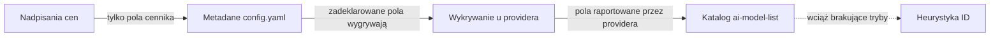

Każdy model w katalogu ma metadane – cennik, okno kontekstu, maksymalną liczbę tokenów
wyjściowych, możliwości i tryby (które decydują, czy pojawia się jako model czatu,
embeddingów, obrazów czy audio). GoModel składa je z pięciu źródeł,
od najsilniejszego:



## Źródła

1. **Nadpisania cen** – ustawiane dla każdego modelu na stronie **Models** w dashboardzie.
   Najwyższa warstwa, ale tylko dla pól cennika; nieustawione typy cen nadal są dziedziczone.
   Zobacz [Śledzenie kosztów](/pl/features/cost-tracking).
2. **Metadane w `config.yaml`** – wpisy `providers.<name>.models` mogą dołączać
   `metadata` (`pricing`, `context_window`, `modes`, `capabilities`, …). Zadeklarowane
   pola wygrywają pole po polu ze wszystkim poniżej; pominięte pola są dziedziczone. To
   furtka dla modeli lokalnych: zadeklarowanie `modes: [embedding]` wyznacza też
   kategorię modelu.
3. **Wykrywanie u providera** – większość providerów opisuje swoje modele na własnych
   listach, a to, co provider mówi o własnym wdrożeniu, wygrywa z
   katalogiem pole po polu: nazwa wyświetlana, limity tokenów i flagi możliwości
   Anthropic; nazwa wyświetlana, opis, limity tokenów i obsługa thinking w Gemini
   (także w Vertex); okno kontekstu, limit wyjścia, modalności, funkcje i ceny w Groq;
   okno kontekstu, ceny (z progiem długiego kontekstu) i obsługa reasoningu w xAI;
   rodzaj modelu, okno kontekstu i flagi funkcji w Fireworks; nazwa, opis, modalności,
   obsługiwane parametry i ceny w OpenRouter; endpointy, długość kontekstu i funkcje
   w Cohere; nazwa wyświetlana, modalności i obsługa streamingu w Bedrock;
   długość kontekstu, maksymalne wyjście, funkcje i ceny w Chutes; możliwości,
   rodzina i długość kontekstu z `/api/show` w Ollama; `max_model_len` w vLLM, SGLang
   i llm-d; oraz okno kontekstu i modalności w llama.cpp
   (zobacz [llama.cpp](/pl/providers/llamacpp)). Nazwy możliwości są mapowane na
   słownictwo katalogu (`function_calling`, `vision`, `reasoning`, ...),
   dzięki czemu obie warstwy opisują jedną funkcję pod jednym kluczem. Ma to największe
   znaczenie dla serwerów self-hosted, gdzie działający proces jest jedynym źródłem,
   które może znać rzeczywiste okno kontekstu. Modele zadeklarowane przez skonfigurowane
   listy modeli pomijają ten krok.
4. **Katalog modeli** – rejestr
   [`ai-model-list`](https://github.com/ENTERPILOT/ai-model-list),
   pobierany z `MODEL_LIST_URL` (domyślnie: `models.min.json` rejestru na
   GitHubie) przy starcie i przy każdym odświeżeniu katalogu. Dostarcza bogate
   wartości domyślne – cennik, okna kontekstu, możliwości, tryby – dla większości
   hostowanych modeli, dopasowując ID bezpośrednio, przez aliasy i po usunięciu
   sufiksów z datą wydania, oraz uzupełnia każde pole, którego provider powyżej nie
   zaraportował. Modalności wejściowe liczą się jako możliwości: wpis akceptujący `image`
   deklaruje `vision` (analogicznie `audio_input`, `video_input`, `pdf_input`),
   chyba że jego możliwości ustawiają ten klucz jawnie. Błędne lub brakujące dane najlepiej
   poprawić, wnosząc zmianę do rejestru; do natychmiastowej poprawki użyj nadpisania.
5. **Heurystyka ID** – sprawdzenie nazwy w ostateczności dla modeli, które w ogóle
   nie mają trybów (typowe dla llama.cpp i LM Studio): ID zawierające `embed` lub
   pasujące do znanych rodzin embeddingów (`bge`, `e5`, `gte`, `minilm`) stają się
   modelami embeddingów, a ID zawierające `rerank` – modelami rerankingu. ID z przestrzenią
   nazw są dopasowywane po ostatnim segmencie ścieżki. W razie wątpliwości heurystyka
   niczego nie przypisuje.

## Sprawdzanie, skąd pochodzi wartość

Rozwiń wiersz na stronie **Models** w dashboardzie, aby zobaczyć efektywne
metadane modelu wraz z warstwą, która dostarczyła każde pole, i przełącz panel na
**Provider**, **Catalog** lub **Config**, aby zobaczyć pojedynczą warstwę. Te same
dane zwraca
[`GET /admin/models/metadata`](/pl/advanced/admin-endpoints#get-/admin/models/metadata).

## Na co wpływają metadane

- **Cennik** napędza [śledzenie kosztów](/pl/features/cost-tracking), budżety i
  load balancing `cost`. Każde wycenione pole pamięta swoje źródło, więc
  dashboard może pokazać, skąd pochodzi stawka.
- **Tryby i kategorie** wpływają tylko na grupowanie w dashboardzie – routing nigdy
  nie jest przez nie blokowany, więc `/v1/embeddings` dociera do każdego modelu
  obsługiwanego przez providera.
- **Okno kontekstu i możliwości** są publikowane w `GET /v1/models` (oraz
  w `GET /v1/models/{model}` dla pojedynczego modelu) dla klientów, które wybierają modele
  dynamicznie.

## Zachowanie offline

Jeśli pobranie katalogu się nie powiedzie albo wdrożenie jest odcięte od sieci (air-gapped),
gateway działa normalnie – brakuje tylko wartości domyślnych z katalogu (w tym cen
z katalogu). Nadpisania cen, metadane z `config.yaml`, sygnały z wykrywania u providera
i heurystyka ID nadal obowiązują.

`MODEL_LIST_URL` przyjmuje zarówno lokalny plik, jak i URL HTTP:

```bash
MODEL_LIST_URL=/etc/gomodel/models.json          # sama ścieżka
MODEL_LIST_URL=file:///etc/gomodel/models.json   # URL pliku
```

Plik jest odczytywany przy starcie i przy każdym odświeżeniu cache'u, a parsowany ponownie
tylko wtedy, gdy zmieni się jego zawartość, więc możesz aktualizować cennik, podmieniając plik.
Ponieważ plik nie wymaga requestu sieciowego, działa również przy
`GOMODEL_OFFLINE=true`, które pomija URL-e katalogu HTTP. Ustaw `MODEL_LIST_URL=off`,
aby całkowicie wyłączyć katalog i deklarować metadane w `config.yaml`; pełną listę
kontrolną dla środowisk air-gapped znajdziesz w
[przewodniku produkcyjnym](/pl/guides/production#wdrożenia-air-gapped-i-offline).
