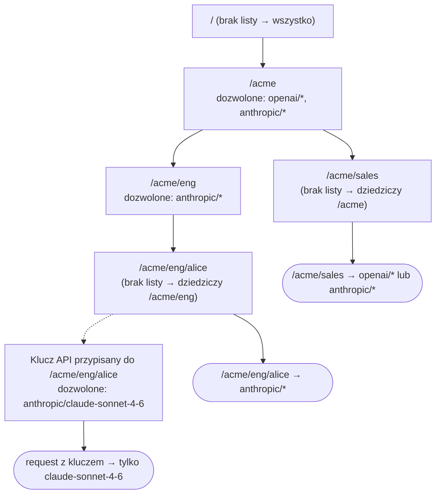
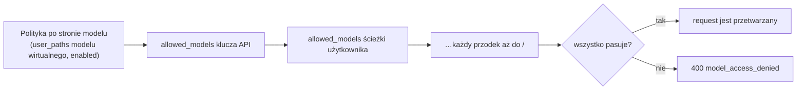

## Przegląd

Strona **Users** zamienia hierarchię [`user_path`](/pl/features/user-path)
stojącą za Twoimi kluczami API w drzewo grup i użytkowników i pozwala każdemu węzłowi
ograniczyć, z których modeli mogą korzystać requesty pod nim:

- `/acme` i `/acme/eng` to **grupy** – zawierają inne ścieżki.
- `/acme/eng/alice` to **użytkownik** – klucze API są przypisane bezpośrednio do niego.

Niczego nie trzeba tworzyć z góry. Drzewo powstaje na podstawie ścieżek użytkownika
istniejących kluczy API; dodaj politykę do węzła tylko wtedy, gdy chcesz go ograniczyć.

## Reguły

1. **Nowe klucze i węzły pozwalają na wszystko.** Węzeł lub klucz bez
   `allowed_models` nie nakłada żadnego własnego ograniczenia.
2. **Wypisanie modeli ogranicza.** Gdy węzeł wypisze modele, requesty pod nim
   mogą korzystać tylko z modeli pasujących do tej listy.
3. **Listy przecinają się w dół drzewa.** Request musi spełniać listę dozwolonych modeli
   swojego klucza API, swojej ścieżki użytkownika i każdego przodka aż do `/`. Węzeł podrzędny
   może zawęzić to, na co pozwala jego grupa, ale nigdy tego nie poszerzy.
4. Reguły po stronie modeli nadal obowiązują. [Polityka dostępu modelu wirtualnego](/pl/features/virtual-models),
   która ukrywa model przed poddrzewem, nadal go ukrywa.

`GET /v1/models` zwraca tylko modele, z których wywołujący może korzystać, więc klienci widzą
ten sam obraz, który egzekwuje gateway.

Requesty uwierzytelnione w inny sposób podlegają tym samym regułom ścieżek: sesja
[OIDC SSO](/pl/pro/sso) lub request zawierający tylko
nagłówek ścieżki użytkownika jest ograniczany przez polityki swojego `user_path`; tylko zarządzane
klucze API mają dodatkowo własną listę dozwolonych modeli. Master key nie ma przypisanej
ścieżki użytkownika: bez nagłówka nie ma ograniczeń, z nagłówkiem jest
ograniczany jak każdy inny request na tej ścieżce.

## Jak ustalany jest dostęp

Polityki są zaczepione w drzewie ścieżek użytkownika i łączone od góry do dołu. Każda lista
na drodze od korzenia do ścieżki requestu musi pasować, a lista samego klucza API
jest stosowana na końcu:



Dla pojedynczego requestu gateway sprawdza po kolei:



Skąd pochodzą poszczególne elementy:

| Element                 | Źródło                                                       |
| ----------------------- | ------------------------------------------------------------ |
| ścieżka użytkownika requestu | `user_path` zarządzanego klucza API, sesja SSO lub nagłówek `X-GoModel-User-Path` |
| drzewo                  | powstaje na podstawie ścieżek użytkownika istniejących kluczy API – nie trzeba niczego tworzyć |
| polityki węzłów         | strona **Users**, `users:` w `config.yaml` lub zmienna środowiskowa `USERS` |
| polityki kluczy         | strona **API Keys** lub `allowed_models` w `POST /admin/auth-keys` |
| polityki po stronie modeli | [modele wirtualne](/pl/features/virtual-models) z `user_paths` lub `enabled: false` |

Węzeł bez listy nie wnosi niczego do łańcucha; ani nie poszerza, ani nie
zawęża. Dlatego nowy klucz lub nowa grupa zaczynają z dostępem do
wszystkiego i dlatego `/acme/sales` powyżej nadal widzi obu providerów.

## Selektory

Każdy wpis na liście dozwolonych modeli to jeden selektor:

| Wpis               | Dopasowuje                                          |
| ------------------ | --------------------------------------------------- |
| `anthropic/*`      | każdy model providera `anthropic`                   |
| `openai/gpt-4o`    | jeden model u jednego providera                     |
| `gpt-4o`           | ten identyfikator modelu u dowolnego providera      |
| `*`                | każdy model; zbędny, chyba że chcesz mieć jawny wiersz, i nigdy nie poszerza listy rodzica (reguła 3) |

Nazwy providerów muszą odpowiadać skonfigurowanemu providerowi; nieznane nazwy są odrzucane
przy zapisie polityki. Modele wirtualne nie są selektorami: alias lub load
balancer jest rozwiązywany do konkretnego modelu providera przed sprawdzeniem, więc zezwalaj
na modele docelowe, a nie na model wirtualny. Nazwa modelu wirtualnego na liście jest
akceptowana jako zwykły identyfikator modelu, ale nigdy niczego nie dopasowuje; load balancer, którego
cele obejmują różnych providerów, jest użyteczny tylko wtedy, gdy dozwolony jest każdy cel, który może wybrać,
w przeciwnym razie requesty kończą się błędem `400` za każdym razem, gdy wybierze niedozwolony cel.
Drzewo użytkowników pokazuje taki węzeł z pustą listą efektywną.

## Przykład

```yaml
users:
  - path: /acme
    allowed_models: [openai/*, anthropic/*]
  - path: /acme/eng
    allowed_models: [anthropic/*]
    description: Engineering only ships on Claude
```

| Ścieżka użytkownika requestu | `openai/gpt-4o` | `anthropic/claude-sonnet-4-6` |
| ------------------ | --------------- | ----------------------------- |
| `/acme/sales`      | dozwolony       | dozwolony                     |
| `/acme/eng/alice`  | odrzucony       | dozwolony                     |
| `/other`           | dozwolony       | dozwolony                     |

Klucz API przypisany do `/acme/eng/alice` z własnym
`allowed_models: [anthropic/claude-sonnet-4-6]` dodatkowo zawęża dostęp Alice do tego
jednego modelu.

Odrzucony request otrzymuje `400` z kodem `model_access_denied`.

## Zarządzanie politykami

### Dashboard

`Users` wyświetla każdy węzeł z jego własną listą dozwolonych modeli, jego **modelami efektywnymi** –
wynikiem na poziomie ścieżki po zastosowaniu jego własnej listy, list wszystkich rodziców i
polityk modeli wirtualnych po stronie modeli (czerwone **None** oznacza węzeł,
którego listy przecinają się do zbioru pustego) – oraz liczbą przypisanych do niego kluczy API.
Własne `allowed_models` zarządzanego klucza API może zawęzić request bardziej, niż
pokazuje ścieżka. Edytor ostrzega już w trakcie pisania, gdy
lista nie pozostawiłaby żadnego dostępnego modelu. Dodaj lub edytuj węzeł, żeby
ustawić jego modele; usuń politykę, żeby wrócić do limitów rodziców.

Liczba kluczy prowadzi do strony **API Keys** przefiltrowanej do poddrzewa tej ścieżki,
a każdy wiersz ma akcję *Add API key*, która otwiera formularz tworzenia klucza z
wstępnie wypełnioną ścieżką.

Listy dozwolonych modeli per klucz znajdują się na stronie **API Keys**: ustaw `Allowed models` przy
tworzeniu klucza lub edytuj je później z poziomu wiersza klucza. Jej kolumna **Effective models**
to ostateczna odpowiedź dla tych danych uwierzytelniających – połączenie polityk ścieżek, własnej
listy klucza i polityk po stronie modeli.

### Konfiguracja

Zadeklaruj polityki w `config.yaml` pod `users:` (zobacz przykład powyżej) lub
w zmiennej środowiskowej `USERS` jako tablicę JSON z tymi samymi polami:

```bash
USERS='[{"path":"/acme/eng","allowed_models":["anthropic/*"]}]'
```

Zadeklarowane polityki przesłaniają wiersze z dashboardu dla tej samej ścieżki i są w dashboardzie
tylko do odczytu. Literówka w nazwie providera w zadeklarowanej polityce powoduje błąd przy starcie.

### Admin API

| Metoda   | Endpoint                                | Opis                                      |
| -------- | --------------------------------------- | ----------------------------------------- |
| `GET`    | `/admin/users`                          | Drzewo z własnymi i dziedziczonymi limitami |
| `PUT`    | `/admin/users`                          | Tworzy lub zastępuje politykę jednego węzła |
| `DELETE` | `/admin/users?user_path=/acme/eng`      | Usuwa politykę jednego węzła              |
| `PUT`    | `/admin/auth-keys/{id}/allowed-models`  | Zastępuje listę dozwolonych modeli jednego klucza API |

`POST /admin/auth-keys` akceptuje `allowed_models` przy tworzeniu klucza. Kształty requestów i odpowiedzi
opisuje strona [Endpointy administracyjne](/pl/advanced/admin-endpoints).
