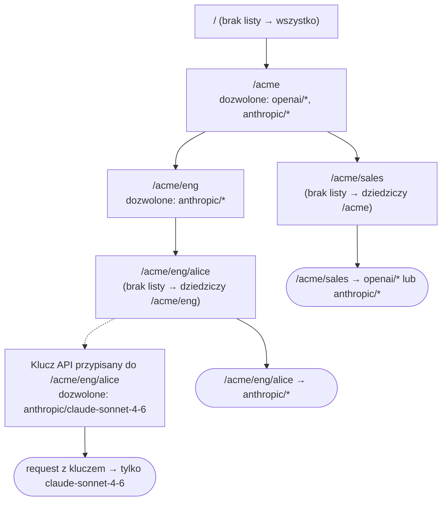
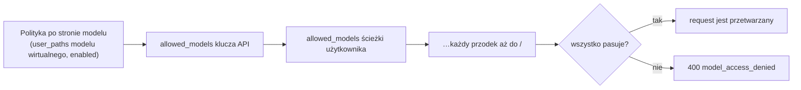

## Przegląd

Strona **Users** zamienia hierarchię [`user_path`](/pl/features/user-path)
stojącą za Twoimi kluczami API w drzewo grup i użytkowników i pozwala każdemu węzłowi
ograniczyć, z których modeli mogą korzystać requesty pod nim:

- `/acme` i `/acme/eng` to **grupy** – zawierają inne ścieżki.
- `/acme/eng/alice` to **użytkownik** – klucze API są przypisane bezpośrednio do niego.

Niczego nie trzeba tworzyć z góry. Drzewo powstaje na podstawie ścieżek użytkownika
istniejących kluczy API; dodaj politykę do węzła tylko wtedy, gdy chcesz go ograniczyć.

## Reguły

1. **Nowe klucze i węzły pozwalają na wszystko.** Węzeł lub klucz bez
   `allowed_models` nie nakłada żadnego własnego ograniczenia.
2. **Wypisanie modeli ogranicza.** Gdy węzeł wypisze modele, requesty pod nim
   mogą korzystać tylko z modeli pasujących do tej listy.
3. **Listy przecinają się w dół drzewa.** Request musi spełniać listę dozwolonych modeli
   swojego klucza API, swojej ścieżki użytkownika i każdego przodka aż do `/`. Węzeł podrzędny
   może zawęzić to, na co pozwala jego grupa, ale nigdy tego nie poszerzy.
4. Reguły po stronie modeli nadal obowiązują. [Polityka dostępu modelu wirtualnego](/pl/features/virtual-models),
   która ukrywa model przed poddrzewem, nadal go ukrywa.

`GET /v1/models` zwraca tylko modele, z których wywołujący może korzystać, więc klienci widzą
ten sam obraz, który egzekwuje gateway.

Requesty uwierzytelnione w inny sposób podlegają tym samym regułom ścieżek: sesja
[OIDC SSO](/pl/pro/sso) lub request zawierający tylko
nagłówek ścieżki użytkownika jest ograniczany przez polityki swojego `user_path`; tylko zarządzane
klucze API mają dodatkowo własną listę dozwolonych modeli. Master key nie ma przypisanej
ścieżki użytkownika: bez nagłówka nie ma ograniczeń, z nagłówkiem jest
ograniczany jak każdy inny request na tej ścieżce.

## Jak ustalany jest dostęp

Polityki są zaczepione w drzewie ścieżek użytkownika i łączone od góry do dołu. Każda lista
na drodze od korzenia do ścieżki requestu musi pasować, a lista samego klucza API
jest stosowana na końcu:



Dla pojedynczego requestu gateway sprawdza po kolei:



Skąd pochodzą poszczególne elementy:

| Element                 | Źródło                                                       |
| ----------------------- | ------------------------------------------------------------ |
| ścieżka użytkownika requestu | `user_path` zarządzanego klucza API, sesja SSO lub nagłówek `X-GoModel-User-Path` |
| drzewo                  | powstaje na podstawie ścieżek użytkownika istniejących kluczy API – nie trzeba niczego tworzyć |
| polityki węzłów         | strona **Users**, `users:` w `config.yaml` lub zmienna środowiskowa `USERS` |
| polityki kluczy         | strona **API Keys** lub `allowed_models` w `POST /admin/auth-keys` |
| polityki po stronie modeli | [modele wirtualne](/pl/features/virtual-models) z `user_paths` lub `enabled: false` |

Węzeł bez listy nie wnosi niczego do łańcucha; ani nie poszerza, ani nie
zawęża. Dlatego nowy klucz lub nowa grupa zaczynają z dostępem do
wszystkiego i dlatego `/acme/sales` powyżej nadal widzi obu providerów.

## Selektory

Każdy wpis na liście dozwolonych modeli to jeden selektor:

| Wpis               | Dopasowuje                                          |
| ------------------ | --------------------------------------------------- |
| `anthropic/*`      | każdy model providera `anthropic`                   |
| `openai/gpt-4o`    | jeden model u jednego providera                     |
| `gpt-4o`           | ten identyfikator modelu u dowolnego providera      |
| `*`                | każdy model; zbędny, chyba że chcesz mieć jawny wiersz, i nigdy nie poszerza listy rodzica (reguła 3) |

Nazwy providerów muszą odpowiadać skonfigurowanemu providerowi; nieznane nazwy są odrzucane
przy zapisie polityki. Modele wirtualne nie są selektorami: alias lub load
balancer jest rozwiązywany do konkretnego modelu providera przed sprawdzeniem, więc zezwalaj
na modele docelowe, a nie na model wirtualny. Nazwa modelu wirtualnego na liście jest
akceptowana jako zwykły identyfikator modelu, ale nigdy niczego nie dopasowuje; load balancer, którego
cele obejmują różnych providerów, jest użyteczny tylko wtedy, gdy dozwolony jest każdy cel, który może wybrać,
w przeciwnym razie requesty kończą się błędem `400` za każdym razem, gdy wybierze niedozwolony cel.
Drzewo użytkowników pokazuje taki węzeł z pustą listą efektywną.

## Przykład

```yaml
users:
  - path: /acme
    allowed_models: [openai/*, anthropic/*]
  - path: /acme/eng
    allowed_models: [anthropic/*]
    description: Engineering only ships on Claude
```

| Ścieżka użytkownika requestu | `openai/gpt-4o` | `anthropic/claude-sonnet-4-6` |
| ------------------ | --------------- | ----------------------------- |
| `/acme/sales`      | dozwolony       | dozwolony                     |
| `/acme/eng/alice`  | odrzucony       | dozwolony                     |
| `/other`           | dozwolony       | dozwolony                     |

Klucz API przypisany do `/acme/eng/alice` z własnym
`allowed_models: [anthropic/claude-sonnet-4-6]` dodatkowo zawęża dostęp Alice do tego
jednego modelu.

Odrzucony request otrzymuje `400` z kodem `model_access_denied`.

## Polityka requestów

Węzeł może też kształtować requesty pod sobą. Wszystkie trzy pola są domyślnie
puste, więc nic się nie zmienia, dopóki któregoś nie ustawisz:

| Pole                   | Działanie                                                   | Dziedziczenie                  |
| ---------------------- | ----------------------------------------------------------- | ------------------------------ |
| `default_model`        | obsługuje request, który nie wskazuje modelu                | wygrywa najbliższa ścieżka     |
| `max_reasoning_effort` | obniża wyższy reasoning effort do tego poziomu              | obowiązuje najniższy limit     |
| `max_output_tokens`    | obniża wyższy limit tokenów wyjściowych do tej wartości i ustawia go w requeście bez limitu | obowiązuje najniższy limit     |

```yaml
users:
  - path: /acme
    max_output_tokens: 8192
  - path: /acme/eng
    default_model: team-model # model lub model wirtualny
    max_reasoning_effort: medium
  - path: /acme/eng/interns
    max_reasoning_effort: low
```

| Request z               | Klient wysyła                                 | Wysłane upstream                         |
| ----------------------- | --------------------------------------------- | ---------------------------------------- |
| `/acme/eng/alice`       | brak `model`                                  | `team-model`, rozwiązany jak zwykle      |
| `/acme/eng/alice`       | `reasoning_effort: high`, `max_tokens: 32000` | `medium`, `8192`                         |
| `/acme/eng/alice`       | `reasoning_effort: low`, `max_tokens: 100`    | bez zmian                                |
| `/acme/eng/alice`       | bez effortu i bez limitu                      | bez effortu, `max_tokens: 8192`          |
| `/acme/eng/interns/bob` | `reasoning_effort: medium`                    | `low`                                    |
| `/acme/sales`           | `max_tokens: 32000`                           | `8192`                                   |

**Limity** to górne granice. Obowiązuje najniższy limit między ścieżką a `/`,
więc dziecko może zaostrzyć limit swojej grupy, a wyższy limit ustawiony na
dziecku niczego nie zmienia. Efforty używają skali `none`, `minimal`, `low`,
`medium`, `high`, `xhigh`, `max`. Limit tokenów obejmuje `max_tokens`,
`max_completion_tokens` i `max_output_tokens` w pisowni użytej przez klienta, a
request bez limitu dostaje limit jako swój limit, w polu, którego oczekuje
model upstream. Limit effortu tylko obniża effort, który request niesie, i
nigdy go nie dodaje, bo dodany effort włączyłby reasoning w requestach, które o
to nie prosiły. Request bez effortu działa więc z domyślnym ustawieniem modelu,
a model, który nie potrafi myśleć mniej niż na pewnym poziomie (Gemini 3,
OpenAI seria o, OpenCode Zen), dostaje ten poziom także przy niższym limicie.

Oprócz `reasoning_effort` i `reasoning.effort` limit effortu sprawdza
specyficzne dla providerów sterowania reasoningiem, które docierają do
upstreamów, na najwyższym poziomie body albo w `extra_body`:

| Sterowanie                                                 | Czytane przez                             |
| ---------------------------------------------------------- | ----------------------------------------- |
| `thinking` (`{"type": "enabled", "budget_tokens"/"token_budget": N}`) | Cohere, Xiaomi MiMo, DeepSeek, Kimi, upstreamy GLM |
| `enable_thinking`, `thinking_budget`                       | Qwen, Bailian, serwery vLLM i SGLang      |
| `think` (wartość logiczna albo poziom)                     | Ollama                                    |
| `chat_template_kwargs.enable_thinking`, `.thinking`, `.reasoning_effort`, `.thinking_budget` | vLLM, SGLang, llama.cpp |
| `extra_body.google.thinking_config` `thinking_budget`/`thinking_level` (nazwy w dowolnej wielkości liter) | Gemini |
| Messages `thinking.budget_tokens`                          | Anthropic                                 |

Sterowanie, które wyłącza reasoning (`false`, budżet zero,
`{"type": "disabled"}`), oraz poziom w granicach limitu zostają zachowane.
Wszystko, czego skala nie potrafi umieścić, np. budżet tokenów albo `true`,
liczy się jako powyżej limitu: gateway usuwa wszystkie sterowania reasoningiem
klienta i zamiast nich wysyła limit jako effort. Messages `budget_tokens`
powyżej budżetu, który gateway sam wysyła dla poziomu limitu (5000 dla `low`,
10000 dla `medium`, 20000 od `high`), zostaje obniżony do tego budżetu. Gdy
adapter sam wstawia wartość (domyślne `max_tokens` Anthropic i zapas, który
dodaje ponad budżet thinking, domyślny effort OpenCode Zen), także ona mieści
się w limitach: budżet thinking kurczy się, aż zmieści się pod ograniczonym
`max_tokens`, a thinking zostaje wyłączony, gdy nie mieści się nawet budżet
minimalny.

Limity działają po [nadpisaniach modeli wirtualnych](/pl/features/virtual-models#wymuszanie-reasoning-effort),
przy każdej próbie, także przy próbach failover, więc ograniczają też effort
lub `max_tokens`, które model wirtualny wymusza albo ustawia domyślnie. Dotyczą
Chat Completions, Responses API i Anthropic Messages API; request Messages
mieszczący się w limitach jest nadal przekazywany natywnie do Anthropic, a
przekraczający je idzie ścieżką tłumaczoną, żeby można go było obniżyć.
Embeddingi i endpointy mediów nie są przepisywane.

<Warning>
Batche i passthrough providera pod `/p/` **nie** są ograniczane: ich body
trafiają upstream bez zmian. Ograniczony klucz, który może też używać batchy
albo `/p/`, może obejść politykę, więc zablokuj te endpointy kluczom, które
ograniczasz.
</Warning>

Polityka na `/` obowiązuje każdy request, także bez ścieżki użytkownika (master
key albo klucz bez przypisanej ścieżki, który nie wysyła nagłówka). Credential
bez przypisanej ścieżki sam wybiera ścieżkę przez
[nagłówek ścieżki użytkownika](/pl/features/user-path), a z nią politykę
własnego poddrzewa, więc może uciec spod limitu ustawionego niżej w drzewie.
Przypisuj limity wywołującym przez [klucze API](/pl/features/user-path#klucze-api)
ze stałym `user_path` albo ustawiaj je na `/`.

**Domyślny model** jest używany tylko wtedy, gdy request Chat Completions,
Responses lub Messages (łącznie z liczeniem tokenów Messages) nie wskazuje ani
`model`, ani `provider`; model wskazany przez klienta zawsze wygrywa. Jest
rozwiązywany dokładnie jak model wysłany przez klienta: może być
[modelem wirtualnym](/pl/features/virtual-models) i nadal jest sprawdzany
względem list dozwolonych modeli, więc domyślny model, którego ścieżka nie może
używać, zostaje odrzucony. Request bez ścieżki użytkownika używa domyślnego
modelu z `/`, jeśli jest ustawiony; ścieżki bez domyślnego modelu nadal dostają
`400 model is required`.

## Zarządzanie politykami

### Dashboard

`Users` wyświetla każdy węzeł z jego własną listą dozwolonych modeli, jego **modelami efektywnymi** –
wynikiem na poziomie ścieżki po zastosowaniu jego własnej listy, list wszystkich rodziców i
polityk modeli wirtualnych po stronie modeli (czerwone **None** oznacza węzeł,
którego listy przecinają się do zbioru pustego) – oraz liczbą przypisanych do niego kluczy API.
Własne `allowed_models` zarządzanego klucza API może zawęzić request bardziej, niż
pokazuje ścieżka. Edytor ostrzega już w trakcie pisania, gdy
lista nie pozostawiłaby żadnego dostępnego modelu. Dodaj lub edytuj węzeł, żeby
ustawić jego modele, domyślny model i limity; usuń politykę, żeby wrócić do
limitów rodziców. Kolumna **Polityka Request'ów** pokazuje obowiązujące
wartości i ścieżkę, z której pochodzi każda z nich.

Liczba kluczy prowadzi do strony **API Keys** przefiltrowanej do poddrzewa tej ścieżki,
a każdy wiersz ma akcję *Add API key*, która otwiera formularz tworzenia klucza z
wstępnie wypełnioną ścieżką.

Listy dozwolonych modeli per klucz znajdują się na stronie **API Keys**: ustaw `Allowed models` przy
tworzeniu klucza lub edytuj je później z poziomu wiersza klucza. Jej kolumna **Effective models**
to ostateczna odpowiedź dla tych danych uwierzytelniających – połączenie polityk ścieżek, własnej
listy klucza i polityk po stronie modeli.

### Konfiguracja

Zadeklaruj polityki w `config.yaml` pod `users:` (zobacz przykład powyżej) lub
w zmiennej środowiskowej `USERS` jako tablicę JSON z tymi samymi polami:

```bash
USERS='[{"path":"/acme/eng","allowed_models":["anthropic/*"],"default_model":"team-model","max_reasoning_effort":"medium","max_output_tokens":4096}]'
```

Zadeklarowane polityki przesłaniają wiersze z dashboardu dla tej samej ścieżki i są w dashboardzie
tylko do odczytu. Literówka w nazwie providera w zadeklarowanej polityce powoduje błąd przy starcie, podobnie jak
nieznany effort, ujemny limit tokenów lub domyślny model z wildcardem.

### Admin API

| Metoda   | Endpoint                                | Opis                                      |
| -------- | --------------------------------------- | ----------------------------------------- |
| `GET`    | `/admin/users`                          | Drzewo z własnymi i dziedziczonymi limitami |
| `PUT`    | `/admin/users`                          | Tworzy lub zastępuje politykę jednego węzła |
| `DELETE` | `/admin/users?user_path=/acme/eng`      | Usuwa politykę jednego węzła              |
| `PUT`    | `/admin/auth-keys/{id}/allowed-models`  | Zastępuje listę dozwolonych modeli jednego klucza API |

`PUT /admin/users` przyjmuje `user_path`, `allowed_models`, `default_model`,
`max_reasoning_effort`, `max_output_tokens` i `description` i zastępuje cały
wiersz: pominięte pole zostaje wyczyszczone. `GET /admin/users` zwraca własne
pola każdego węzła oraz obiekt `request_policy` z obowiązującymi wartościami i
ścieżką, z której pochodzi każda z nich (`default_model_from`,
`max_reasoning_effort_from`, `max_output_tokens_from`). Poświadczenie
ograniczone do poddrzewa nie może zmienić polityki własnego korzenia zakresu,
tylko ścieżek pod nim.

`POST /admin/auth-keys` akceptuje `allowed_models` przy tworzeniu klucza. Kształty requestów i odpowiedzi
opisuje strona [Endpointy administracyjne](/pl/advanced/admin-endpoints).
