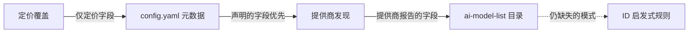

目录中的每个模型都带有元数据：定价、上下文窗口、最大输出 Token 数、能力和模式
（模式决定模型显示为聊天、嵌入、图像还是音频模型）。GoModel 从五个来源汇总元数据，
优先级从高到低依次为：



## 元数据来源

1. **定价覆盖**：在控制台的 **Models** 页面中按模型设置。
   仅对定价字段而言是最高优先级；未设置的价格类型会继续沿用下层的值。
   请参阅 [成本追踪](/zh/features/cost-tracking)。
2. **`config.yaml` 元数据**：`providers.<name>.models` 条目可以附带
   `metadata`（`pricing`、`context_window`、`modes`、`capabilities` 等）。声明的字段会逐字段覆盖下层的所有来源；
   省略的字段则沿用下层的值。这是本地模型的兜底方案：声明 `modes: [embedding]` 还会同时推导出模型的类别。
3. **提供商发现**：大多数提供商会在自己的模型列表中描述其模型，对于提供商自身的部署，
   提供商所报告的信息会逐字段覆盖目录中的值：Anthropic 的显示名称、Token 限制和能力标志；
   Gemini 的显示名称、描述、Token 限制和思考支持（Vertex 上同样适用）；Groq 的上下文窗口、输出限制、
   模态、特性和价格；xAI 的上下文窗口、价格（含长上下文档位）和推理支持；Fireworks 的模型类型、上下文窗口和特性标志；
   OpenRouter 的名称、描述、模态、支持的参数和价格；Cohere 的端点、上下文长度和特性；
   Bedrock 的显示名称、模态和流式传输支持；Chutes 的上下文长度、最大输出、特性和价格；
   Ollama 的 `/api/show` 能力、模型家族和上下文长度；vLLM、SGLang 和
   llm-d 的 `max_model_len`；以及 llama.cpp 的上下文窗口和模态
   （请参阅 [llama.cpp](/zh/providers/llamacpp)）。能力名称会映射到目录的词汇表
   （`function_calling`、`vision`、`reasoning` 等），使两层用同一个键描述同一项特性。
   这对自托管服务器最为重要，因为只有正在运行的进程才能知道真实的上下文窗口。
   通过配置的模型列表声明的模型会跳过此步骤。
4. **模型目录**：即
   [`ai-model-list`](https://github.com/ENTERPILOT/ai-model-list) 注册表，
   在启动时以及每次刷新目录时从 `MODEL_LIST_URL`（默认值：GitHub 上该注册表的 `models.min.json`）获取。
   它为大多数托管模型提供丰富的默认值（定价、上下文窗口、能力、模式），
   可直接匹配 ID、通过别名匹配，或去掉发布日期后缀后匹配，并补全上层提供商未报告的所有字段。
   输入模态也算作能力：接受 `image` 的条目会声明 `vision`（`audio_input`、`video_input`、`pdf_input` 同理），
   除非其能力中显式设置了该键。数据错误或缺失时，最好的修复方式是向注册表贡献修改；
   如需立即修复，请使用覆盖配置。
5. **ID 启发式规则**：针对最终没有任何模式的模型（llama.cpp 和 LM Studio 中很常见）的最后手段，按名称进行检查：
   ID 中包含 `embed` 或匹配常见嵌入模型家族（`bge`、`e5`、`gte`、`minilm`）的模型会被视为嵌入模型，
   ID 中包含 `rerank` 的模型会被视为重排序模型。带命名空间的 ID 按其最后一段路径进行匹配。
   无法确定时，不做任何判定。

## 查看值的来源

在控制台的 **Models** 页面中展开某一行，即可查看模型的有效元数据以及每个字段的来源层；
将面板切换到 **Provider**、**Catalog** 或 **Config**，可以单独查看某一层。相同的数据也可通过
[`GET /admin/models/metadata`](/zh/advanced/admin-endpoints#get-/admin/models/metadata) 获取。

## 元数据的作用

- **定价**用于 [成本追踪](/zh/features/cost-tracking)、预算和
  `cost` 负载均衡。每个定价字段都会记录其来源，因此控制台可以显示某个费率来自何处。
- **模式和类别**仅用于控制台中的分组，路由从不会因此被阻止，因此 `/v1/embeddings` 可以访问提供商提供的任何模型。
- **上下文窗口和能力**会在 `GET /v1/models`（以及针对单个模型的
  `GET /v1/models/{model}`）中公布，供动态选择模型的客户端使用。

## 离线行为

如果目录获取失败或部署环境处于隔离网络（air-gapped），网关仍会正常运行，
只是缺少由目录提供的默认值（包括目录中的定价）。定价覆盖、`config.yaml` 元数据、提供商发现信息
以及 ID 启发式规则依然有效。

`MODEL_LIST_URL` 既接受 HTTP URL，也接受本地文件：

```bash
MODEL_LIST_URL=/etc/gomodel/models.json          # 纯路径
MODEL_LIST_URL=file:///etc/gomodel/models.json   # file URL
```

文件会在启动时以及每次刷新缓存时读取，且仅在内容变化时重新解析，因此您可以通过替换文件来更新定价。
由于读取文件不涉及网络请求，它在 `GOMODEL_OFFLINE=true`（该设置会忽略 HTTP 目录 URL）下依然有效。
设置 `MODEL_LIST_URL=off` 可完全关闭目录，并在 `config.yaml` 中声明元数据；完整的隔离网络部署检查清单请参阅
[生产环境指南](/zh/guides/production#离线隔离与离线部署)。
