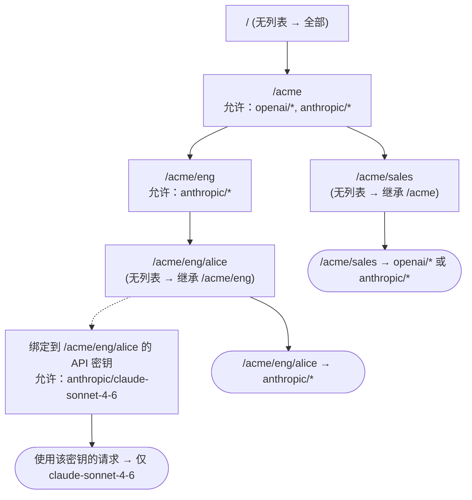
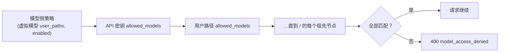

## 概览

**Users** 页面会将 API 密钥背后的 [`user_path`](/zh/features/user-path) 层级结构转换为由组和用户组成的树，并允许每个节点限制其下的请求可以调用哪些模型：

- `/acme` 和 `/acme/eng` 是**组**：它们包含其他路径。
- `/acme/eng/alice` 是**用户**：API 密钥直接绑定到它。

无需预先创建任何内容。这棵树由现有 API 密钥的用户路径推导而来；只有当您想要限制某个节点时，才需要为其添加策略。

## 规则

1. **新的密钥和节点允许所有模型。** 没有 `allowed_models` 的节点或密钥自身不施加任何限制。
2. **列出模型即构成限制。** 一旦某个节点列出了模型，其下的请求就只能使用与该列表匹配的模型。
3. **列表沿树向下取交集。** 请求必须同时满足其 API 密钥、其用户路径以及直到 `/` 的每个祖先节点的允许列表。子节点可以缩小其所在组允许的范围，但永远不能扩大。
4. 模型侧规则仍然适用。对某个子树隐藏某个模型的[虚拟模型访问策略](/zh/features/virtual-models)会继续隐藏该模型。

`GET /v1/models` 只返回调用方可以使用的模型，因此客户端看到的情况与网关实际执行的规则一致。

通过其他方式认证的请求遵循相同的路径规则：[OIDC SSO](/zh/pro/sso) 会话或仅携带用户路径 Header 的请求，受其 `user_path` 上的策略限制；只有托管 API 密钥还会额外携带按密钥设置的允许列表。主密钥没有绑定的用户路径：不带该 Header 时不受限制，带该 Header 时则与该路径上的其他请求一样受到限制。

## 访问权限的解析方式

策略挂在用户路径树上，并自上而下组合。从根节点到请求路径上的每个列表都必须匹配，最后再应用 API 密钥自身的列表：



对于一个请求，网关会依次检查：



各部分的来源：

| 部分                   | 来源                                                       |
| ----------------------- | ------------------------------------------------------------ |
| 请求的用户路径 | 托管 API 密钥的 `user_path`、SSO 会话，或 `X-GoModel-User-Path` Header |
| 树                | 由现有 API 密钥的用户路径推导而来，无需创建 |
| 节点策略           | **Users** 页面、`config.yaml` 中的 `users:`，或 `USERS` 环境变量 |
| 密钥策略            | **API Keys** 页面，或 `POST /admin/auth-keys` 上的 `allowed_models` |
| 模型侧策略     | 带有 `user_paths` 或 `enabled: false` 的[虚拟模型](/zh/features/virtual-models) |

没有列表的节点不会对整条链产生任何影响，既不扩大也不缩小范围。这就是为什么新密钥或新组一开始可以访问所有模型，也是为什么上图中的 `/acme/sales` 仍能看到两个提供商。

## 选择器

允许列表中的每个条目都是一个选择器：

| 条目              | 匹配                                             |
| ------------------ | --------------------------------------------------- |
| `anthropic/*`      | `anthropic` 提供商的所有模型             |
| `openai/gpt-4o`    | 某个提供商上的某个模型                           |
| `gpt-4o`           | 任意提供商上的该模型 ID                           |
| `*`                | 所有模型；除非您想要一个显式条目，否则是多余的，并且它永远不会扩大父节点的列表（规则 3） |

提供商名称必须与已配置的提供商匹配；保存策略时会拒绝未知名称。虚拟模型不是选择器：别名或负载均衡器会在检查运行之前解析为具体的提供商模型，因此请允许目标模型，而不是虚拟模型。列表中的虚拟模型名称会作为不带前缀的模型 ID 被接受，但永远不会匹配任何内容；对于目标跨越多个提供商的负载均衡器，只有当它可能选择的每个目标都被允许时才可用，否则每当它选中不被允许的目标时，请求就会以 `400` 失败。用户树会将这样的节点显示为有效列表为空。

## 示例

```yaml
users:
  - path: /acme
    allowed_models: [openai/*, anthropic/*]
  - path: /acme/eng
    allowed_models: [anthropic/*]
    description: Engineering only ships on Claude
```

| 请求的用户路径  | `openai/gpt-4o` | `anthropic/claude-sonnet-4-6` |
| ------------------ | --------------- | ----------------------------- |
| `/acme/sales`      | 允许         | 允许                       |
| `/acme/eng/alice`  | 拒绝          | 允许                       |
| `/other`           | 允许         | 允许                       |

绑定到 `/acme/eng/alice`、且自身设置了 `allowed_models: [anthropic/claude-sonnet-4-6]` 的 API 密钥，会将 Alice 进一步限制为只能使用这一个模型。

被拒绝的请求会收到 `400`，错误码为 `model_access_denied`。

## 管理策略

### 控制台

`Users` 列出每个节点及其自身的允许列表、其**有效模型**（即应用自身列表、每个父节点的列表以及模型侧虚拟模型策略之后的路径级结果；红色的 **None** 表示该节点的列表交集为空），以及绑定到该节点的 API 密钥数量。托管 API 密钥自身的 `allowed_models` 可以比路径显示的结果进一步缩小请求范围。在您输入时，如果列表会导致没有可用模型，编辑器会发出警告。添加或编辑节点即可设置其模型；移除策略则会回退到父节点的限制。

密钥数量链接到 **API Keys** 页面，并按该路径的子树过滤；每一行都有一个 *Add API key* 操作，会打开预填好该路径的创建密钥表单。

按密钥设置的允许列表位于 **API Keys** 页面：创建密钥时设置 `Allowed models`，或稍后在该密钥所在行中编辑。其 **Effective models** 列就是该凭据的最终结果，综合了路径策略、密钥自身的列表和模型侧策略。

### 配置

可以在 `config.yaml` 的 `users:` 下声明策略（参见上面的示例），也可以在 `USERS` 环境变量中以包含相同字段的 JSON 数组声明：

```bash
USERS='[{"path":"/acme/eng","allowed_models":["anthropic/*"]}]'
```

声明的策略会覆盖控制台中同一路径的条目，并在控制台中显示为只读。声明的策略中如果提供商名称拼写错误，会导致启动失败。

### Admin API

| 方法   | 端点                                | 说明                               |
| -------- | --------------------------------------- | ----------------------------------------- |
| `GET`    | `/admin/users`                          | 包含自身限制和继承限制的树    |
| `PUT`    | `/admin/users`                          | 创建或替换某个节点的策略       |
| `DELETE` | `/admin/users?user_path=/acme/eng`      | 移除某个节点的策略                  |
| `PUT`    | `/admin/auth-keys/{id}/allowed-models`  | 替换某个 API 密钥的允许列表           |

`POST /admin/auth-keys` 在创建时接受 `allowed_models`。请求和响应格式请参阅 [Admin 端点](/zh/advanced/admin-endpoints)。
